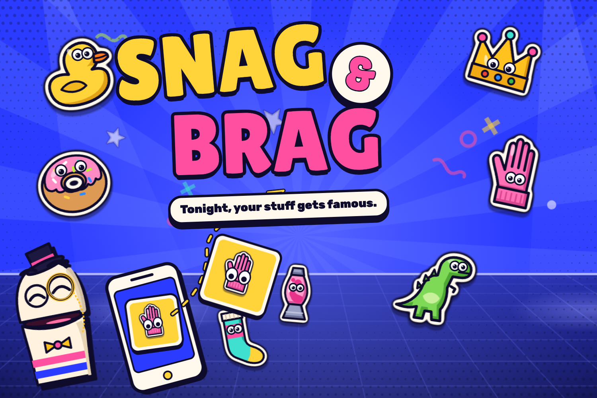
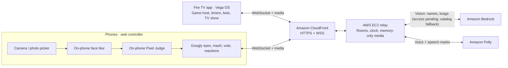

# Snag & Brag

Snag & Brag is a family party game for Fire TV, hosted by the sock puppet Sir Socksworth. Teams use their phones to hunt for household objects, photograph them, add googly eyes and turn their finds into contestants. Three rounds of color matching, thumb-mashing and voting crown the champions in about five minutes.



[Judge testing guide](TESTING.md) · [Fire TV packages (v1.0.0)](https://github.com/nickfromlater/snag-and-brag-fire-tv/releases/tag/v1.0.0) · [Phone controller](https://d2q0olvpmfmvjn.cloudfront.net/) · [Native TV gallery](docs/gallery/GALLERY.md) · [Game specification](BRIEF.md)

## How it plays

Scan the TV's QR code, choose a team name and badge color, then hold the yellow button to go live. Play with **2–4 teams**, one phone per team, or switch on **Play with bots** for a complete solo game.

| Round | Find something… | Win by… |
| --- | --- | --- |
| **Color Rush** | Matching the target color | The on-phone Pixel Judge's color score, plus a speed bonus |
| **Brag-Off** | Fitting a prompt such as “A PIRATE would steal it” | Mashing your phone through a head-to-head bracket |
| **Showstopper** | Weird enough for the spotlight | Earning the other teams' votes |

Each hunt lasts 35 seconds, followed by a glow-up: place eyes, pick a suggested stage name and choose a brag. Waiting players send reactions to the TV. The Fire TV remote controls the lobby and pause menu, including Resume, Skip, Sound, Music, Voice and End game.

## Architecture



The TV owns the game. The relay routes messages, synchronizes clocks and brokers AI/voice calls; it contains no game rules. Bedrock suggestions have a four-second budget and fall back to a built-in catalog; our Bedrock model access is pending, so suggestions currently come from that catalog. Polly speech drives the host's mouth; synthesized voice blips remain the fallback. Local development uses mock services and needs no AWS credentials.

## Repository map

| Directory | Contents |
| --- | --- |
| `tv/` | Native React Native for Vega app, scenes, remote controls and audio |
| `phone/` | Vite/TypeScript camera and controller web app |
| `relay/` | Node/WebSocket room service, Bedrock/Polly adapters and deployment templates |
| `shared/` | Protocol, game engine, timing, scoring and Pixel Judge |
| `tvsim/` | Headless TV host for local play and deterministic smoke runs |
| `tools/` | Art/audio generation, evaluation, capture and release packaging |
| `assets/` | Original sticker/host art, fonts and synthesized sound bank |
| `docs/` | Gallery, review evidence, release checks and product feedback |
| `reference/` | Approved playable mockup, source art and acceptance screenshots |

## Quick start

Use **Node 24** and **pnpm 10 or newer**. From the repository root:

```sh
pnpm install --frozen-lockfile
pnpm --filter phone build
```

Start these in three terminals, all at the repository root:

```sh
# 1. Relay: local services, no AWS calls.
HOST=127.0.0.1 PORT=8788 PUBLIC_URL=http://localhost:5173 AI_MODE=mock POLLY_MODE=mock pnpm --filter relay start
```

```sh
# 2. Headless TV host: prints the room code, join URL and show events.
pnpm --filter tvsim start -- --relay ws://127.0.0.1:8788/ws --bots
```

```sh
# 3. Phone page: proxies WebSockets and media to the local relay.
PHONE_RELAY_URL=http://127.0.0.1:8788 pnpm --filter phone dev --host 127.0.0.1
```

Open the join URL printed by `tvsim` in desktop Chrome/Safari, join and hold the yellow button. This runs the actual relay and phone controller with a headless TV host; it does not display the graphical TV show. `localhost` supports camera access. A physical phone needs a reachable **HTTPS** origin: use the [phone HTTPS guide](phone/README.md#https-and-physical-phone-testing) or the hosted deployment.

For the graphical TV experience, build the matching Vega package below and follow [TESTING.md](TESTING.md) to install it on a Fire TV or Vega Virtual Device (VVD). For a local VVD build, set `TV_RELAY_URL=ws://127.0.0.1:8788/ws` and reverse device port 8788 to the computer's relay port. [Release verification](docs/release/verification.md) records what has been checked.

An account-free, synthetic three-round smoke run needs no servers or browser:

```sh
pnpm --filter tvsim start -- --loopback --demo --bots --fast
pnpm test
pnpm typecheck
```

## Deployment and release packages

[relay/deploy/README.md](relay/deploy/README.md) describes EC2, CloudFront, scoped IAM, the budget alarm and the memory-only origin. The hosted server stays up through December 3, 2026.

With the **existing Vega SDK** on your PATH and dependencies installed, set `TV_RELAY_URL` to the deployed relay's public `wss://…/ws` URL, then run:

```sh
bash tools/release/package.sh
```

The script fails if `TV_RELAY_URL` is unset. It bakes that URL into **Release** builds for `armv7` (stick), `aarch64` (Apple silicon VVD) and `x86_64` (Intel VVD), with debug/capture/showcase modes disabled. Hermes debug metadata is omitted (`-g0`) so the compiled archive does not expose the build machine's home path. It restores the source configuration on exit, names the packages `snagbrag_<arch>.vpkg`, writes `SHA256SUMS` and prints the exact **draft** `gh release create` command without executing it.

Output defaults to the gitignored `dist/release/`; override it with `RELEASE_OUTPUT_DIR`. A `release-manifest.json` receipt records the source commit, baked relay URL, disabled debug modes, archive sizes and hashes. Set `RELEASE_TAG` to override the default tag derived from the TV package version. Builds are sequential, require the installed toolchains and make no AWS calls. Check downloaded packages from their output directory with:

```sh
LC_ALL=C shasum -a 256 -c SHA256SUMS
```

No package is committed, uploaded or published by this script. [Release verification](docs/release/verification.md) and the [public-tree scrub report](docs/release/scrub-report.md) record the preparation checks.

## Privacy

Player photos and thumbnails stay in browser/TV/relay memory for the life of the room. They are never written to disk, a bucket or application logs, and the relay drops them when the room closes. Media responses disable caching; the phone has no service worker or saved-photo history.

Face detection and blur run on the phone before Pixel Judge scoring and upload. This is best-effort detection: unsupported or failed detectors can send an unblurred photo, and small/obscured faces can be missed. Live camera tiles use coarse pixelation. Live Bedrock reads require the deployment's zero-retention workspace and disabled payload logging; AWS credentials remain on the relay, never in the phone or TV packages. Review [the face-blur evaluation](docs/review/eval/face-blur.md) and [deployment privacy controls](relay/deploy/README.md) for the measured limits and configuration.

## Amazon tools and Fire TV priorities

| Fire TV priority | Tools used | Experience |
| --- | --- | --- |
| **Family entertainment** | Fire TV, React Native for Vega, Vega SDK/VVD | A living-room game show, shared scores and solo bots |
| **Multi-modal UX** | Vega remote input, native media controls, Amazon Polly | TV show + phone camera/touch + remote controls + a voiced puppet |
| **Computer vision** | Amazon Bedrock vision (wired; access pending); on-phone Pixel Judge and MediaPipe | Object naming, color matching, visual scoring masks and face blur |

Amazon EC2 and CloudFront connect the players. The Amazon Devices Builder Tools MCP served documentation search and early trace analysis; the Vega CLI and profiler handled scaffolding, packaging and device traces. Product feedback is recorded in [FRICTION.md](FRICTION.md); new observations go to [docs/friction-raw.md](docs/friction-raw.md).

## Credits and license

The project's approved mockup supplies the original game art, copy, motion and synthesized audio. Lilita One, Rubik, Google's MediaPipe/BlazeFace assets and the public evaluation photographs have separate notices in [CREDITS.md](CREDITS.md).

Code and original project assets: [MIT](LICENSE). Fonts: **SIL Open Font License 1.1**, with notices alongside every font copy. Evaluation photographs and derived contact sheets retain their credited Creative Commons/public-domain terms; the MIT license does not replace those licenses.
