# Bedrock benchmark — mock

Generated 2026-10-13T14:45:12.739Z. Same 30 fixture photos and prompts for every model. Sequential requests, no retries, relay arrival-to-fallback deadline 4000 ms.

**Mock plumbing evidence only. No AWS calls or billing. Each model label ran the same relay mock provider; timings and taste outputs do not compare actual models.**

Planning token cost printed before any provider construction: ~$2.485 (1800 estimated input + at most 512 output tokens/call). Actual cost $0. Rates are planning assumptions, not guaranteed current prices; Opus/Sonnet 5 IDs and prices are unverified.

Calls use `relay/src/ai.ts` directly: `AiReader`, `bedrockProvider` in live mode, `readPrompt`, `AI_FORMAT`, image preparation (512 px inside, JPEG q75, used only if smaller) and `parseAiRead`. Mock mode uses the relay’s `mockAiProvider`, which does not exercise the HTTP image path; the injected-Mantle test covers its request and resize without AWS.

Latency includes image preparation, response parsing and fallback, excludes fixture disk reads, and uses monotonic time. p50/p95 use nearest-rank percentiles. Timeouts count the relay timeout reason; >4 s counts measured end-to-end overruns, including timer scheduling. Schema failures mean the provider/parser rejected JSON as `bad_result`; raw contract violations also expose responses that the relay repaired by clamping/truncating. Refusals and provider failures are separate. Brand checks cover raw and delivered output using the checked-in list; false positives (e.g. “apple” the fruit, “Stanley” a stage name) need human review, and unlisted brands will be missed.

| Model | n | Latency p50/p95/max ms | Success-only p50/p95/max ms | Timeouts / >4 s | Refusals | Schema failures | Raw contract violations | Brand outputs | Fallbacks |
|---|---:|---|---|---|---:|---:|---:|---:|---:|
| anthropic.claude-opus-5 | 30 | 151.27/153.91/154.78 | 151.27/153.91/154.78 | 0/0 | 0 | 0 | 0 | 0 | 0 |
| anthropic.claude-sonnet-5 | 30 | 151.21/154.23/154.87 | 151.21/154.23/154.87 | 0/0 | 0 | 0 | 0 | 0 | 0 |
| anthropic.claude-haiku-4-5 | 30 | 151.2/156.52/157.27 | 151.2/156.52/157.27 | 0/0 | 0 | 0 | 0 | 0 | 0 |

## Human taste read

| Model / fixture | Photo | Round prompt | Thing | Names | Brags | Score | Quip | Status / brands |
|---|---|---|---|---|---|---:|---|---|
| anthropic.claude-opus-5 / red-mug | 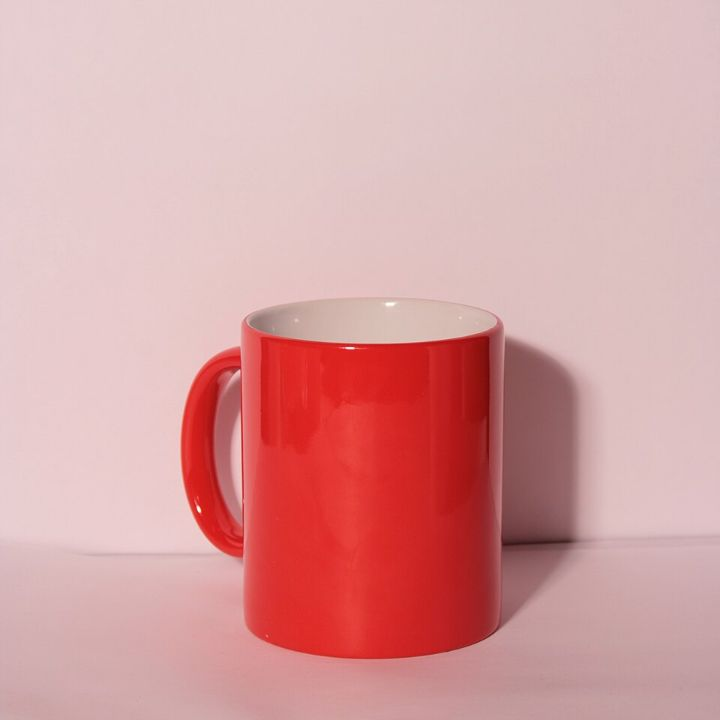 | Snag the most RED thing in the house | household treasure | Sir Findsalot / Captain Clutter / Dame Doohickey | A household legend takes the stage. / Polished by years of being quite splendid. | 7 | A magnificent household treasure. I shall alert the museum. | none |
| anthropic.claude-opus-5 / blue-bag | 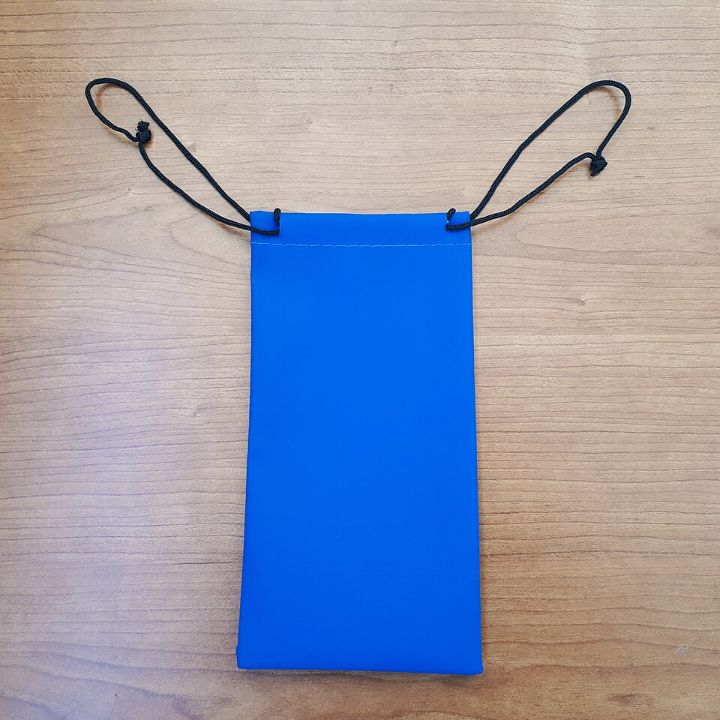 | Snag the most BLUE thing in the house | household treasure | Sir Findsalot / Captain Clutter / Dame Doohickey | A household legend takes the stage. / Polished by years of being quite splendid. | 7 | A magnificent household treasure. I shall alert the museum. | none |
| anthropic.claude-opus-5 / yellow-lemon | 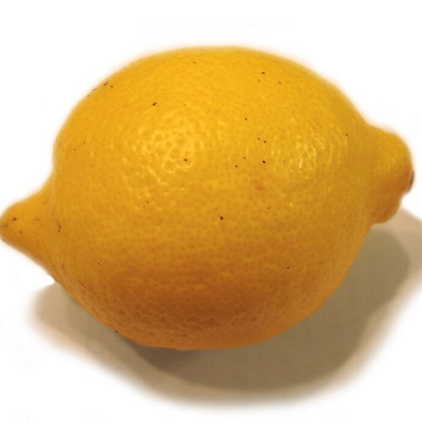 | Snag the most YELLOW thing in the house | household treasure | Sir Findsalot / Captain Clutter / Dame Doohickey | A household legend takes the stage. / Polished by years of being quite splendid. | 7 | A magnificent household treasure. I shall alert the museum. | none |
| anthropic.claude-opus-5 / green-pepper | 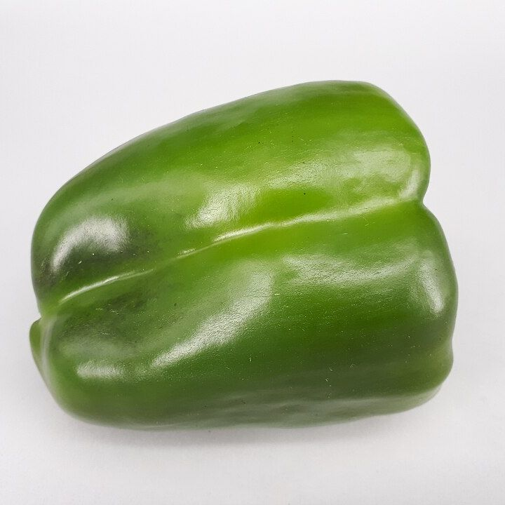 | Snag the most GREEN thing in the house | household treasure | Sir Findsalot / Captain Clutter / Dame Doohickey | A household legend takes the stage. / Polished by years of being quite splendid. | 7 | A magnificent household treasure. I shall alert the museum. | none |
| anthropic.claude-opus-5 / pink-tumblers | 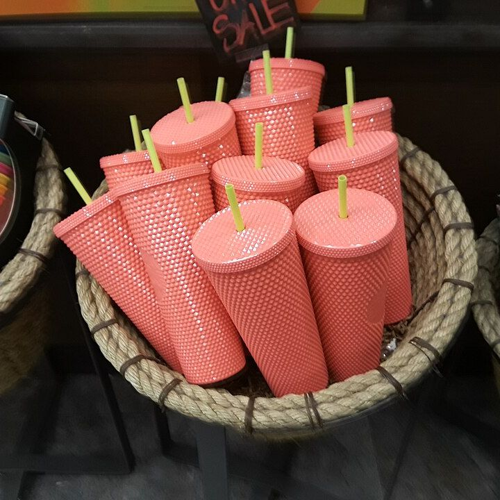 | Snag the most PINK thing in the house | household treasure | Sir Findsalot / Captain Clutter / Dame Doohickey | A household legend takes the stage. / Polished by years of being quite splendid. | 7 | A magnificent household treasure. I shall alert the museum. | none |
| anthropic.claude-opus-5 / orange-forked-carrot | 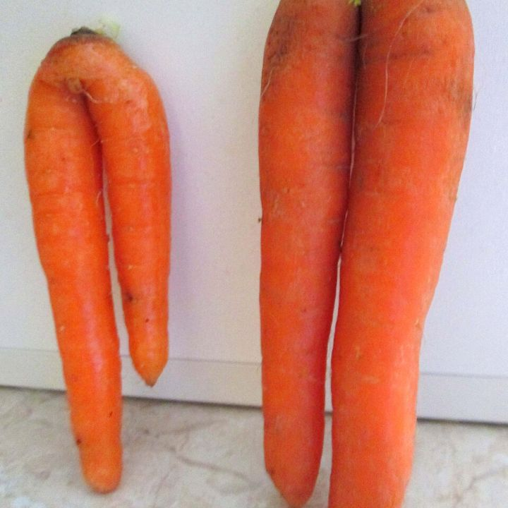 | Snag the most ORANGE thing in the house | household treasure | Sir Findsalot / Captain Clutter / Dame Doohickey | A household legend takes the stage. / Polished by years of being quite splendid. | 7 | A magnificent household treasure. I shall alert the museum. | none |
| anthropic.claude-opus-5 / loot-pearl-necklace | 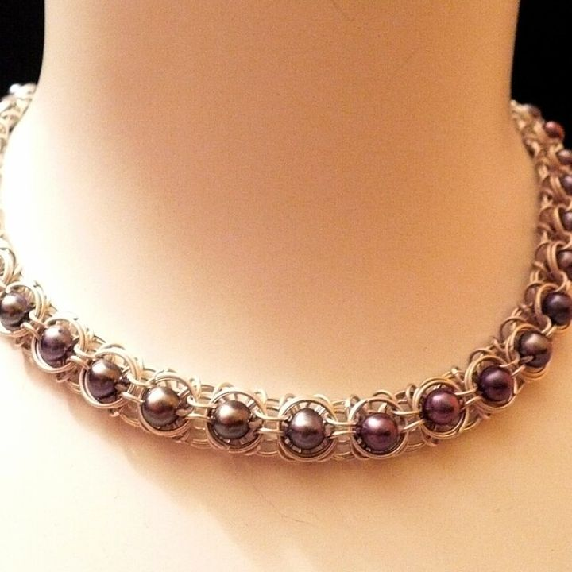 | Something a PIRATE would steal | household treasure | Sir Findsalot / Captain Clutter / Dame Doohickey | A household legend takes the stage. / Polished by years of being quite splendid. | 7 | A magnificent household treasure. I shall alert the museum. | none |
| anthropic.claude-opus-5 / old-wall-clock | 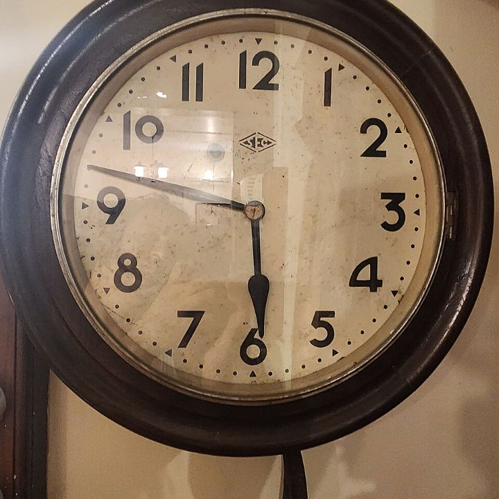 | Something that has SEEN THINGS (the older the better) | household treasure | Sir Findsalot / Captain Clutter / Dame Doohickey | A household legend takes the stage. / Polished by years of being quite splendid. | 7 | A magnificent household treasure. I shall alert the museum. | none |
| anthropic.claude-opus-5 / tough-iron-pan | 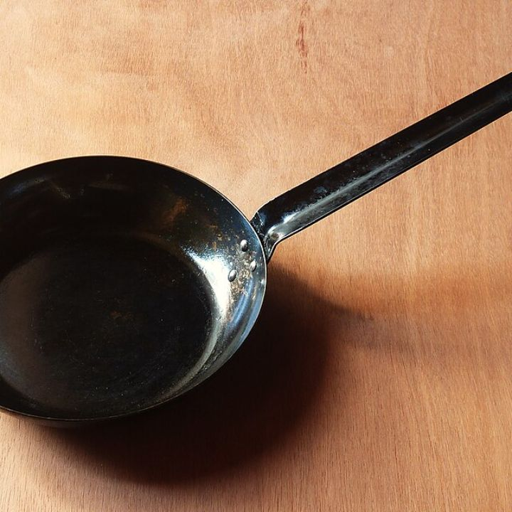 | Something that would WIN A FIGHT against anything | household treasure | Sir Findsalot / Captain Clutter / Dame Doohickey | A household legend takes the stage. / Polished by years of being quite splendid. | 7 | A magnificent household treasure. I shall alert the museum. | none |
| anthropic.claude-opus-5 / island-teddy | 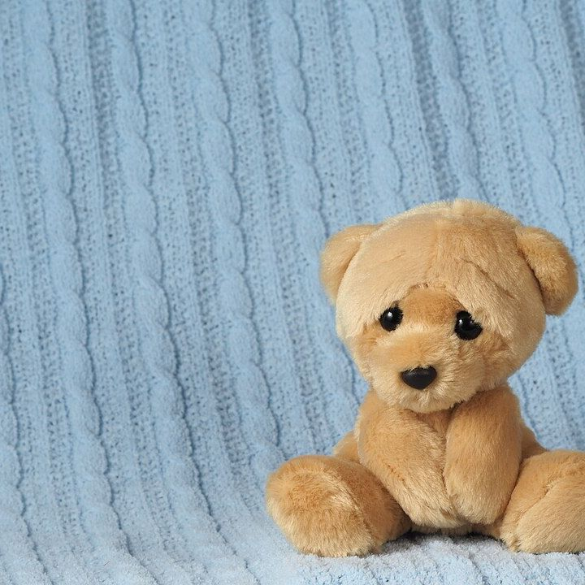 | Your ISLAND BUDDY for a desert island | household treasure | Sir Findsalot / Captain Clutter / Dame Doohickey | A household legend takes the stage. / Polished by years of being quite splendid. | 7 | A magnificent household treasure. I shall alert the museum. | none |
| anthropic.claude-opus-5 / weird-satyr-mug | 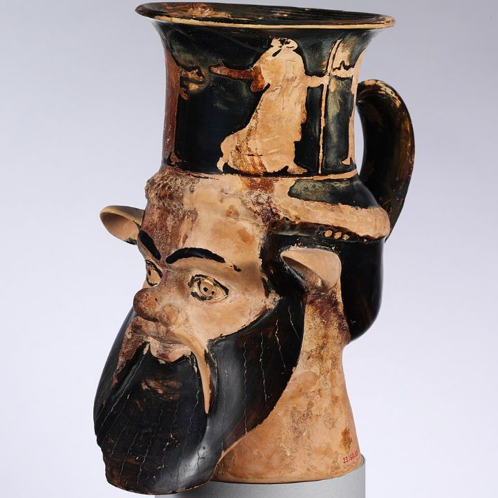 | The WEIRDEST thing you can find | household treasure | Sir Findsalot / Captain Clutter / Dame Doohickey | A household legend takes the stage. / Polished by years of being quite splendid. | 7 | A magnificent household treasure. I shall alert the museum. | none |
| anthropic.claude-opus-5 / museum-porcelain-bottle | 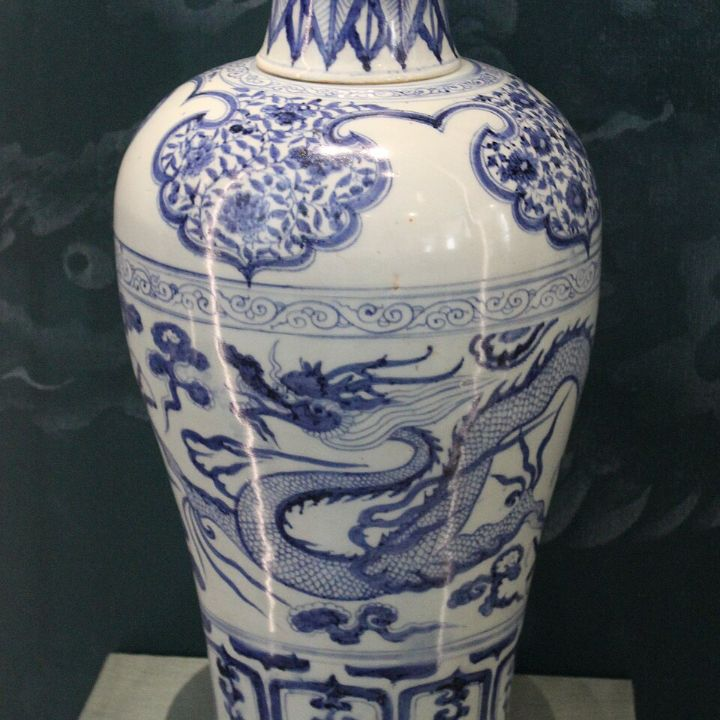 | Something that belongs IN A MUSEUM priceless, obviously | household treasure | Sir Findsalot / Captain Clutter / Dame Doohickey | A household legend takes the stage. / Polished by years of being quite splendid. | 7 | A magnificent household treasure. I shall alert the museum. | none |
| anthropic.claude-opus-5 / pink-small-cup | 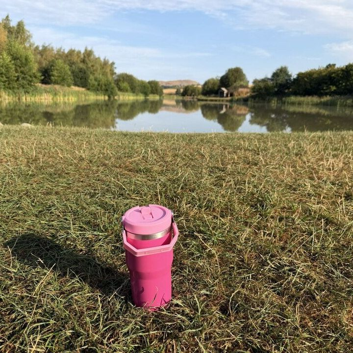 | Snag the most PINK thing in the house | household treasure | Sir Findsalot / Captain Clutter / Dame Doohickey | A household legend takes the stage. / Polished by years of being quite splendid. | 7 | A magnificent household treasure. I shall alert the museum. | none |
| anthropic.claude-opus-5 / red-pepper | 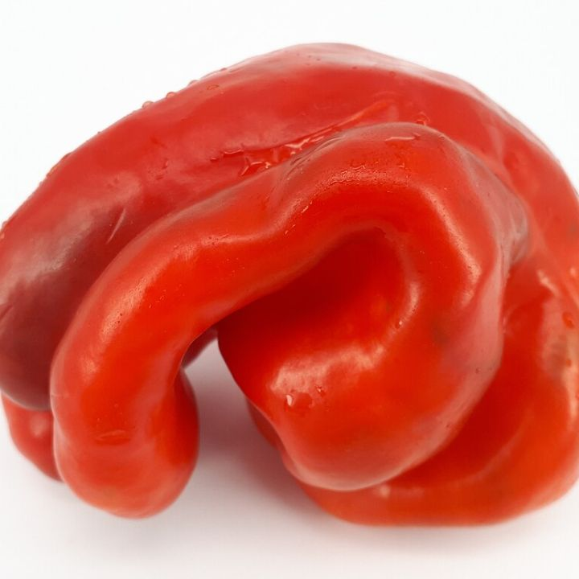 | Snag the most RED thing in the house | household treasure | Sir Findsalot / Captain Clutter / Dame Doohickey | A household legend takes the stage. / Polished by years of being quite splendid. | 7 | A magnificent household treasure. I shall alert the museum. | none |
| anthropic.claude-opus-5 / red-multicolor-peppers | 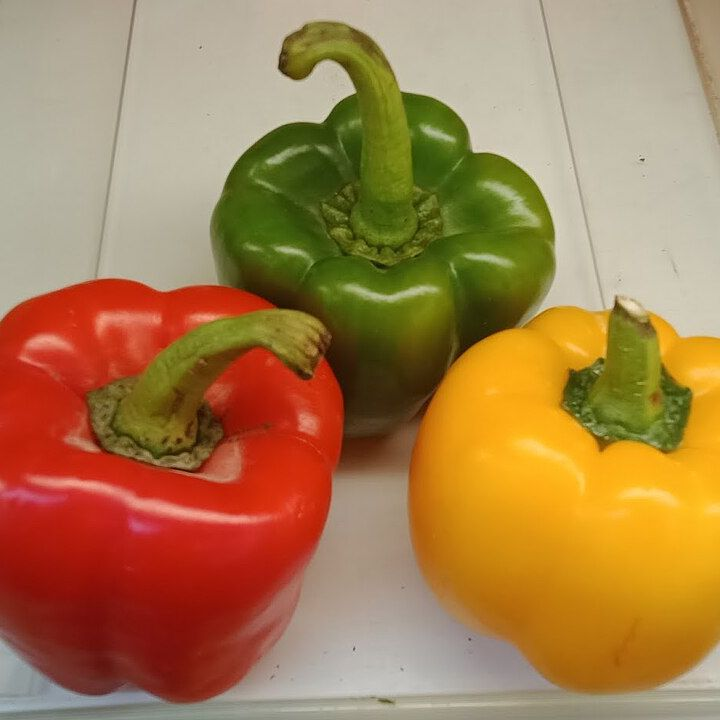 | Snag the most RED thing in the house | household treasure | Sir Findsalot / Captain Clutter / Dame Doohickey | A household legend takes the stage. / Polished by years of being quite splendid. | 7 | A magnificent household treasure. I shall alert the museum. | none |
| anthropic.claude-opus-5 / red-tomatoes | 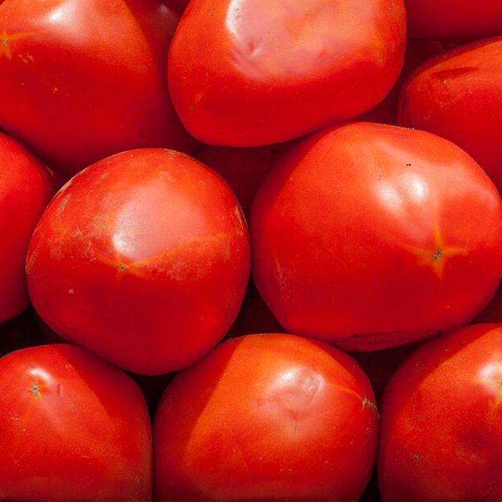 | Snag the most RED thing in the house | household treasure | Sir Findsalot / Captain Clutter / Dame Doohickey | A household legend takes the stage. / Polished by years of being quite splendid. | 7 | A magnificent household treasure. I shall alert the museum. | none |
| anthropic.claude-opus-5 / blue-lids | 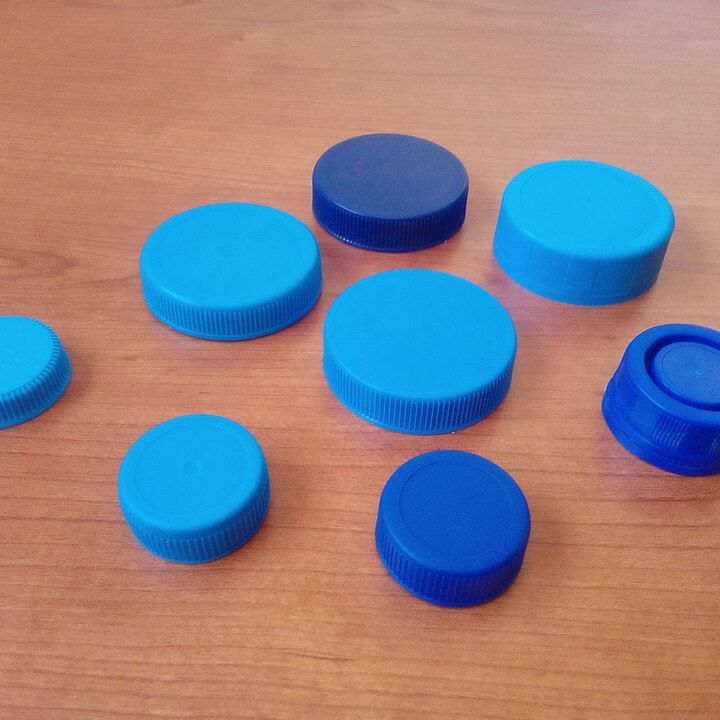 | Snag the most BLUE thing in the house | household treasure | Sir Findsalot / Captain Clutter / Dame Doohickey | A household legend takes the stage. / Polished by years of being quite splendid. | 7 | A magnificent household treasure. I shall alert the museum. | none |
| anthropic.claude-opus-5 / yellow-banana | 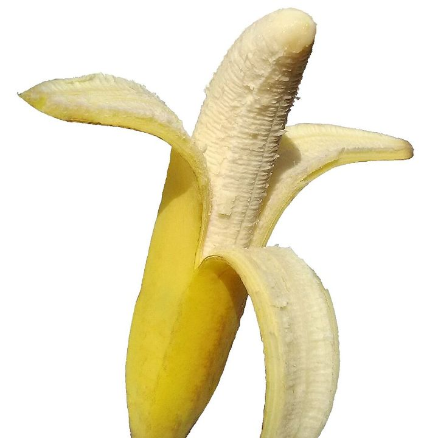 | Snag the most YELLOW thing in the house | household treasure | Sir Findsalot / Captain Clutter / Dame Doohickey | A household legend takes the stage. / Polished by years of being quite splendid. | 7 | A magnificent household treasure. I shall alert the museum. | none |
| anthropic.claude-opus-5 / green-yoyo | 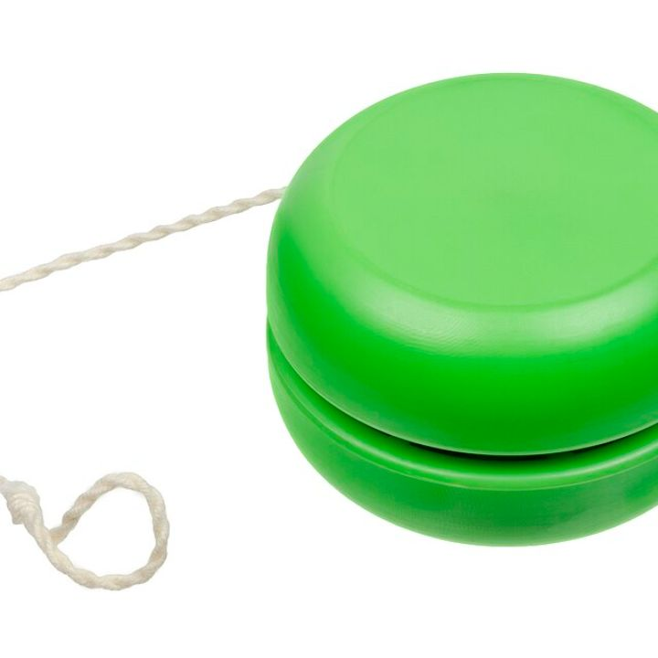 | Snag the most GREEN thing in the house | household treasure | Sir Findsalot / Captain Clutter / Dame Doohickey | A household legend takes the stage. / Polished by years of being quite splendid. | 7 | A magnificent household treasure. I shall alert the museum. | none |
| anthropic.claude-opus-5 / pink-plastic-cups |  | Snag the most PINK thing in the house | household treasure | Sir Findsalot / Captain Clutter / Dame Doohickey | A household legend takes the stage. / Polished by years of being quite splendid. | 7 | A magnificent household treasure. I shall alert the museum. | none |
| anthropic.claude-opus-5 / orange-oranges | 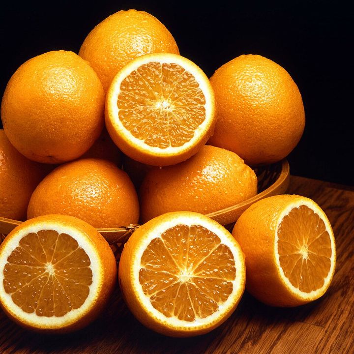 | Snag the most ORANGE thing in the house | household treasure | Sir Findsalot / Captain Clutter / Dame Doohickey | A household legend takes the stage. / Polished by years of being quite splendid. | 7 | A magnificent household treasure. I shall alert the museum. | none |
| anthropic.claude-opus-5 / loot-gold-chain | 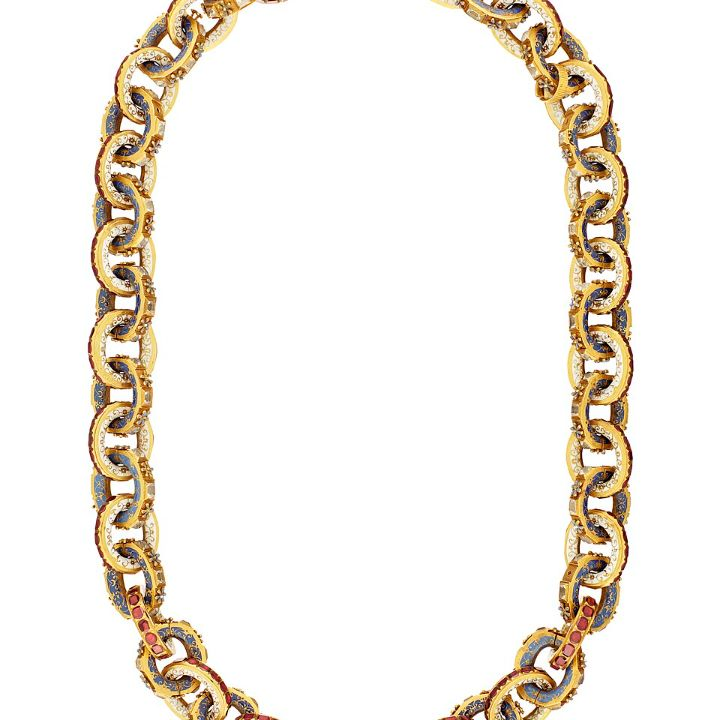 | Something a PIRATE would steal | household treasure | Sir Findsalot / Captain Clutter / Dame Doohickey | A household legend takes the stage. / Polished by years of being quite splendid. | 7 | A magnificent household treasure. I shall alert the museum. | none |
| anthropic.claude-opus-5 / old-telephone | 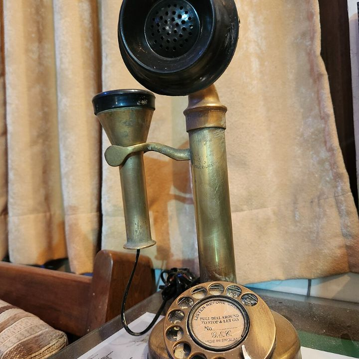 | Something that has SEEN THINGS (the older the better) | household treasure | Sir Findsalot / Captain Clutter / Dame Doohickey | A household legend takes the stage. / Polished by years of being quite splendid. | 7 | A magnificent household treasure. I shall alert the museum. | none |
| anthropic.claude-opus-5 / tough-hammer | 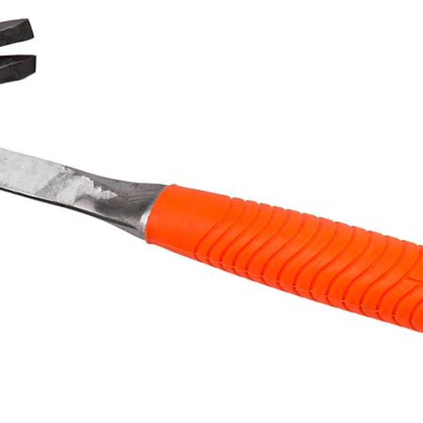 | Something that would WIN A FIGHT against anything | household treasure | Sir Findsalot / Captain Clutter / Dame Doohickey | A household legend takes the stage. / Polished by years of being quite splendid. | 7 | A magnificent household treasure. I shall alert the museum. | none |
| anthropic.claude-opus-5 / island-water-bottles | 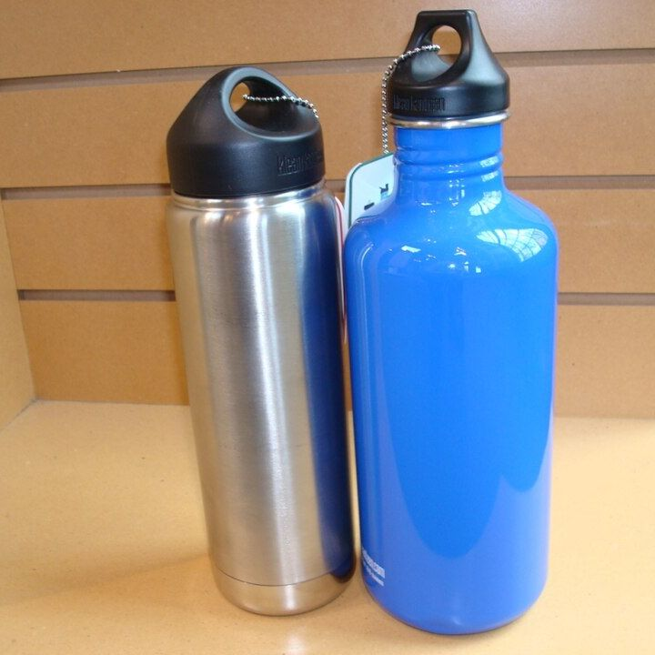 | Your ISLAND BUDDY for a desert island | household treasure | Sir Findsalot / Captain Clutter / Dame Doohickey | A household legend takes the stage. / Polished by years of being quite splendid. | 7 | A magnificent household treasure. I shall alert the museum. | none |
| anthropic.claude-opus-5 / weird-cicada-toy | 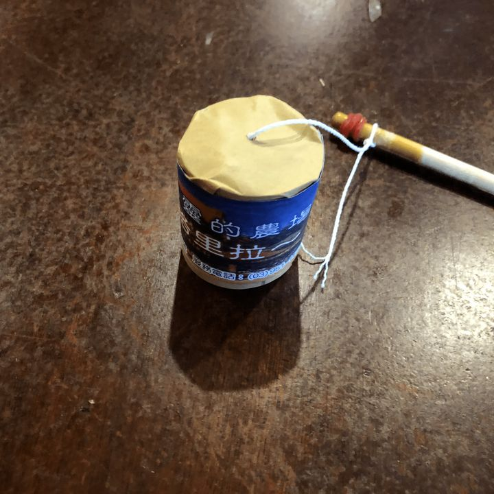 | The WEIRDEST thing you can find | household treasure | Sir Findsalot / Captain Clutter / Dame Doohickey | A household legend takes the stage. / Polished by years of being quite splendid. | 7 | A magnificent household treasure. I shall alert the museum. | none |
| anthropic.claude-opus-5 / museum-vinyl | 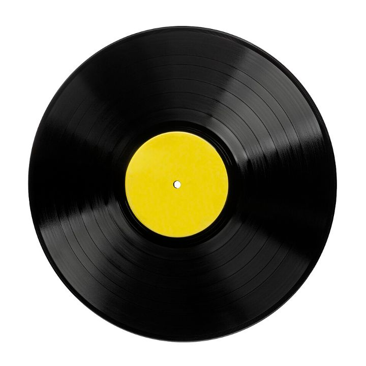 | Something that belongs IN A MUSEUM priceless, obviously | household treasure | Sir Findsalot / Captain Clutter / Dame Doohickey | A household legend takes the stage. / Polished by years of being quite splendid. | 7 | A magnificent household treasure. I shall alert the museum. | none |
| anthropic.claude-opus-5 / messy-kitchen | 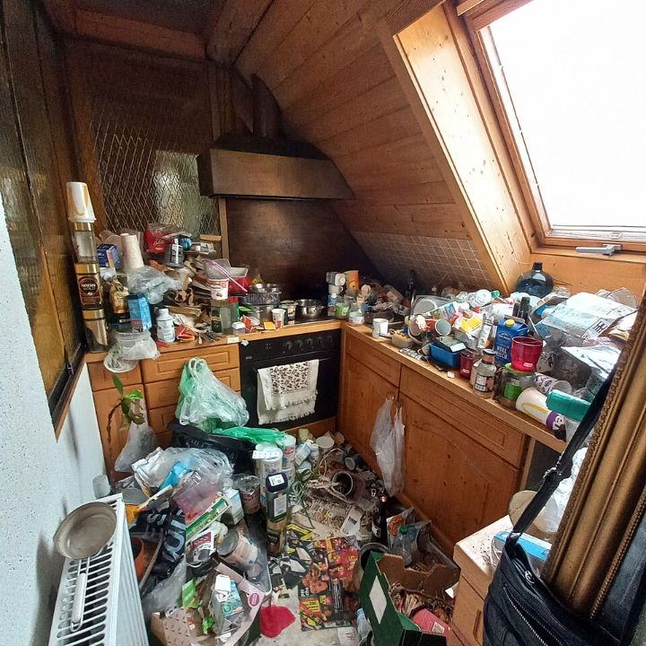 | Snag the most GREEN thing in the house | household treasure | Sir Findsalot / Captain Clutter / Dame Doohickey | A household legend takes the stage. / Polished by years of being quite splendid. | 7 | A magnificent household treasure. I shall alert the museum. | none |
| anthropic.claude-opus-5 / near-teal-mug | 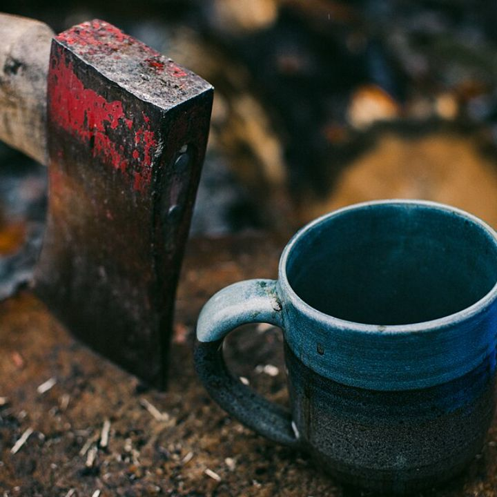 | Snag the most BLUE thing in the house | household treasure | Sir Findsalot / Captain Clutter / Dame Doohickey | A household legend takes the stage. / Polished by years of being quite splendid. | 7 | A magnificent household treasure. I shall alert the museum. | none |
| anthropic.claude-opus-5 / blue-small-lid | 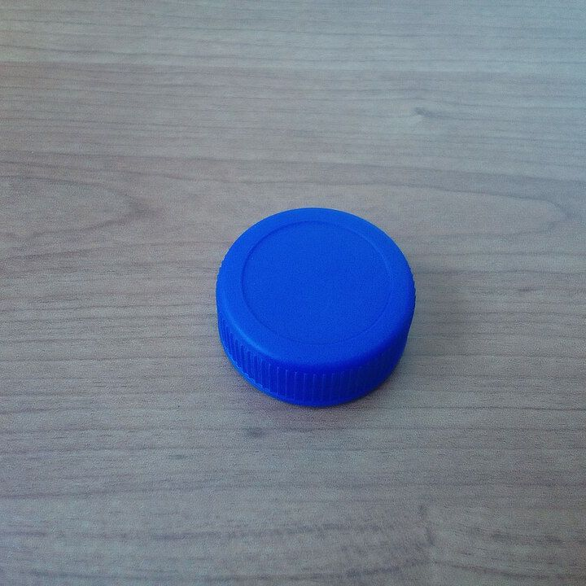 | Snag the most BLUE thing in the house | household treasure | Sir Findsalot / Captain Clutter / Dame Doohickey | A household legend takes the stage. / Polished by years of being quite splendid. | 7 | A magnificent household treasure. I shall alert the museum. | none |
| anthropic.claude-sonnet-5 / red-mug |  | Snag the most RED thing in the house | household treasure | Sir Findsalot / Captain Clutter / Dame Doohickey | A household legend takes the stage. / Polished by years of being quite splendid. | 7 | A magnificent household treasure. I shall alert the museum. | none |
| anthropic.claude-sonnet-5 / blue-bag |  | Snag the most BLUE thing in the house | household treasure | Sir Findsalot / Captain Clutter / Dame Doohickey | A household legend takes the stage. / Polished by years of being quite splendid. | 7 | A magnificent household treasure. I shall alert the museum. | none |
| anthropic.claude-sonnet-5 / yellow-lemon |  | Snag the most YELLOW thing in the house | household treasure | Sir Findsalot / Captain Clutter / Dame Doohickey | A household legend takes the stage. / Polished by years of being quite splendid. | 7 | A magnificent household treasure. I shall alert the museum. | none |
| anthropic.claude-sonnet-5 / green-pepper |  | Snag the most GREEN thing in the house | household treasure | Sir Findsalot / Captain Clutter / Dame Doohickey | A household legend takes the stage. / Polished by years of being quite splendid. | 7 | A magnificent household treasure. I shall alert the museum. | none |
| anthropic.claude-sonnet-5 / pink-tumblers |  | Snag the most PINK thing in the house | household treasure | Sir Findsalot / Captain Clutter / Dame Doohickey | A household legend takes the stage. / Polished by years of being quite splendid. | 7 | A magnificent household treasure. I shall alert the museum. | none |
| anthropic.claude-sonnet-5 / orange-forked-carrot |  | Snag the most ORANGE thing in the house | household treasure | Sir Findsalot / Captain Clutter / Dame Doohickey | A household legend takes the stage. / Polished by years of being quite splendid. | 7 | A magnificent household treasure. I shall alert the museum. | none |
| anthropic.claude-sonnet-5 / loot-pearl-necklace |  | Something a PIRATE would steal | household treasure | Sir Findsalot / Captain Clutter / Dame Doohickey | A household legend takes the stage. / Polished by years of being quite splendid. | 7 | A magnificent household treasure. I shall alert the museum. | none |
| anthropic.claude-sonnet-5 / old-wall-clock |  | Something that has SEEN THINGS (the older the better) | household treasure | Sir Findsalot / Captain Clutter / Dame Doohickey | A household legend takes the stage. / Polished by years of being quite splendid. | 7 | A magnificent household treasure. I shall alert the museum. | none |
| anthropic.claude-sonnet-5 / tough-iron-pan |  | Something that would WIN A FIGHT against anything | household treasure | Sir Findsalot / Captain Clutter / Dame Doohickey | A household legend takes the stage. / Polished by years of being quite splendid. | 7 | A magnificent household treasure. I shall alert the museum. | none |
| anthropic.claude-sonnet-5 / island-teddy |  | Your ISLAND BUDDY for a desert island | household treasure | Sir Findsalot / Captain Clutter / Dame Doohickey | A household legend takes the stage. / Polished by years of being quite splendid. | 7 | A magnificent household treasure. I shall alert the museum. | none |
| anthropic.claude-sonnet-5 / weird-satyr-mug |  | The WEIRDEST thing you can find | household treasure | Sir Findsalot / Captain Clutter / Dame Doohickey | A household legend takes the stage. / Polished by years of being quite splendid. | 7 | A magnificent household treasure. I shall alert the museum. | none |
| anthropic.claude-sonnet-5 / museum-porcelain-bottle |  | Something that belongs IN A MUSEUM priceless, obviously | household treasure | Sir Findsalot / Captain Clutter / Dame Doohickey | A household legend takes the stage. / Polished by years of being quite splendid. | 7 | A magnificent household treasure. I shall alert the museum. | none |
| anthropic.claude-sonnet-5 / pink-small-cup |  | Snag the most PINK thing in the house | household treasure | Sir Findsalot / Captain Clutter / Dame Doohickey | A household legend takes the stage. / Polished by years of being quite splendid. | 7 | A magnificent household treasure. I shall alert the museum. | none |
| anthropic.claude-sonnet-5 / red-pepper |  | Snag the most RED thing in the house | household treasure | Sir Findsalot / Captain Clutter / Dame Doohickey | A household legend takes the stage. / Polished by years of being quite splendid. | 7 | A magnificent household treasure. I shall alert the museum. | none |
| anthropic.claude-sonnet-5 / red-multicolor-peppers |  | Snag the most RED thing in the house | household treasure | Sir Findsalot / Captain Clutter / Dame Doohickey | A household legend takes the stage. / Polished by years of being quite splendid. | 7 | A magnificent household treasure. I shall alert the museum. | none |
| anthropic.claude-sonnet-5 / red-tomatoes |  | Snag the most RED thing in the house | household treasure | Sir Findsalot / Captain Clutter / Dame Doohickey | A household legend takes the stage. / Polished by years of being quite splendid. | 7 | A magnificent household treasure. I shall alert the museum. | none |
| anthropic.claude-sonnet-5 / blue-lids |  | Snag the most BLUE thing in the house | household treasure | Sir Findsalot / Captain Clutter / Dame Doohickey | A household legend takes the stage. / Polished by years of being quite splendid. | 7 | A magnificent household treasure. I shall alert the museum. | none |
| anthropic.claude-sonnet-5 / yellow-banana |  | Snag the most YELLOW thing in the house | household treasure | Sir Findsalot / Captain Clutter / Dame Doohickey | A household legend takes the stage. / Polished by years of being quite splendid. | 7 | A magnificent household treasure. I shall alert the museum. | none |
| anthropic.claude-sonnet-5 / green-yoyo |  | Snag the most GREEN thing in the house | household treasure | Sir Findsalot / Captain Clutter / Dame Doohickey | A household legend takes the stage. / Polished by years of being quite splendid. | 7 | A magnificent household treasure. I shall alert the museum. | none |
| anthropic.claude-sonnet-5 / pink-plastic-cups |  | Snag the most PINK thing in the house | household treasure | Sir Findsalot / Captain Clutter / Dame Doohickey | A household legend takes the stage. / Polished by years of being quite splendid. | 7 | A magnificent household treasure. I shall alert the museum. | none |
| anthropic.claude-sonnet-5 / orange-oranges |  | Snag the most ORANGE thing in the house | household treasure | Sir Findsalot / Captain Clutter / Dame Doohickey | A household legend takes the stage. / Polished by years of being quite splendid. | 7 | A magnificent household treasure. I shall alert the museum. | none |
| anthropic.claude-sonnet-5 / loot-gold-chain |  | Something a PIRATE would steal | household treasure | Sir Findsalot / Captain Clutter / Dame Doohickey | A household legend takes the stage. / Polished by years of being quite splendid. | 7 | A magnificent household treasure. I shall alert the museum. | none |
| anthropic.claude-sonnet-5 / old-telephone |  | Something that has SEEN THINGS (the older the better) | household treasure | Sir Findsalot / Captain Clutter / Dame Doohickey | A household legend takes the stage. / Polished by years of being quite splendid. | 7 | A magnificent household treasure. I shall alert the museum. | none |
| anthropic.claude-sonnet-5 / tough-hammer |  | Something that would WIN A FIGHT against anything | household treasure | Sir Findsalot / Captain Clutter / Dame Doohickey | A household legend takes the stage. / Polished by years of being quite splendid. | 7 | A magnificent household treasure. I shall alert the museum. | none |
| anthropic.claude-sonnet-5 / island-water-bottles |  | Your ISLAND BUDDY for a desert island | household treasure | Sir Findsalot / Captain Clutter / Dame Doohickey | A household legend takes the stage. / Polished by years of being quite splendid. | 7 | A magnificent household treasure. I shall alert the museum. | none |
| anthropic.claude-sonnet-5 / weird-cicada-toy |  | The WEIRDEST thing you can find | household treasure | Sir Findsalot / Captain Clutter / Dame Doohickey | A household legend takes the stage. / Polished by years of being quite splendid. | 7 | A magnificent household treasure. I shall alert the museum. | none |
| anthropic.claude-sonnet-5 / museum-vinyl |  | Something that belongs IN A MUSEUM priceless, obviously | household treasure | Sir Findsalot / Captain Clutter / Dame Doohickey | A household legend takes the stage. / Polished by years of being quite splendid. | 7 | A magnificent household treasure. I shall alert the museum. | none |
| anthropic.claude-sonnet-5 / messy-kitchen |  | Snag the most GREEN thing in the house | household treasure | Sir Findsalot / Captain Clutter / Dame Doohickey | A household legend takes the stage. / Polished by years of being quite splendid. | 7 | A magnificent household treasure. I shall alert the museum. | none |
| anthropic.claude-sonnet-5 / near-teal-mug |  | Snag the most BLUE thing in the house | household treasure | Sir Findsalot / Captain Clutter / Dame Doohickey | A household legend takes the stage. / Polished by years of being quite splendid. | 7 | A magnificent household treasure. I shall alert the museum. | none |
| anthropic.claude-sonnet-5 / blue-small-lid |  | Snag the most BLUE thing in the house | household treasure | Sir Findsalot / Captain Clutter / Dame Doohickey | A household legend takes the stage. / Polished by years of being quite splendid. | 7 | A magnificent household treasure. I shall alert the museum. | none |
| anthropic.claude-haiku-4-5 / red-mug |  | Snag the most RED thing in the house | household treasure | Sir Findsalot / Captain Clutter / Dame Doohickey | A household legend takes the stage. / Polished by years of being quite splendid. | 7 | A magnificent household treasure. I shall alert the museum. | none |
| anthropic.claude-haiku-4-5 / blue-bag |  | Snag the most BLUE thing in the house | household treasure | Sir Findsalot / Captain Clutter / Dame Doohickey | A household legend takes the stage. / Polished by years of being quite splendid. | 7 | A magnificent household treasure. I shall alert the museum. | none |
| anthropic.claude-haiku-4-5 / yellow-lemon |  | Snag the most YELLOW thing in the house | household treasure | Sir Findsalot / Captain Clutter / Dame Doohickey | A household legend takes the stage. / Polished by years of being quite splendid. | 7 | A magnificent household treasure. I shall alert the museum. | none |
| anthropic.claude-haiku-4-5 / green-pepper |  | Snag the most GREEN thing in the house | household treasure | Sir Findsalot / Captain Clutter / Dame Doohickey | A household legend takes the stage. / Polished by years of being quite splendid. | 7 | A magnificent household treasure. I shall alert the museum. | none |
| anthropic.claude-haiku-4-5 / pink-tumblers |  | Snag the most PINK thing in the house | household treasure | Sir Findsalot / Captain Clutter / Dame Doohickey | A household legend takes the stage. / Polished by years of being quite splendid. | 7 | A magnificent household treasure. I shall alert the museum. | none |
| anthropic.claude-haiku-4-5 / orange-forked-carrot |  | Snag the most ORANGE thing in the house | household treasure | Sir Findsalot / Captain Clutter / Dame Doohickey | A household legend takes the stage. / Polished by years of being quite splendid. | 7 | A magnificent household treasure. I shall alert the museum. | none |
| anthropic.claude-haiku-4-5 / loot-pearl-necklace |  | Something a PIRATE would steal | household treasure | Sir Findsalot / Captain Clutter / Dame Doohickey | A household legend takes the stage. / Polished by years of being quite splendid. | 7 | A magnificent household treasure. I shall alert the museum. | none |
| anthropic.claude-haiku-4-5 / old-wall-clock |  | Something that has SEEN THINGS (the older the better) | household treasure | Sir Findsalot / Captain Clutter / Dame Doohickey | A household legend takes the stage. / Polished by years of being quite splendid. | 7 | A magnificent household treasure. I shall alert the museum. | none |
| anthropic.claude-haiku-4-5 / tough-iron-pan |  | Something that would WIN A FIGHT against anything | household treasure | Sir Findsalot / Captain Clutter / Dame Doohickey | A household legend takes the stage. / Polished by years of being quite splendid. | 7 | A magnificent household treasure. I shall alert the museum. | none |
| anthropic.claude-haiku-4-5 / island-teddy |  | Your ISLAND BUDDY for a desert island | household treasure | Sir Findsalot / Captain Clutter / Dame Doohickey | A household legend takes the stage. / Polished by years of being quite splendid. | 7 | A magnificent household treasure. I shall alert the museum. | none |
| anthropic.claude-haiku-4-5 / weird-satyr-mug |  | The WEIRDEST thing you can find | household treasure | Sir Findsalot / Captain Clutter / Dame Doohickey | A household legend takes the stage. / Polished by years of being quite splendid. | 7 | A magnificent household treasure. I shall alert the museum. | none |
| anthropic.claude-haiku-4-5 / museum-porcelain-bottle |  | Something that belongs IN A MUSEUM priceless, obviously | household treasure | Sir Findsalot / Captain Clutter / Dame Doohickey | A household legend takes the stage. / Polished by years of being quite splendid. | 7 | A magnificent household treasure. I shall alert the museum. | none |
| anthropic.claude-haiku-4-5 / pink-small-cup |  | Snag the most PINK thing in the house | household treasure | Sir Findsalot / Captain Clutter / Dame Doohickey | A household legend takes the stage. / Polished by years of being quite splendid. | 7 | A magnificent household treasure. I shall alert the museum. | none |
| anthropic.claude-haiku-4-5 / red-pepper |  | Snag the most RED thing in the house | household treasure | Sir Findsalot / Captain Clutter / Dame Doohickey | A household legend takes the stage. / Polished by years of being quite splendid. | 7 | A magnificent household treasure. I shall alert the museum. | none |
| anthropic.claude-haiku-4-5 / red-multicolor-peppers |  | Snag the most RED thing in the house | household treasure | Sir Findsalot / Captain Clutter / Dame Doohickey | A household legend takes the stage. / Polished by years of being quite splendid. | 7 | A magnificent household treasure. I shall alert the museum. | none |
| anthropic.claude-haiku-4-5 / red-tomatoes |  | Snag the most RED thing in the house | household treasure | Sir Findsalot / Captain Clutter / Dame Doohickey | A household legend takes the stage. / Polished by years of being quite splendid. | 7 | A magnificent household treasure. I shall alert the museum. | none |
| anthropic.claude-haiku-4-5 / blue-lids |  | Snag the most BLUE thing in the house | household treasure | Sir Findsalot / Captain Clutter / Dame Doohickey | A household legend takes the stage. / Polished by years of being quite splendid. | 7 | A magnificent household treasure. I shall alert the museum. | none |
| anthropic.claude-haiku-4-5 / yellow-banana |  | Snag the most YELLOW thing in the house | household treasure | Sir Findsalot / Captain Clutter / Dame Doohickey | A household legend takes the stage. / Polished by years of being quite splendid. | 7 | A magnificent household treasure. I shall alert the museum. | none |
| anthropic.claude-haiku-4-5 / green-yoyo |  | Snag the most GREEN thing in the house | household treasure | Sir Findsalot / Captain Clutter / Dame Doohickey | A household legend takes the stage. / Polished by years of being quite splendid. | 7 | A magnificent household treasure. I shall alert the museum. | none |
| anthropic.claude-haiku-4-5 / pink-plastic-cups |  | Snag the most PINK thing in the house | household treasure | Sir Findsalot / Captain Clutter / Dame Doohickey | A household legend takes the stage. / Polished by years of being quite splendid. | 7 | A magnificent household treasure. I shall alert the museum. | none |
| anthropic.claude-haiku-4-5 / orange-oranges |  | Snag the most ORANGE thing in the house | household treasure | Sir Findsalot / Captain Clutter / Dame Doohickey | A household legend takes the stage. / Polished by years of being quite splendid. | 7 | A magnificent household treasure. I shall alert the museum. | none |
| anthropic.claude-haiku-4-5 / loot-gold-chain |  | Something a PIRATE would steal | household treasure | Sir Findsalot / Captain Clutter / Dame Doohickey | A household legend takes the stage. / Polished by years of being quite splendid. | 7 | A magnificent household treasure. I shall alert the museum. | none |
| anthropic.claude-haiku-4-5 / old-telephone |  | Something that has SEEN THINGS (the older the better) | household treasure | Sir Findsalot / Captain Clutter / Dame Doohickey | A household legend takes the stage. / Polished by years of being quite splendid. | 7 | A magnificent household treasure. I shall alert the museum. | none |
| anthropic.claude-haiku-4-5 / tough-hammer |  | Something that would WIN A FIGHT against anything | household treasure | Sir Findsalot / Captain Clutter / Dame Doohickey | A household legend takes the stage. / Polished by years of being quite splendid. | 7 | A magnificent household treasure. I shall alert the museum. | none |
| anthropic.claude-haiku-4-5 / island-water-bottles |  | Your ISLAND BUDDY for a desert island | household treasure | Sir Findsalot / Captain Clutter / Dame Doohickey | A household legend takes the stage. / Polished by years of being quite splendid. | 7 | A magnificent household treasure. I shall alert the museum. | none |
| anthropic.claude-haiku-4-5 / weird-cicada-toy |  | The WEIRDEST thing you can find | household treasure | Sir Findsalot / Captain Clutter / Dame Doohickey | A household legend takes the stage. / Polished by years of being quite splendid. | 7 | A magnificent household treasure. I shall alert the museum. | none |
| anthropic.claude-haiku-4-5 / museum-vinyl |  | Something that belongs IN A MUSEUM priceless, obviously | household treasure | Sir Findsalot / Captain Clutter / Dame Doohickey | A household legend takes the stage. / Polished by years of being quite splendid. | 7 | A magnificent household treasure. I shall alert the museum. | none |
| anthropic.claude-haiku-4-5 / messy-kitchen |  | Snag the most GREEN thing in the house | household treasure | Sir Findsalot / Captain Clutter / Dame Doohickey | A household legend takes the stage. / Polished by years of being quite splendid. | 7 | A magnificent household treasure. I shall alert the museum. | none |
| anthropic.claude-haiku-4-5 / near-teal-mug |  | Snag the most BLUE thing in the house | household treasure | Sir Findsalot / Captain Clutter / Dame Doohickey | A household legend takes the stage. / Polished by years of being quite splendid. | 7 | A magnificent household treasure. I shall alert the museum. | none |
| anthropic.claude-haiku-4-5 / blue-small-lid |  | Snag the most BLUE thing in the house | household treasure | Sir Findsalot / Captain Clutter / Dame Doohickey | A household legend takes the stage. / Polished by years of being quite splendid. | 7 | A magnificent household treasure. I shall alert the museum. | none |

[Raw public-fixture results, costs and per-model summaries](bedrock-mock.json).
