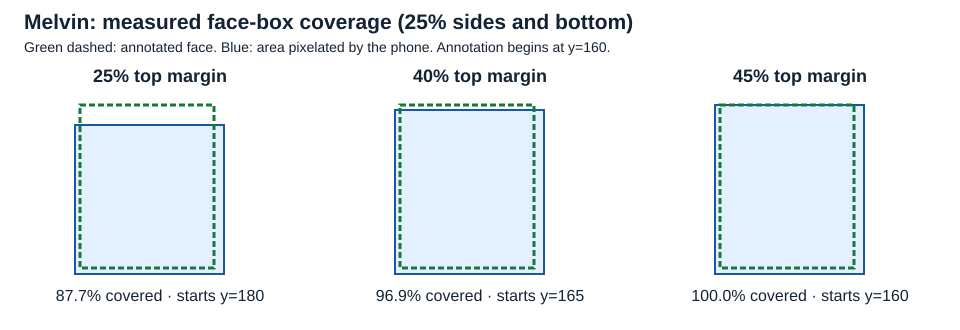

# Offline face-redaction settings sweep

2000 settings on the same 12 annotated face JPEGs and 64 object JPEGs. Source: working tree on 7ffe2d3b78d44c52e3fe0162d848edd2bcadc4bf, SHA-256 83a044f2a7b51ee441bf074b4fec9bca92212f2cae4ac25181ca57464846da3d. MediaPipe 0.10.14, Chrome/155.0.8059.40.

**Recommended and implemented: confidence 0.7; padded retry off (its threshold is 0.7); minimum relative side 5%; aspect ratio 0.5–2; minimum visible box area 0.5% of frame. 12/12 faces, 0/64 object false positives.** Padding: 25% sides/bottom, 45% top.

The original setting was SDK confidence 0.5, retry on at 0.5, and no size/aspect/area limits: 12/12 faces and 11/64 object detections. Threshold 0.7 alone, with retry off, reaches the minimum possible false-positive count (zero). Threshold 0.8 ties; 0.7 leaves more confidence margin. Loose sanity guards tie the unfiltered setting; stronger guards are unnecessary and can miss Melvin (14% minimum side or 2% minimum area). The retry adds no face recall in this corpus; retry at 0.5 reintroduces four object detections at primary 0.7. Toy/drawn-face false positives are acceptable for the review but still undesirable, and remain included in the total. This is a choice for this frozen corpus, rather than an estimate of recall on untested photos.

The real CPU BlazeFace loader and padded retry ran separately at SDK thresholds 0.5, 0.6, 0.7 and 0.8. Candidate boxes (including confidence) are numeric receipts. Each table row replays the phone’s exported selection function on those exact candidates; retry runs only when the filtered first pass is empty. Both relative side lengths and visible unpadded area are measured against the original 720×720 frame; aspect ratio uses raw width/height. A face counts only when its annotated box matches at IoU ≥0.2. Toy/sculpted faces are included in total object false positives.

Actual SDK threshold outputs differ from filtering 0.5 detections in 48 image/pass/threshold combinations (weighted NMS changes box geometry). Consequently all four SDK thresholds were inferred separately; if retry is enabled with a different threshold, the phone loads an independent detector at that exact threshold. Foreign requests: 0; browser errors: 0. No paid calls or new assets; temporary pixels are cleared and only numeric detections are saved.

## Confidence and retry, without size/aspect/area filters

| Confidence | Retry confidence | Min side/frame | Aspect w/h | Min area/frame | Faces | Object FP | Toy/mug FP | Misses |
|---:|---:|---:|---|---:|---:|---:|---:|---|
| 0.5 | off | 0 | 0–100 | 0 | 12/12 | 10/64 | 4 | — |
| 0.5 | 0.5 | 0 | 0–100 | 0 | 12/12 | 11/64 | 4 | — |
| 0.5 | 0.6 | 0 | 0–100 | 0 | 12/12 | 10/64 | 4 | — |
| 0.5 | 0.7 | 0 | 0–100 | 0 | 12/12 | 10/64 | 4 | — |
| 0.5 | 0.8 | 0 | 0–100 | 0 | 12/12 | 10/64 | 4 | — |
| 0.6 | off | 0 | 0–100 | 0 | 12/12 | 4/64 | 2 | — |
| 0.6 | 0.5 | 0 | 0–100 | 0 | 12/12 | 7/64 | 3 | — |
| 0.6 | 0.6 | 0 | 0–100 | 0 | 12/12 | 5/64 | 2 | — |
| 0.6 | 0.7 | 0 | 0–100 | 0 | 12/12 | 4/64 | 2 | — |
| 0.6 | 0.8 | 0 | 0–100 | 0 | 12/12 | 4/64 | 2 | — |
| 0.7 | off | 0 | 0–100 | 0 | 12/12 | 0/64 | 0 | — |
| 0.7 | 0.5 | 0 | 0–100 | 0 | 12/12 | 4/64 | 2 | — |
| 0.7 | 0.6 | 0 | 0–100 | 0 | 12/12 | 1/64 | 0 | — |
| 0.7 | 0.7 | 0 | 0–100 | 0 | 12/12 | 0/64 | 0 | — |
| 0.7 | 0.8 | 0 | 0–100 | 0 | 12/12 | 0/64 | 0 | — |
| 0.8 | off | 0 | 0–100 | 0 | 12/12 | 0/64 | 0 | — |
| 0.8 | 0.5 | 0 | 0–100 | 0 | 12/12 | 4/64 | 2 | — |
| 0.8 | 0.6 | 0 | 0–100 | 0 | 12/12 | 1/64 | 0 | — |
| 0.8 | 0.7 | 0 | 0–100 | 0 | 12/12 | 0/64 | 0 | — |
| 0.8 | 0.8 | 0 | 0–100 | 0 | 12/12 | 0/64 | 0 | — |

## Isolated sanity-filter changes at the original 0.5 / retry 0.5

| Confidence | Retry confidence | Min side/frame | Aspect w/h | Min area/frame | Faces | Object FP | Toy/mug FP | Misses |
|---:|---:|---:|---|---:|---:|---:|---:|---|
| 0.5 | 0.5 | 0 | 0–100 | 0.005 | 12/12 | 11/64 | 4 | — |
| 0.5 | 0.5 | 0 | 0–100 | 0.01 | 12/12 | 11/64 | 4 | — |
| 0.5 | 0.5 | 0 | 0–100 | 0.015 | 12/12 | 11/64 | 4 | — |
| 0.5 | 0.5 | 0 | 0–100 | 0.02 | 11/12 | 11/64 | 4 | face-melvin |
| 0.5 | 0.5 | 0 | 0.5–2 | 0 | 12/12 | 11/64 | 4 | — |
| 0.5 | 0.5 | 0 | 0.67–1.5 | 0 | 12/12 | 11/64 | 4 | — |
| 0.5 | 0.5 | 0 | 0.8–1.25 | 0 | 12/12 | 11/64 | 4 | — |
| 0.5 | 0.5 | 0.05 | 0–100 | 0 | 12/12 | 11/64 | 4 | — |
| 0.5 | 0.5 | 0.1 | 0–100 | 0 | 12/12 | 11/64 | 4 | — |
| 0.5 | 0.5 | 0.12 | 0–100 | 0 | 12/12 | 11/64 | 4 | — |
| 0.5 | 0.5 | 0.14 | 0–100 | 0 | 11/12 | 11/64 | 4 | face-melvin |

## Implemented choice

| Confidence | Retry confidence | Min side/frame | Aspect w/h | Min area/frame | Faces | Object FP | Toy/mug FP | Misses |
|---:|---:|---:|---|---:|---:|---:|---:|---|
| 0.7 | off | 0.05 | 0.5–2 | 0.005 | 12/12 | 0/64 | 0 | — |

## Lowest-FP settings retaining all faces

| Confidence | Retry confidence | Min side/frame | Aspect w/h | Min area/frame | Faces | Object FP | Toy/mug FP | Misses |
|---:|---:|---:|---|---:|---:|---:|---:|---|
| 0.7 | off | 0 | 0–100 | 0 | 12/12 | 0/64 | 0 | — |
| 0.7 | off | 0 | 0.5–2 | 0 | 12/12 | 0/64 | 0 | — |
| 0.7 | off | 0 | 0.67–1.5 | 0 | 12/12 | 0/64 | 0 | — |
| 0.7 | off | 0 | 0.8–1.25 | 0 | 12/12 | 0/64 | 0 | — |
| 0.7 | off | 0 | 0–100 | 0.005 | 12/12 | 0/64 | 0 | — |
| 0.7 | off | 0 | 0.5–2 | 0.005 | 12/12 | 0/64 | 0 | — |
| 0.7 | off | 0 | 0.67–1.5 | 0.005 | 12/12 | 0/64 | 0 | — |
| 0.7 | off | 0 | 0.8–1.25 | 0.005 | 12/12 | 0/64 | 0 | — |
| 0.7 | off | 0 | 0–100 | 0.01 | 12/12 | 0/64 | 0 | — |
| 0.7 | off | 0 | 0.5–2 | 0.01 | 12/12 | 0/64 | 0 | — |
| 0.7 | off | 0 | 0.67–1.5 | 0.01 | 12/12 | 0/64 | 0 | — |
| 0.7 | off | 0 | 0.8–1.25 | 0.01 | 12/12 | 0/64 | 0 | — |
| 0.7 | off | 0 | 0–100 | 0.015 | 12/12 | 0/64 | 0 | — |
| 0.7 | off | 0 | 0.5–2 | 0.015 | 12/12 | 0/64 | 0 | — |
| 0.7 | off | 0 | 0.67–1.5 | 0.015 | 12/12 | 0/64 | 0 | — |
| 0.7 | off | 0 | 0.8–1.25 | 0.015 | 12/12 | 0/64 | 0 | — |
| 0.7 | off | 0.05 | 0–100 | 0 | 12/12 | 0/64 | 0 | — |
| 0.7 | off | 0.05 | 0.5–2 | 0 | 12/12 | 0/64 | 0 | — |
| 0.7 | off | 0.05 | 0.67–1.5 | 0 | 12/12 | 0/64 | 0 | — |
| 0.7 | off | 0.05 | 0.8–1.25 | 0 | 12/12 | 0/64 | 0 | — |

## Forehead coverage (25% sides and bottom)

Coverage uses the selected 0.7 SDK detections against the fixed manually annotated boxes. Melvin’s annotation spans y=160–323; 25% top padding starts at y=180 (87.7% coverage), 40% starts at y=165 (96.9%), and 45% starts at y=160 (100%). The chosen expanded box is x=231, y=160, width=149, height=169; it covers the annotated x=236, y=160, width=134, height=163. All 12 selected faces have 100% annotated-box coverage with 45% top padding. This geometric coverage is approximate and does not measure identifiability.

[Public-domain Melvin source fixture](../../../tools/eval/photos/faces/face-melvin.jpg). [Original production baseline](face-blur-baseline.md).

| Face | Top 25% | Top 40% | Top 45% | Top 50% |
|---|---:|---:|---:|---:|
| face-kerwin | 100.0% | 100.0% | 100.0% | 100.0% |
| face-cassidy | 97.5% | 100.0% | 100.0% | 100.0% |
| face-watkins | 100.0% | 100.0% | 100.0% | 100.0% |
| face-resnik | 100.0% | 100.0% | 100.0% | 100.0% |
| face-jemison | 98.2% | 100.0% | 100.0% | 100.0% |
| face-melvin | 87.7% | 96.9% | 100.0% | 100.0% |
| face-barron | 100.0% | 100.0% | 100.0% | 100.0% |
| face-hague | 93.2% | 100.0% | 100.0% | 100.0% |
| face-ride | 100.0% | 100.0% | 100.0% | 100.0% |
| face-priven | 100.0% | 100.0% | 100.0% | 100.0% |
| face-bolt | 96.8% | 100.0% | 100.0% | 100.0% |
| face-cockrell | 100.0% | 100.0% | 100.0% | 100.0% |

## Every swept setting

| Confidence | Retry confidence | Min side/frame | Aspect w/h | Min area/frame | Faces | Object FP | Toy/mug FP | Misses |
|---:|---:|---:|---|---:|---:|---:|---:|---|
| 0.5 | off | 0 | 0–100 | 0 | 12/12 | 10/64 | 4 | — |
| 0.5 | off | 0 | 0–100 | 0.005 | 12/12 | 10/64 | 4 | — |
| 0.5 | off | 0 | 0–100 | 0.01 | 12/12 | 10/64 | 4 | — |
| 0.5 | off | 0 | 0–100 | 0.015 | 12/12 | 10/64 | 4 | — |
| 0.5 | off | 0 | 0–100 | 0.02 | 11/12 | 10/64 | 4 | face-melvin |
| 0.5 | off | 0 | 0.5–2 | 0 | 12/12 | 10/64 | 4 | — |
| 0.5 | off | 0 | 0.5–2 | 0.005 | 12/12 | 10/64 | 4 | — |
| 0.5 | off | 0 | 0.5–2 | 0.01 | 12/12 | 10/64 | 4 | — |
| 0.5 | off | 0 | 0.5–2 | 0.015 | 12/12 | 10/64 | 4 | — |
| 0.5 | off | 0 | 0.5–2 | 0.02 | 11/12 | 10/64 | 4 | face-melvin |
| 0.5 | off | 0 | 0.67–1.5 | 0 | 12/12 | 10/64 | 4 | — |
| 0.5 | off | 0 | 0.67–1.5 | 0.005 | 12/12 | 10/64 | 4 | — |
| 0.5 | off | 0 | 0.67–1.5 | 0.01 | 12/12 | 10/64 | 4 | — |
| 0.5 | off | 0 | 0.67–1.5 | 0.015 | 12/12 | 10/64 | 4 | — |
| 0.5 | off | 0 | 0.67–1.5 | 0.02 | 11/12 | 10/64 | 4 | face-melvin |
| 0.5 | off | 0 | 0.8–1.25 | 0 | 12/12 | 10/64 | 4 | — |
| 0.5 | off | 0 | 0.8–1.25 | 0.005 | 12/12 | 10/64 | 4 | — |
| 0.5 | off | 0 | 0.8–1.25 | 0.01 | 12/12 | 10/64 | 4 | — |
| 0.5 | off | 0 | 0.8–1.25 | 0.015 | 12/12 | 10/64 | 4 | — |
| 0.5 | off | 0 | 0.8–1.25 | 0.02 | 11/12 | 10/64 | 4 | face-melvin |
| 0.5 | off | 0.05 | 0–100 | 0 | 12/12 | 10/64 | 4 | — |
| 0.5 | off | 0.05 | 0–100 | 0.005 | 12/12 | 10/64 | 4 | — |
| 0.5 | off | 0.05 | 0–100 | 0.01 | 12/12 | 10/64 | 4 | — |
| 0.5 | off | 0.05 | 0–100 | 0.015 | 12/12 | 10/64 | 4 | — |
| 0.5 | off | 0.05 | 0–100 | 0.02 | 11/12 | 10/64 | 4 | face-melvin |
| 0.5 | off | 0.05 | 0.5–2 | 0 | 12/12 | 10/64 | 4 | — |
| 0.5 | off | 0.05 | 0.5–2 | 0.005 | 12/12 | 10/64 | 4 | — |
| 0.5 | off | 0.05 | 0.5–2 | 0.01 | 12/12 | 10/64 | 4 | — |
| 0.5 | off | 0.05 | 0.5–2 | 0.015 | 12/12 | 10/64 | 4 | — |
| 0.5 | off | 0.05 | 0.5–2 | 0.02 | 11/12 | 10/64 | 4 | face-melvin |
| 0.5 | off | 0.05 | 0.67–1.5 | 0 | 12/12 | 10/64 | 4 | — |
| 0.5 | off | 0.05 | 0.67–1.5 | 0.005 | 12/12 | 10/64 | 4 | — |
| 0.5 | off | 0.05 | 0.67–1.5 | 0.01 | 12/12 | 10/64 | 4 | — |
| 0.5 | off | 0.05 | 0.67–1.5 | 0.015 | 12/12 | 10/64 | 4 | — |
| 0.5 | off | 0.05 | 0.67–1.5 | 0.02 | 11/12 | 10/64 | 4 | face-melvin |
| 0.5 | off | 0.05 | 0.8–1.25 | 0 | 12/12 | 10/64 | 4 | — |
| 0.5 | off | 0.05 | 0.8–1.25 | 0.005 | 12/12 | 10/64 | 4 | — |
| 0.5 | off | 0.05 | 0.8–1.25 | 0.01 | 12/12 | 10/64 | 4 | — |
| 0.5 | off | 0.05 | 0.8–1.25 | 0.015 | 12/12 | 10/64 | 4 | — |
| 0.5 | off | 0.05 | 0.8–1.25 | 0.02 | 11/12 | 10/64 | 4 | face-melvin |
| 0.5 | off | 0.1 | 0–100 | 0 | 12/12 | 10/64 | 4 | — |
| 0.5 | off | 0.1 | 0–100 | 0.005 | 12/12 | 10/64 | 4 | — |
| 0.5 | off | 0.1 | 0–100 | 0.01 | 12/12 | 10/64 | 4 | — |
| 0.5 | off | 0.1 | 0–100 | 0.015 | 12/12 | 10/64 | 4 | — |
| 0.5 | off | 0.1 | 0–100 | 0.02 | 11/12 | 10/64 | 4 | face-melvin |
| 0.5 | off | 0.1 | 0.5–2 | 0 | 12/12 | 10/64 | 4 | — |
| 0.5 | off | 0.1 | 0.5–2 | 0.005 | 12/12 | 10/64 | 4 | — |
| 0.5 | off | 0.1 | 0.5–2 | 0.01 | 12/12 | 10/64 | 4 | — |
| 0.5 | off | 0.1 | 0.5–2 | 0.015 | 12/12 | 10/64 | 4 | — |
| 0.5 | off | 0.1 | 0.5–2 | 0.02 | 11/12 | 10/64 | 4 | face-melvin |
| 0.5 | off | 0.1 | 0.67–1.5 | 0 | 12/12 | 10/64 | 4 | — |
| 0.5 | off | 0.1 | 0.67–1.5 | 0.005 | 12/12 | 10/64 | 4 | — |
| 0.5 | off | 0.1 | 0.67–1.5 | 0.01 | 12/12 | 10/64 | 4 | — |
| 0.5 | off | 0.1 | 0.67–1.5 | 0.015 | 12/12 | 10/64 | 4 | — |
| 0.5 | off | 0.1 | 0.67–1.5 | 0.02 | 11/12 | 10/64 | 4 | face-melvin |
| 0.5 | off | 0.1 | 0.8–1.25 | 0 | 12/12 | 10/64 | 4 | — |
| 0.5 | off | 0.1 | 0.8–1.25 | 0.005 | 12/12 | 10/64 | 4 | — |
| 0.5 | off | 0.1 | 0.8–1.25 | 0.01 | 12/12 | 10/64 | 4 | — |
| 0.5 | off | 0.1 | 0.8–1.25 | 0.015 | 12/12 | 10/64 | 4 | — |
| 0.5 | off | 0.1 | 0.8–1.25 | 0.02 | 11/12 | 10/64 | 4 | face-melvin |
| 0.5 | off | 0.12 | 0–100 | 0 | 12/12 | 10/64 | 4 | — |
| 0.5 | off | 0.12 | 0–100 | 0.005 | 12/12 | 10/64 | 4 | — |
| 0.5 | off | 0.12 | 0–100 | 0.01 | 12/12 | 10/64 | 4 | — |
| 0.5 | off | 0.12 | 0–100 | 0.015 | 12/12 | 10/64 | 4 | — |
| 0.5 | off | 0.12 | 0–100 | 0.02 | 11/12 | 10/64 | 4 | face-melvin |
| 0.5 | off | 0.12 | 0.5–2 | 0 | 12/12 | 10/64 | 4 | — |
| 0.5 | off | 0.12 | 0.5–2 | 0.005 | 12/12 | 10/64 | 4 | — |
| 0.5 | off | 0.12 | 0.5–2 | 0.01 | 12/12 | 10/64 | 4 | — |
| 0.5 | off | 0.12 | 0.5–2 | 0.015 | 12/12 | 10/64 | 4 | — |
| 0.5 | off | 0.12 | 0.5–2 | 0.02 | 11/12 | 10/64 | 4 | face-melvin |
| 0.5 | off | 0.12 | 0.67–1.5 | 0 | 12/12 | 10/64 | 4 | — |
| 0.5 | off | 0.12 | 0.67–1.5 | 0.005 | 12/12 | 10/64 | 4 | — |
| 0.5 | off | 0.12 | 0.67–1.5 | 0.01 | 12/12 | 10/64 | 4 | — |
| 0.5 | off | 0.12 | 0.67–1.5 | 0.015 | 12/12 | 10/64 | 4 | — |
| 0.5 | off | 0.12 | 0.67–1.5 | 0.02 | 11/12 | 10/64 | 4 | face-melvin |
| 0.5 | off | 0.12 | 0.8–1.25 | 0 | 12/12 | 10/64 | 4 | — |
| 0.5 | off | 0.12 | 0.8–1.25 | 0.005 | 12/12 | 10/64 | 4 | — |
| 0.5 | off | 0.12 | 0.8–1.25 | 0.01 | 12/12 | 10/64 | 4 | — |
| 0.5 | off | 0.12 | 0.8–1.25 | 0.015 | 12/12 | 10/64 | 4 | — |
| 0.5 | off | 0.12 | 0.8–1.25 | 0.02 | 11/12 | 10/64 | 4 | face-melvin |
| 0.5 | off | 0.14 | 0–100 | 0 | 11/12 | 10/64 | 4 | face-melvin |
| 0.5 | off | 0.14 | 0–100 | 0.005 | 11/12 | 10/64 | 4 | face-melvin |
| 0.5 | off | 0.14 | 0–100 | 0.01 | 11/12 | 10/64 | 4 | face-melvin |
| 0.5 | off | 0.14 | 0–100 | 0.015 | 11/12 | 10/64 | 4 | face-melvin |
| 0.5 | off | 0.14 | 0–100 | 0.02 | 11/12 | 10/64 | 4 | face-melvin |
| 0.5 | off | 0.14 | 0.5–2 | 0 | 11/12 | 10/64 | 4 | face-melvin |
| 0.5 | off | 0.14 | 0.5–2 | 0.005 | 11/12 | 10/64 | 4 | face-melvin |
| 0.5 | off | 0.14 | 0.5–2 | 0.01 | 11/12 | 10/64 | 4 | face-melvin |
| 0.5 | off | 0.14 | 0.5–2 | 0.015 | 11/12 | 10/64 | 4 | face-melvin |
| 0.5 | off | 0.14 | 0.5–2 | 0.02 | 11/12 | 10/64 | 4 | face-melvin |
| 0.5 | off | 0.14 | 0.67–1.5 | 0 | 11/12 | 10/64 | 4 | face-melvin |
| 0.5 | off | 0.14 | 0.67–1.5 | 0.005 | 11/12 | 10/64 | 4 | face-melvin |
| 0.5 | off | 0.14 | 0.67–1.5 | 0.01 | 11/12 | 10/64 | 4 | face-melvin |
| 0.5 | off | 0.14 | 0.67–1.5 | 0.015 | 11/12 | 10/64 | 4 | face-melvin |
| 0.5 | off | 0.14 | 0.67–1.5 | 0.02 | 11/12 | 10/64 | 4 | face-melvin |
| 0.5 | off | 0.14 | 0.8–1.25 | 0 | 11/12 | 10/64 | 4 | face-melvin |
| 0.5 | off | 0.14 | 0.8–1.25 | 0.005 | 11/12 | 10/64 | 4 | face-melvin |
| 0.5 | off | 0.14 | 0.8–1.25 | 0.01 | 11/12 | 10/64 | 4 | face-melvin |
| 0.5 | off | 0.14 | 0.8–1.25 | 0.015 | 11/12 | 10/64 | 4 | face-melvin |
| 0.5 | off | 0.14 | 0.8–1.25 | 0.02 | 11/12 | 10/64 | 4 | face-melvin |
| 0.5 | 0.5 | 0 | 0–100 | 0 | 12/12 | 11/64 | 4 | — |
| 0.5 | 0.5 | 0 | 0–100 | 0.005 | 12/12 | 11/64 | 4 | — |
| 0.5 | 0.5 | 0 | 0–100 | 0.01 | 12/12 | 11/64 | 4 | — |
| 0.5 | 0.5 | 0 | 0–100 | 0.015 | 12/12 | 11/64 | 4 | — |
| 0.5 | 0.5 | 0 | 0–100 | 0.02 | 11/12 | 11/64 | 4 | face-melvin |
| 0.5 | 0.5 | 0 | 0.5–2 | 0 | 12/12 | 11/64 | 4 | — |
| 0.5 | 0.5 | 0 | 0.5–2 | 0.005 | 12/12 | 11/64 | 4 | — |
| 0.5 | 0.5 | 0 | 0.5–2 | 0.01 | 12/12 | 11/64 | 4 | — |
| 0.5 | 0.5 | 0 | 0.5–2 | 0.015 | 12/12 | 11/64 | 4 | — |
| 0.5 | 0.5 | 0 | 0.5–2 | 0.02 | 11/12 | 11/64 | 4 | face-melvin |
| 0.5 | 0.5 | 0 | 0.67–1.5 | 0 | 12/12 | 11/64 | 4 | — |
| 0.5 | 0.5 | 0 | 0.67–1.5 | 0.005 | 12/12 | 11/64 | 4 | — |
| 0.5 | 0.5 | 0 | 0.67–1.5 | 0.01 | 12/12 | 11/64 | 4 | — |
| 0.5 | 0.5 | 0 | 0.67–1.5 | 0.015 | 12/12 | 11/64 | 4 | — |
| 0.5 | 0.5 | 0 | 0.67–1.5 | 0.02 | 11/12 | 11/64 | 4 | face-melvin |
| 0.5 | 0.5 | 0 | 0.8–1.25 | 0 | 12/12 | 11/64 | 4 | — |
| 0.5 | 0.5 | 0 | 0.8–1.25 | 0.005 | 12/12 | 11/64 | 4 | — |
| 0.5 | 0.5 | 0 | 0.8–1.25 | 0.01 | 12/12 | 11/64 | 4 | — |
| 0.5 | 0.5 | 0 | 0.8–1.25 | 0.015 | 12/12 | 11/64 | 4 | — |
| 0.5 | 0.5 | 0 | 0.8–1.25 | 0.02 | 11/12 | 11/64 | 4 | face-melvin |
| 0.5 | 0.5 | 0.05 | 0–100 | 0 | 12/12 | 11/64 | 4 | — |
| 0.5 | 0.5 | 0.05 | 0–100 | 0.005 | 12/12 | 11/64 | 4 | — |
| 0.5 | 0.5 | 0.05 | 0–100 | 0.01 | 12/12 | 11/64 | 4 | — |
| 0.5 | 0.5 | 0.05 | 0–100 | 0.015 | 12/12 | 11/64 | 4 | — |
| 0.5 | 0.5 | 0.05 | 0–100 | 0.02 | 11/12 | 11/64 | 4 | face-melvin |
| 0.5 | 0.5 | 0.05 | 0.5–2 | 0 | 12/12 | 11/64 | 4 | — |
| 0.5 | 0.5 | 0.05 | 0.5–2 | 0.005 | 12/12 | 11/64 | 4 | — |
| 0.5 | 0.5 | 0.05 | 0.5–2 | 0.01 | 12/12 | 11/64 | 4 | — |
| 0.5 | 0.5 | 0.05 | 0.5–2 | 0.015 | 12/12 | 11/64 | 4 | — |
| 0.5 | 0.5 | 0.05 | 0.5–2 | 0.02 | 11/12 | 11/64 | 4 | face-melvin |
| 0.5 | 0.5 | 0.05 | 0.67–1.5 | 0 | 12/12 | 11/64 | 4 | — |
| 0.5 | 0.5 | 0.05 | 0.67–1.5 | 0.005 | 12/12 | 11/64 | 4 | — |
| 0.5 | 0.5 | 0.05 | 0.67–1.5 | 0.01 | 12/12 | 11/64 | 4 | — |
| 0.5 | 0.5 | 0.05 | 0.67–1.5 | 0.015 | 12/12 | 11/64 | 4 | — |
| 0.5 | 0.5 | 0.05 | 0.67–1.5 | 0.02 | 11/12 | 11/64 | 4 | face-melvin |
| 0.5 | 0.5 | 0.05 | 0.8–1.25 | 0 | 12/12 | 11/64 | 4 | — |
| 0.5 | 0.5 | 0.05 | 0.8–1.25 | 0.005 | 12/12 | 11/64 | 4 | — |
| 0.5 | 0.5 | 0.05 | 0.8–1.25 | 0.01 | 12/12 | 11/64 | 4 | — |
| 0.5 | 0.5 | 0.05 | 0.8–1.25 | 0.015 | 12/12 | 11/64 | 4 | — |
| 0.5 | 0.5 | 0.05 | 0.8–1.25 | 0.02 | 11/12 | 11/64 | 4 | face-melvin |
| 0.5 | 0.5 | 0.1 | 0–100 | 0 | 12/12 | 11/64 | 4 | — |
| 0.5 | 0.5 | 0.1 | 0–100 | 0.005 | 12/12 | 11/64 | 4 | — |
| 0.5 | 0.5 | 0.1 | 0–100 | 0.01 | 12/12 | 11/64 | 4 | — |
| 0.5 | 0.5 | 0.1 | 0–100 | 0.015 | 12/12 | 11/64 | 4 | — |
| 0.5 | 0.5 | 0.1 | 0–100 | 0.02 | 11/12 | 11/64 | 4 | face-melvin |
| 0.5 | 0.5 | 0.1 | 0.5–2 | 0 | 12/12 | 11/64 | 4 | — |
| 0.5 | 0.5 | 0.1 | 0.5–2 | 0.005 | 12/12 | 11/64 | 4 | — |
| 0.5 | 0.5 | 0.1 | 0.5–2 | 0.01 | 12/12 | 11/64 | 4 | — |
| 0.5 | 0.5 | 0.1 | 0.5–2 | 0.015 | 12/12 | 11/64 | 4 | — |
| 0.5 | 0.5 | 0.1 | 0.5–2 | 0.02 | 11/12 | 11/64 | 4 | face-melvin |
| 0.5 | 0.5 | 0.1 | 0.67–1.5 | 0 | 12/12 | 11/64 | 4 | — |
| 0.5 | 0.5 | 0.1 | 0.67–1.5 | 0.005 | 12/12 | 11/64 | 4 | — |
| 0.5 | 0.5 | 0.1 | 0.67–1.5 | 0.01 | 12/12 | 11/64 | 4 | — |
| 0.5 | 0.5 | 0.1 | 0.67–1.5 | 0.015 | 12/12 | 11/64 | 4 | — |
| 0.5 | 0.5 | 0.1 | 0.67–1.5 | 0.02 | 11/12 | 11/64 | 4 | face-melvin |
| 0.5 | 0.5 | 0.1 | 0.8–1.25 | 0 | 12/12 | 11/64 | 4 | — |
| 0.5 | 0.5 | 0.1 | 0.8–1.25 | 0.005 | 12/12 | 11/64 | 4 | — |
| 0.5 | 0.5 | 0.1 | 0.8–1.25 | 0.01 | 12/12 | 11/64 | 4 | — |
| 0.5 | 0.5 | 0.1 | 0.8–1.25 | 0.015 | 12/12 | 11/64 | 4 | — |
| 0.5 | 0.5 | 0.1 | 0.8–1.25 | 0.02 | 11/12 | 11/64 | 4 | face-melvin |
| 0.5 | 0.5 | 0.12 | 0–100 | 0 | 12/12 | 11/64 | 4 | — |
| 0.5 | 0.5 | 0.12 | 0–100 | 0.005 | 12/12 | 11/64 | 4 | — |
| 0.5 | 0.5 | 0.12 | 0–100 | 0.01 | 12/12 | 11/64 | 4 | — |
| 0.5 | 0.5 | 0.12 | 0–100 | 0.015 | 12/12 | 11/64 | 4 | — |
| 0.5 | 0.5 | 0.12 | 0–100 | 0.02 | 11/12 | 11/64 | 4 | face-melvin |
| 0.5 | 0.5 | 0.12 | 0.5–2 | 0 | 12/12 | 11/64 | 4 | — |
| 0.5 | 0.5 | 0.12 | 0.5–2 | 0.005 | 12/12 | 11/64 | 4 | — |
| 0.5 | 0.5 | 0.12 | 0.5–2 | 0.01 | 12/12 | 11/64 | 4 | — |
| 0.5 | 0.5 | 0.12 | 0.5–2 | 0.015 | 12/12 | 11/64 | 4 | — |
| 0.5 | 0.5 | 0.12 | 0.5–2 | 0.02 | 11/12 | 11/64 | 4 | face-melvin |
| 0.5 | 0.5 | 0.12 | 0.67–1.5 | 0 | 12/12 | 11/64 | 4 | — |
| 0.5 | 0.5 | 0.12 | 0.67–1.5 | 0.005 | 12/12 | 11/64 | 4 | — |
| 0.5 | 0.5 | 0.12 | 0.67–1.5 | 0.01 | 12/12 | 11/64 | 4 | — |
| 0.5 | 0.5 | 0.12 | 0.67–1.5 | 0.015 | 12/12 | 11/64 | 4 | — |
| 0.5 | 0.5 | 0.12 | 0.67–1.5 | 0.02 | 11/12 | 11/64 | 4 | face-melvin |
| 0.5 | 0.5 | 0.12 | 0.8–1.25 | 0 | 12/12 | 11/64 | 4 | — |
| 0.5 | 0.5 | 0.12 | 0.8–1.25 | 0.005 | 12/12 | 11/64 | 4 | — |
| 0.5 | 0.5 | 0.12 | 0.8–1.25 | 0.01 | 12/12 | 11/64 | 4 | — |
| 0.5 | 0.5 | 0.12 | 0.8–1.25 | 0.015 | 12/12 | 11/64 | 4 | — |
| 0.5 | 0.5 | 0.12 | 0.8–1.25 | 0.02 | 11/12 | 11/64 | 4 | face-melvin |
| 0.5 | 0.5 | 0.14 | 0–100 | 0 | 11/12 | 11/64 | 4 | face-melvin |
| 0.5 | 0.5 | 0.14 | 0–100 | 0.005 | 11/12 | 11/64 | 4 | face-melvin |
| 0.5 | 0.5 | 0.14 | 0–100 | 0.01 | 11/12 | 11/64 | 4 | face-melvin |
| 0.5 | 0.5 | 0.14 | 0–100 | 0.015 | 11/12 | 11/64 | 4 | face-melvin |
| 0.5 | 0.5 | 0.14 | 0–100 | 0.02 | 11/12 | 11/64 | 4 | face-melvin |
| 0.5 | 0.5 | 0.14 | 0.5–2 | 0 | 11/12 | 11/64 | 4 | face-melvin |
| 0.5 | 0.5 | 0.14 | 0.5–2 | 0.005 | 11/12 | 11/64 | 4 | face-melvin |
| 0.5 | 0.5 | 0.14 | 0.5–2 | 0.01 | 11/12 | 11/64 | 4 | face-melvin |
| 0.5 | 0.5 | 0.14 | 0.5–2 | 0.015 | 11/12 | 11/64 | 4 | face-melvin |
| 0.5 | 0.5 | 0.14 | 0.5–2 | 0.02 | 11/12 | 11/64 | 4 | face-melvin |
| 0.5 | 0.5 | 0.14 | 0.67–1.5 | 0 | 11/12 | 11/64 | 4 | face-melvin |
| 0.5 | 0.5 | 0.14 | 0.67–1.5 | 0.005 | 11/12 | 11/64 | 4 | face-melvin |
| 0.5 | 0.5 | 0.14 | 0.67–1.5 | 0.01 | 11/12 | 11/64 | 4 | face-melvin |
| 0.5 | 0.5 | 0.14 | 0.67–1.5 | 0.015 | 11/12 | 11/64 | 4 | face-melvin |
| 0.5 | 0.5 | 0.14 | 0.67–1.5 | 0.02 | 11/12 | 11/64 | 4 | face-melvin |
| 0.5 | 0.5 | 0.14 | 0.8–1.25 | 0 | 11/12 | 11/64 | 4 | face-melvin |
| 0.5 | 0.5 | 0.14 | 0.8–1.25 | 0.005 | 11/12 | 11/64 | 4 | face-melvin |
| 0.5 | 0.5 | 0.14 | 0.8–1.25 | 0.01 | 11/12 | 11/64 | 4 | face-melvin |
| 0.5 | 0.5 | 0.14 | 0.8–1.25 | 0.015 | 11/12 | 11/64 | 4 | face-melvin |
| 0.5 | 0.5 | 0.14 | 0.8–1.25 | 0.02 | 11/12 | 11/64 | 4 | face-melvin |
| 0.5 | 0.6 | 0 | 0–100 | 0 | 12/12 | 10/64 | 4 | — |
| 0.5 | 0.6 | 0 | 0–100 | 0.005 | 12/12 | 10/64 | 4 | — |
| 0.5 | 0.6 | 0 | 0–100 | 0.01 | 12/12 | 10/64 | 4 | — |
| 0.5 | 0.6 | 0 | 0–100 | 0.015 | 12/12 | 10/64 | 4 | — |
| 0.5 | 0.6 | 0 | 0–100 | 0.02 | 11/12 | 10/64 | 4 | face-melvin |
| 0.5 | 0.6 | 0 | 0.5–2 | 0 | 12/12 | 10/64 | 4 | — |
| 0.5 | 0.6 | 0 | 0.5–2 | 0.005 | 12/12 | 10/64 | 4 | — |
| 0.5 | 0.6 | 0 | 0.5–2 | 0.01 | 12/12 | 10/64 | 4 | — |
| 0.5 | 0.6 | 0 | 0.5–2 | 0.015 | 12/12 | 10/64 | 4 | — |
| 0.5 | 0.6 | 0 | 0.5–2 | 0.02 | 11/12 | 10/64 | 4 | face-melvin |
| 0.5 | 0.6 | 0 | 0.67–1.5 | 0 | 12/12 | 10/64 | 4 | — |
| 0.5 | 0.6 | 0 | 0.67–1.5 | 0.005 | 12/12 | 10/64 | 4 | — |
| 0.5 | 0.6 | 0 | 0.67–1.5 | 0.01 | 12/12 | 10/64 | 4 | — |
| 0.5 | 0.6 | 0 | 0.67–1.5 | 0.015 | 12/12 | 10/64 | 4 | — |
| 0.5 | 0.6 | 0 | 0.67–1.5 | 0.02 | 11/12 | 10/64 | 4 | face-melvin |
| 0.5 | 0.6 | 0 | 0.8–1.25 | 0 | 12/12 | 10/64 | 4 | — |
| 0.5 | 0.6 | 0 | 0.8–1.25 | 0.005 | 12/12 | 10/64 | 4 | — |
| 0.5 | 0.6 | 0 | 0.8–1.25 | 0.01 | 12/12 | 10/64 | 4 | — |
| 0.5 | 0.6 | 0 | 0.8–1.25 | 0.015 | 12/12 | 10/64 | 4 | — |
| 0.5 | 0.6 | 0 | 0.8–1.25 | 0.02 | 11/12 | 10/64 | 4 | face-melvin |
| 0.5 | 0.6 | 0.05 | 0–100 | 0 | 12/12 | 10/64 | 4 | — |
| 0.5 | 0.6 | 0.05 | 0–100 | 0.005 | 12/12 | 10/64 | 4 | — |
| 0.5 | 0.6 | 0.05 | 0–100 | 0.01 | 12/12 | 10/64 | 4 | — |
| 0.5 | 0.6 | 0.05 | 0–100 | 0.015 | 12/12 | 10/64 | 4 | — |
| 0.5 | 0.6 | 0.05 | 0–100 | 0.02 | 11/12 | 10/64 | 4 | face-melvin |
| 0.5 | 0.6 | 0.05 | 0.5–2 | 0 | 12/12 | 10/64 | 4 | — |
| 0.5 | 0.6 | 0.05 | 0.5–2 | 0.005 | 12/12 | 10/64 | 4 | — |
| 0.5 | 0.6 | 0.05 | 0.5–2 | 0.01 | 12/12 | 10/64 | 4 | — |
| 0.5 | 0.6 | 0.05 | 0.5–2 | 0.015 | 12/12 | 10/64 | 4 | — |
| 0.5 | 0.6 | 0.05 | 0.5–2 | 0.02 | 11/12 | 10/64 | 4 | face-melvin |
| 0.5 | 0.6 | 0.05 | 0.67–1.5 | 0 | 12/12 | 10/64 | 4 | — |
| 0.5 | 0.6 | 0.05 | 0.67–1.5 | 0.005 | 12/12 | 10/64 | 4 | — |
| 0.5 | 0.6 | 0.05 | 0.67–1.5 | 0.01 | 12/12 | 10/64 | 4 | — |
| 0.5 | 0.6 | 0.05 | 0.67–1.5 | 0.015 | 12/12 | 10/64 | 4 | — |
| 0.5 | 0.6 | 0.05 | 0.67–1.5 | 0.02 | 11/12 | 10/64 | 4 | face-melvin |
| 0.5 | 0.6 | 0.05 | 0.8–1.25 | 0 | 12/12 | 10/64 | 4 | — |
| 0.5 | 0.6 | 0.05 | 0.8–1.25 | 0.005 | 12/12 | 10/64 | 4 | — |
| 0.5 | 0.6 | 0.05 | 0.8–1.25 | 0.01 | 12/12 | 10/64 | 4 | — |
| 0.5 | 0.6 | 0.05 | 0.8–1.25 | 0.015 | 12/12 | 10/64 | 4 | — |
| 0.5 | 0.6 | 0.05 | 0.8–1.25 | 0.02 | 11/12 | 10/64 | 4 | face-melvin |
| 0.5 | 0.6 | 0.1 | 0–100 | 0 | 12/12 | 10/64 | 4 | — |
| 0.5 | 0.6 | 0.1 | 0–100 | 0.005 | 12/12 | 10/64 | 4 | — |
| 0.5 | 0.6 | 0.1 | 0–100 | 0.01 | 12/12 | 10/64 | 4 | — |
| 0.5 | 0.6 | 0.1 | 0–100 | 0.015 | 12/12 | 10/64 | 4 | — |
| 0.5 | 0.6 | 0.1 | 0–100 | 0.02 | 11/12 | 10/64 | 4 | face-melvin |
| 0.5 | 0.6 | 0.1 | 0.5–2 | 0 | 12/12 | 10/64 | 4 | — |
| 0.5 | 0.6 | 0.1 | 0.5–2 | 0.005 | 12/12 | 10/64 | 4 | — |
| 0.5 | 0.6 | 0.1 | 0.5–2 | 0.01 | 12/12 | 10/64 | 4 | — |
| 0.5 | 0.6 | 0.1 | 0.5–2 | 0.015 | 12/12 | 10/64 | 4 | — |
| 0.5 | 0.6 | 0.1 | 0.5–2 | 0.02 | 11/12 | 10/64 | 4 | face-melvin |
| 0.5 | 0.6 | 0.1 | 0.67–1.5 | 0 | 12/12 | 10/64 | 4 | — |
| 0.5 | 0.6 | 0.1 | 0.67–1.5 | 0.005 | 12/12 | 10/64 | 4 | — |
| 0.5 | 0.6 | 0.1 | 0.67–1.5 | 0.01 | 12/12 | 10/64 | 4 | — |
| 0.5 | 0.6 | 0.1 | 0.67–1.5 | 0.015 | 12/12 | 10/64 | 4 | — |
| 0.5 | 0.6 | 0.1 | 0.67–1.5 | 0.02 | 11/12 | 10/64 | 4 | face-melvin |
| 0.5 | 0.6 | 0.1 | 0.8–1.25 | 0 | 12/12 | 10/64 | 4 | — |
| 0.5 | 0.6 | 0.1 | 0.8–1.25 | 0.005 | 12/12 | 10/64 | 4 | — |
| 0.5 | 0.6 | 0.1 | 0.8–1.25 | 0.01 | 12/12 | 10/64 | 4 | — |
| 0.5 | 0.6 | 0.1 | 0.8–1.25 | 0.015 | 12/12 | 10/64 | 4 | — |
| 0.5 | 0.6 | 0.1 | 0.8–1.25 | 0.02 | 11/12 | 10/64 | 4 | face-melvin |
| 0.5 | 0.6 | 0.12 | 0–100 | 0 | 12/12 | 10/64 | 4 | — |
| 0.5 | 0.6 | 0.12 | 0–100 | 0.005 | 12/12 | 10/64 | 4 | — |
| 0.5 | 0.6 | 0.12 | 0–100 | 0.01 | 12/12 | 10/64 | 4 | — |
| 0.5 | 0.6 | 0.12 | 0–100 | 0.015 | 12/12 | 10/64 | 4 | — |
| 0.5 | 0.6 | 0.12 | 0–100 | 0.02 | 11/12 | 10/64 | 4 | face-melvin |
| 0.5 | 0.6 | 0.12 | 0.5–2 | 0 | 12/12 | 10/64 | 4 | — |
| 0.5 | 0.6 | 0.12 | 0.5–2 | 0.005 | 12/12 | 10/64 | 4 | — |
| 0.5 | 0.6 | 0.12 | 0.5–2 | 0.01 | 12/12 | 10/64 | 4 | — |
| 0.5 | 0.6 | 0.12 | 0.5–2 | 0.015 | 12/12 | 10/64 | 4 | — |
| 0.5 | 0.6 | 0.12 | 0.5–2 | 0.02 | 11/12 | 10/64 | 4 | face-melvin |
| 0.5 | 0.6 | 0.12 | 0.67–1.5 | 0 | 12/12 | 10/64 | 4 | — |
| 0.5 | 0.6 | 0.12 | 0.67–1.5 | 0.005 | 12/12 | 10/64 | 4 | — |
| 0.5 | 0.6 | 0.12 | 0.67–1.5 | 0.01 | 12/12 | 10/64 | 4 | — |
| 0.5 | 0.6 | 0.12 | 0.67–1.5 | 0.015 | 12/12 | 10/64 | 4 | — |
| 0.5 | 0.6 | 0.12 | 0.67–1.5 | 0.02 | 11/12 | 10/64 | 4 | face-melvin |
| 0.5 | 0.6 | 0.12 | 0.8–1.25 | 0 | 12/12 | 10/64 | 4 | — |
| 0.5 | 0.6 | 0.12 | 0.8–1.25 | 0.005 | 12/12 | 10/64 | 4 | — |
| 0.5 | 0.6 | 0.12 | 0.8–1.25 | 0.01 | 12/12 | 10/64 | 4 | — |
| 0.5 | 0.6 | 0.12 | 0.8–1.25 | 0.015 | 12/12 | 10/64 | 4 | — |
| 0.5 | 0.6 | 0.12 | 0.8–1.25 | 0.02 | 11/12 | 10/64 | 4 | face-melvin |
| 0.5 | 0.6 | 0.14 | 0–100 | 0 | 11/12 | 10/64 | 4 | face-melvin |
| 0.5 | 0.6 | 0.14 | 0–100 | 0.005 | 11/12 | 10/64 | 4 | face-melvin |
| 0.5 | 0.6 | 0.14 | 0–100 | 0.01 | 11/12 | 10/64 | 4 | face-melvin |
| 0.5 | 0.6 | 0.14 | 0–100 | 0.015 | 11/12 | 10/64 | 4 | face-melvin |
| 0.5 | 0.6 | 0.14 | 0–100 | 0.02 | 11/12 | 10/64 | 4 | face-melvin |
| 0.5 | 0.6 | 0.14 | 0.5–2 | 0 | 11/12 | 10/64 | 4 | face-melvin |
| 0.5 | 0.6 | 0.14 | 0.5–2 | 0.005 | 11/12 | 10/64 | 4 | face-melvin |
| 0.5 | 0.6 | 0.14 | 0.5–2 | 0.01 | 11/12 | 10/64 | 4 | face-melvin |
| 0.5 | 0.6 | 0.14 | 0.5–2 | 0.015 | 11/12 | 10/64 | 4 | face-melvin |
| 0.5 | 0.6 | 0.14 | 0.5–2 | 0.02 | 11/12 | 10/64 | 4 | face-melvin |
| 0.5 | 0.6 | 0.14 | 0.67–1.5 | 0 | 11/12 | 10/64 | 4 | face-melvin |
| 0.5 | 0.6 | 0.14 | 0.67–1.5 | 0.005 | 11/12 | 10/64 | 4 | face-melvin |
| 0.5 | 0.6 | 0.14 | 0.67–1.5 | 0.01 | 11/12 | 10/64 | 4 | face-melvin |
| 0.5 | 0.6 | 0.14 | 0.67–1.5 | 0.015 | 11/12 | 10/64 | 4 | face-melvin |
| 0.5 | 0.6 | 0.14 | 0.67–1.5 | 0.02 | 11/12 | 10/64 | 4 | face-melvin |
| 0.5 | 0.6 | 0.14 | 0.8–1.25 | 0 | 11/12 | 10/64 | 4 | face-melvin |
| 0.5 | 0.6 | 0.14 | 0.8–1.25 | 0.005 | 11/12 | 10/64 | 4 | face-melvin |
| 0.5 | 0.6 | 0.14 | 0.8–1.25 | 0.01 | 11/12 | 10/64 | 4 | face-melvin |
| 0.5 | 0.6 | 0.14 | 0.8–1.25 | 0.015 | 11/12 | 10/64 | 4 | face-melvin |
| 0.5 | 0.6 | 0.14 | 0.8–1.25 | 0.02 | 11/12 | 10/64 | 4 | face-melvin |
| 0.5 | 0.7 | 0 | 0–100 | 0 | 12/12 | 10/64 | 4 | — |
| 0.5 | 0.7 | 0 | 0–100 | 0.005 | 12/12 | 10/64 | 4 | — |
| 0.5 | 0.7 | 0 | 0–100 | 0.01 | 12/12 | 10/64 | 4 | — |
| 0.5 | 0.7 | 0 | 0–100 | 0.015 | 12/12 | 10/64 | 4 | — |
| 0.5 | 0.7 | 0 | 0–100 | 0.02 | 11/12 | 10/64 | 4 | face-melvin |
| 0.5 | 0.7 | 0 | 0.5–2 | 0 | 12/12 | 10/64 | 4 | — |
| 0.5 | 0.7 | 0 | 0.5–2 | 0.005 | 12/12 | 10/64 | 4 | — |
| 0.5 | 0.7 | 0 | 0.5–2 | 0.01 | 12/12 | 10/64 | 4 | — |
| 0.5 | 0.7 | 0 | 0.5–2 | 0.015 | 12/12 | 10/64 | 4 | — |
| 0.5 | 0.7 | 0 | 0.5–2 | 0.02 | 11/12 | 10/64 | 4 | face-melvin |
| 0.5 | 0.7 | 0 | 0.67–1.5 | 0 | 12/12 | 10/64 | 4 | — |
| 0.5 | 0.7 | 0 | 0.67–1.5 | 0.005 | 12/12 | 10/64 | 4 | — |
| 0.5 | 0.7 | 0 | 0.67–1.5 | 0.01 | 12/12 | 10/64 | 4 | — |
| 0.5 | 0.7 | 0 | 0.67–1.5 | 0.015 | 12/12 | 10/64 | 4 | — |
| 0.5 | 0.7 | 0 | 0.67–1.5 | 0.02 | 11/12 | 10/64 | 4 | face-melvin |
| 0.5 | 0.7 | 0 | 0.8–1.25 | 0 | 12/12 | 10/64 | 4 | — |
| 0.5 | 0.7 | 0 | 0.8–1.25 | 0.005 | 12/12 | 10/64 | 4 | — |
| 0.5 | 0.7 | 0 | 0.8–1.25 | 0.01 | 12/12 | 10/64 | 4 | — |
| 0.5 | 0.7 | 0 | 0.8–1.25 | 0.015 | 12/12 | 10/64 | 4 | — |
| 0.5 | 0.7 | 0 | 0.8–1.25 | 0.02 | 11/12 | 10/64 | 4 | face-melvin |
| 0.5 | 0.7 | 0.05 | 0–100 | 0 | 12/12 | 10/64 | 4 | — |
| 0.5 | 0.7 | 0.05 | 0–100 | 0.005 | 12/12 | 10/64 | 4 | — |
| 0.5 | 0.7 | 0.05 | 0–100 | 0.01 | 12/12 | 10/64 | 4 | — |
| 0.5 | 0.7 | 0.05 | 0–100 | 0.015 | 12/12 | 10/64 | 4 | — |
| 0.5 | 0.7 | 0.05 | 0–100 | 0.02 | 11/12 | 10/64 | 4 | face-melvin |
| 0.5 | 0.7 | 0.05 | 0.5–2 | 0 | 12/12 | 10/64 | 4 | — |
| 0.5 | 0.7 | 0.05 | 0.5–2 | 0.005 | 12/12 | 10/64 | 4 | — |
| 0.5 | 0.7 | 0.05 | 0.5–2 | 0.01 | 12/12 | 10/64 | 4 | — |
| 0.5 | 0.7 | 0.05 | 0.5–2 | 0.015 | 12/12 | 10/64 | 4 | — |
| 0.5 | 0.7 | 0.05 | 0.5–2 | 0.02 | 11/12 | 10/64 | 4 | face-melvin |
| 0.5 | 0.7 | 0.05 | 0.67–1.5 | 0 | 12/12 | 10/64 | 4 | — |
| 0.5 | 0.7 | 0.05 | 0.67–1.5 | 0.005 | 12/12 | 10/64 | 4 | — |
| 0.5 | 0.7 | 0.05 | 0.67–1.5 | 0.01 | 12/12 | 10/64 | 4 | — |
| 0.5 | 0.7 | 0.05 | 0.67–1.5 | 0.015 | 12/12 | 10/64 | 4 | — |
| 0.5 | 0.7 | 0.05 | 0.67–1.5 | 0.02 | 11/12 | 10/64 | 4 | face-melvin |
| 0.5 | 0.7 | 0.05 | 0.8–1.25 | 0 | 12/12 | 10/64 | 4 | — |
| 0.5 | 0.7 | 0.05 | 0.8–1.25 | 0.005 | 12/12 | 10/64 | 4 | — |
| 0.5 | 0.7 | 0.05 | 0.8–1.25 | 0.01 | 12/12 | 10/64 | 4 | — |
| 0.5 | 0.7 | 0.05 | 0.8–1.25 | 0.015 | 12/12 | 10/64 | 4 | — |
| 0.5 | 0.7 | 0.05 | 0.8–1.25 | 0.02 | 11/12 | 10/64 | 4 | face-melvin |
| 0.5 | 0.7 | 0.1 | 0–100 | 0 | 12/12 | 10/64 | 4 | — |
| 0.5 | 0.7 | 0.1 | 0–100 | 0.005 | 12/12 | 10/64 | 4 | — |
| 0.5 | 0.7 | 0.1 | 0–100 | 0.01 | 12/12 | 10/64 | 4 | — |
| 0.5 | 0.7 | 0.1 | 0–100 | 0.015 | 12/12 | 10/64 | 4 | — |
| 0.5 | 0.7 | 0.1 | 0–100 | 0.02 | 11/12 | 10/64 | 4 | face-melvin |
| 0.5 | 0.7 | 0.1 | 0.5–2 | 0 | 12/12 | 10/64 | 4 | — |
| 0.5 | 0.7 | 0.1 | 0.5–2 | 0.005 | 12/12 | 10/64 | 4 | — |
| 0.5 | 0.7 | 0.1 | 0.5–2 | 0.01 | 12/12 | 10/64 | 4 | — |
| 0.5 | 0.7 | 0.1 | 0.5–2 | 0.015 | 12/12 | 10/64 | 4 | — |
| 0.5 | 0.7 | 0.1 | 0.5–2 | 0.02 | 11/12 | 10/64 | 4 | face-melvin |
| 0.5 | 0.7 | 0.1 | 0.67–1.5 | 0 | 12/12 | 10/64 | 4 | — |
| 0.5 | 0.7 | 0.1 | 0.67–1.5 | 0.005 | 12/12 | 10/64 | 4 | — |
| 0.5 | 0.7 | 0.1 | 0.67–1.5 | 0.01 | 12/12 | 10/64 | 4 | — |
| 0.5 | 0.7 | 0.1 | 0.67–1.5 | 0.015 | 12/12 | 10/64 | 4 | — |
| 0.5 | 0.7 | 0.1 | 0.67–1.5 | 0.02 | 11/12 | 10/64 | 4 | face-melvin |
| 0.5 | 0.7 | 0.1 | 0.8–1.25 | 0 | 12/12 | 10/64 | 4 | — |
| 0.5 | 0.7 | 0.1 | 0.8–1.25 | 0.005 | 12/12 | 10/64 | 4 | — |
| 0.5 | 0.7 | 0.1 | 0.8–1.25 | 0.01 | 12/12 | 10/64 | 4 | — |
| 0.5 | 0.7 | 0.1 | 0.8–1.25 | 0.015 | 12/12 | 10/64 | 4 | — |
| 0.5 | 0.7 | 0.1 | 0.8–1.25 | 0.02 | 11/12 | 10/64 | 4 | face-melvin |
| 0.5 | 0.7 | 0.12 | 0–100 | 0 | 12/12 | 10/64 | 4 | — |
| 0.5 | 0.7 | 0.12 | 0–100 | 0.005 | 12/12 | 10/64 | 4 | — |
| 0.5 | 0.7 | 0.12 | 0–100 | 0.01 | 12/12 | 10/64 | 4 | — |
| 0.5 | 0.7 | 0.12 | 0–100 | 0.015 | 12/12 | 10/64 | 4 | — |
| 0.5 | 0.7 | 0.12 | 0–100 | 0.02 | 11/12 | 10/64 | 4 | face-melvin |
| 0.5 | 0.7 | 0.12 | 0.5–2 | 0 | 12/12 | 10/64 | 4 | — |
| 0.5 | 0.7 | 0.12 | 0.5–2 | 0.005 | 12/12 | 10/64 | 4 | — |
| 0.5 | 0.7 | 0.12 | 0.5–2 | 0.01 | 12/12 | 10/64 | 4 | — |
| 0.5 | 0.7 | 0.12 | 0.5–2 | 0.015 | 12/12 | 10/64 | 4 | — |
| 0.5 | 0.7 | 0.12 | 0.5–2 | 0.02 | 11/12 | 10/64 | 4 | face-melvin |
| 0.5 | 0.7 | 0.12 | 0.67–1.5 | 0 | 12/12 | 10/64 | 4 | — |
| 0.5 | 0.7 | 0.12 | 0.67–1.5 | 0.005 | 12/12 | 10/64 | 4 | — |
| 0.5 | 0.7 | 0.12 | 0.67–1.5 | 0.01 | 12/12 | 10/64 | 4 | — |
| 0.5 | 0.7 | 0.12 | 0.67–1.5 | 0.015 | 12/12 | 10/64 | 4 | — |
| 0.5 | 0.7 | 0.12 | 0.67–1.5 | 0.02 | 11/12 | 10/64 | 4 | face-melvin |
| 0.5 | 0.7 | 0.12 | 0.8–1.25 | 0 | 12/12 | 10/64 | 4 | — |
| 0.5 | 0.7 | 0.12 | 0.8–1.25 | 0.005 | 12/12 | 10/64 | 4 | — |
| 0.5 | 0.7 | 0.12 | 0.8–1.25 | 0.01 | 12/12 | 10/64 | 4 | — |
| 0.5 | 0.7 | 0.12 | 0.8–1.25 | 0.015 | 12/12 | 10/64 | 4 | — |
| 0.5 | 0.7 | 0.12 | 0.8–1.25 | 0.02 | 11/12 | 10/64 | 4 | face-melvin |
| 0.5 | 0.7 | 0.14 | 0–100 | 0 | 11/12 | 10/64 | 4 | face-melvin |
| 0.5 | 0.7 | 0.14 | 0–100 | 0.005 | 11/12 | 10/64 | 4 | face-melvin |
| 0.5 | 0.7 | 0.14 | 0–100 | 0.01 | 11/12 | 10/64 | 4 | face-melvin |
| 0.5 | 0.7 | 0.14 | 0–100 | 0.015 | 11/12 | 10/64 | 4 | face-melvin |
| 0.5 | 0.7 | 0.14 | 0–100 | 0.02 | 11/12 | 10/64 | 4 | face-melvin |
| 0.5 | 0.7 | 0.14 | 0.5–2 | 0 | 11/12 | 10/64 | 4 | face-melvin |
| 0.5 | 0.7 | 0.14 | 0.5–2 | 0.005 | 11/12 | 10/64 | 4 | face-melvin |
| 0.5 | 0.7 | 0.14 | 0.5–2 | 0.01 | 11/12 | 10/64 | 4 | face-melvin |
| 0.5 | 0.7 | 0.14 | 0.5–2 | 0.015 | 11/12 | 10/64 | 4 | face-melvin |
| 0.5 | 0.7 | 0.14 | 0.5–2 | 0.02 | 11/12 | 10/64 | 4 | face-melvin |
| 0.5 | 0.7 | 0.14 | 0.67–1.5 | 0 | 11/12 | 10/64 | 4 | face-melvin |
| 0.5 | 0.7 | 0.14 | 0.67–1.5 | 0.005 | 11/12 | 10/64 | 4 | face-melvin |
| 0.5 | 0.7 | 0.14 | 0.67–1.5 | 0.01 | 11/12 | 10/64 | 4 | face-melvin |
| 0.5 | 0.7 | 0.14 | 0.67–1.5 | 0.015 | 11/12 | 10/64 | 4 | face-melvin |
| 0.5 | 0.7 | 0.14 | 0.67–1.5 | 0.02 | 11/12 | 10/64 | 4 | face-melvin |
| 0.5 | 0.7 | 0.14 | 0.8–1.25 | 0 | 11/12 | 10/64 | 4 | face-melvin |
| 0.5 | 0.7 | 0.14 | 0.8–1.25 | 0.005 | 11/12 | 10/64 | 4 | face-melvin |
| 0.5 | 0.7 | 0.14 | 0.8–1.25 | 0.01 | 11/12 | 10/64 | 4 | face-melvin |
| 0.5 | 0.7 | 0.14 | 0.8–1.25 | 0.015 | 11/12 | 10/64 | 4 | face-melvin |
| 0.5 | 0.7 | 0.14 | 0.8–1.25 | 0.02 | 11/12 | 10/64 | 4 | face-melvin |
| 0.5 | 0.8 | 0 | 0–100 | 0 | 12/12 | 10/64 | 4 | — |
| 0.5 | 0.8 | 0 | 0–100 | 0.005 | 12/12 | 10/64 | 4 | — |
| 0.5 | 0.8 | 0 | 0–100 | 0.01 | 12/12 | 10/64 | 4 | — |
| 0.5 | 0.8 | 0 | 0–100 | 0.015 | 12/12 | 10/64 | 4 | — |
| 0.5 | 0.8 | 0 | 0–100 | 0.02 | 11/12 | 10/64 | 4 | face-melvin |
| 0.5 | 0.8 | 0 | 0.5–2 | 0 | 12/12 | 10/64 | 4 | — |
| 0.5 | 0.8 | 0 | 0.5–2 | 0.005 | 12/12 | 10/64 | 4 | — |
| 0.5 | 0.8 | 0 | 0.5–2 | 0.01 | 12/12 | 10/64 | 4 | — |
| 0.5 | 0.8 | 0 | 0.5–2 | 0.015 | 12/12 | 10/64 | 4 | — |
| 0.5 | 0.8 | 0 | 0.5–2 | 0.02 | 11/12 | 10/64 | 4 | face-melvin |
| 0.5 | 0.8 | 0 | 0.67–1.5 | 0 | 12/12 | 10/64 | 4 | — |
| 0.5 | 0.8 | 0 | 0.67–1.5 | 0.005 | 12/12 | 10/64 | 4 | — |
| 0.5 | 0.8 | 0 | 0.67–1.5 | 0.01 | 12/12 | 10/64 | 4 | — |
| 0.5 | 0.8 | 0 | 0.67–1.5 | 0.015 | 12/12 | 10/64 | 4 | — |
| 0.5 | 0.8 | 0 | 0.67–1.5 | 0.02 | 11/12 | 10/64 | 4 | face-melvin |
| 0.5 | 0.8 | 0 | 0.8–1.25 | 0 | 12/12 | 10/64 | 4 | — |
| 0.5 | 0.8 | 0 | 0.8–1.25 | 0.005 | 12/12 | 10/64 | 4 | — |
| 0.5 | 0.8 | 0 | 0.8–1.25 | 0.01 | 12/12 | 10/64 | 4 | — |
| 0.5 | 0.8 | 0 | 0.8–1.25 | 0.015 | 12/12 | 10/64 | 4 | — |
| 0.5 | 0.8 | 0 | 0.8–1.25 | 0.02 | 11/12 | 10/64 | 4 | face-melvin |
| 0.5 | 0.8 | 0.05 | 0–100 | 0 | 12/12 | 10/64 | 4 | — |
| 0.5 | 0.8 | 0.05 | 0–100 | 0.005 | 12/12 | 10/64 | 4 | — |
| 0.5 | 0.8 | 0.05 | 0–100 | 0.01 | 12/12 | 10/64 | 4 | — |
| 0.5 | 0.8 | 0.05 | 0–100 | 0.015 | 12/12 | 10/64 | 4 | — |
| 0.5 | 0.8 | 0.05 | 0–100 | 0.02 | 11/12 | 10/64 | 4 | face-melvin |
| 0.5 | 0.8 | 0.05 | 0.5–2 | 0 | 12/12 | 10/64 | 4 | — |
| 0.5 | 0.8 | 0.05 | 0.5–2 | 0.005 | 12/12 | 10/64 | 4 | — |
| 0.5 | 0.8 | 0.05 | 0.5–2 | 0.01 | 12/12 | 10/64 | 4 | — |
| 0.5 | 0.8 | 0.05 | 0.5–2 | 0.015 | 12/12 | 10/64 | 4 | — |
| 0.5 | 0.8 | 0.05 | 0.5–2 | 0.02 | 11/12 | 10/64 | 4 | face-melvin |
| 0.5 | 0.8 | 0.05 | 0.67–1.5 | 0 | 12/12 | 10/64 | 4 | — |
| 0.5 | 0.8 | 0.05 | 0.67–1.5 | 0.005 | 12/12 | 10/64 | 4 | — |
| 0.5 | 0.8 | 0.05 | 0.67–1.5 | 0.01 | 12/12 | 10/64 | 4 | — |
| 0.5 | 0.8 | 0.05 | 0.67–1.5 | 0.015 | 12/12 | 10/64 | 4 | — |
| 0.5 | 0.8 | 0.05 | 0.67–1.5 | 0.02 | 11/12 | 10/64 | 4 | face-melvin |
| 0.5 | 0.8 | 0.05 | 0.8–1.25 | 0 | 12/12 | 10/64 | 4 | — |
| 0.5 | 0.8 | 0.05 | 0.8–1.25 | 0.005 | 12/12 | 10/64 | 4 | — |
| 0.5 | 0.8 | 0.05 | 0.8–1.25 | 0.01 | 12/12 | 10/64 | 4 | — |
| 0.5 | 0.8 | 0.05 | 0.8–1.25 | 0.015 | 12/12 | 10/64 | 4 | — |
| 0.5 | 0.8 | 0.05 | 0.8–1.25 | 0.02 | 11/12 | 10/64 | 4 | face-melvin |
| 0.5 | 0.8 | 0.1 | 0–100 | 0 | 12/12 | 10/64 | 4 | — |
| 0.5 | 0.8 | 0.1 | 0–100 | 0.005 | 12/12 | 10/64 | 4 | — |
| 0.5 | 0.8 | 0.1 | 0–100 | 0.01 | 12/12 | 10/64 | 4 | — |
| 0.5 | 0.8 | 0.1 | 0–100 | 0.015 | 12/12 | 10/64 | 4 | — |
| 0.5 | 0.8 | 0.1 | 0–100 | 0.02 | 11/12 | 10/64 | 4 | face-melvin |
| 0.5 | 0.8 | 0.1 | 0.5–2 | 0 | 12/12 | 10/64 | 4 | — |
| 0.5 | 0.8 | 0.1 | 0.5–2 | 0.005 | 12/12 | 10/64 | 4 | — |
| 0.5 | 0.8 | 0.1 | 0.5–2 | 0.01 | 12/12 | 10/64 | 4 | — |
| 0.5 | 0.8 | 0.1 | 0.5–2 | 0.015 | 12/12 | 10/64 | 4 | — |
| 0.5 | 0.8 | 0.1 | 0.5–2 | 0.02 | 11/12 | 10/64 | 4 | face-melvin |
| 0.5 | 0.8 | 0.1 | 0.67–1.5 | 0 | 12/12 | 10/64 | 4 | — |
| 0.5 | 0.8 | 0.1 | 0.67–1.5 | 0.005 | 12/12 | 10/64 | 4 | — |
| 0.5 | 0.8 | 0.1 | 0.67–1.5 | 0.01 | 12/12 | 10/64 | 4 | — |
| 0.5 | 0.8 | 0.1 | 0.67–1.5 | 0.015 | 12/12 | 10/64 | 4 | — |
| 0.5 | 0.8 | 0.1 | 0.67–1.5 | 0.02 | 11/12 | 10/64 | 4 | face-melvin |
| 0.5 | 0.8 | 0.1 | 0.8–1.25 | 0 | 12/12 | 10/64 | 4 | — |
| 0.5 | 0.8 | 0.1 | 0.8–1.25 | 0.005 | 12/12 | 10/64 | 4 | — |
| 0.5 | 0.8 | 0.1 | 0.8–1.25 | 0.01 | 12/12 | 10/64 | 4 | — |
| 0.5 | 0.8 | 0.1 | 0.8–1.25 | 0.015 | 12/12 | 10/64 | 4 | — |
| 0.5 | 0.8 | 0.1 | 0.8–1.25 | 0.02 | 11/12 | 10/64 | 4 | face-melvin |
| 0.5 | 0.8 | 0.12 | 0–100 | 0 | 12/12 | 10/64 | 4 | — |
| 0.5 | 0.8 | 0.12 | 0–100 | 0.005 | 12/12 | 10/64 | 4 | — |
| 0.5 | 0.8 | 0.12 | 0–100 | 0.01 | 12/12 | 10/64 | 4 | — |
| 0.5 | 0.8 | 0.12 | 0–100 | 0.015 | 12/12 | 10/64 | 4 | — |
| 0.5 | 0.8 | 0.12 | 0–100 | 0.02 | 11/12 | 10/64 | 4 | face-melvin |
| 0.5 | 0.8 | 0.12 | 0.5–2 | 0 | 12/12 | 10/64 | 4 | — |
| 0.5 | 0.8 | 0.12 | 0.5–2 | 0.005 | 12/12 | 10/64 | 4 | — |
| 0.5 | 0.8 | 0.12 | 0.5–2 | 0.01 | 12/12 | 10/64 | 4 | — |
| 0.5 | 0.8 | 0.12 | 0.5–2 | 0.015 | 12/12 | 10/64 | 4 | — |
| 0.5 | 0.8 | 0.12 | 0.5–2 | 0.02 | 11/12 | 10/64 | 4 | face-melvin |
| 0.5 | 0.8 | 0.12 | 0.67–1.5 | 0 | 12/12 | 10/64 | 4 | — |
| 0.5 | 0.8 | 0.12 | 0.67–1.5 | 0.005 | 12/12 | 10/64 | 4 | — |
| 0.5 | 0.8 | 0.12 | 0.67–1.5 | 0.01 | 12/12 | 10/64 | 4 | — |
| 0.5 | 0.8 | 0.12 | 0.67–1.5 | 0.015 | 12/12 | 10/64 | 4 | — |
| 0.5 | 0.8 | 0.12 | 0.67–1.5 | 0.02 | 11/12 | 10/64 | 4 | face-melvin |
| 0.5 | 0.8 | 0.12 | 0.8–1.25 | 0 | 12/12 | 10/64 | 4 | — |
| 0.5 | 0.8 | 0.12 | 0.8–1.25 | 0.005 | 12/12 | 10/64 | 4 | — |
| 0.5 | 0.8 | 0.12 | 0.8–1.25 | 0.01 | 12/12 | 10/64 | 4 | — |
| 0.5 | 0.8 | 0.12 | 0.8–1.25 | 0.015 | 12/12 | 10/64 | 4 | — |
| 0.5 | 0.8 | 0.12 | 0.8–1.25 | 0.02 | 11/12 | 10/64 | 4 | face-melvin |
| 0.5 | 0.8 | 0.14 | 0–100 | 0 | 11/12 | 10/64 | 4 | face-melvin |
| 0.5 | 0.8 | 0.14 | 0–100 | 0.005 | 11/12 | 10/64 | 4 | face-melvin |
| 0.5 | 0.8 | 0.14 | 0–100 | 0.01 | 11/12 | 10/64 | 4 | face-melvin |
| 0.5 | 0.8 | 0.14 | 0–100 | 0.015 | 11/12 | 10/64 | 4 | face-melvin |
| 0.5 | 0.8 | 0.14 | 0–100 | 0.02 | 11/12 | 10/64 | 4 | face-melvin |
| 0.5 | 0.8 | 0.14 | 0.5–2 | 0 | 11/12 | 10/64 | 4 | face-melvin |
| 0.5 | 0.8 | 0.14 | 0.5–2 | 0.005 | 11/12 | 10/64 | 4 | face-melvin |
| 0.5 | 0.8 | 0.14 | 0.5–2 | 0.01 | 11/12 | 10/64 | 4 | face-melvin |
| 0.5 | 0.8 | 0.14 | 0.5–2 | 0.015 | 11/12 | 10/64 | 4 | face-melvin |
| 0.5 | 0.8 | 0.14 | 0.5–2 | 0.02 | 11/12 | 10/64 | 4 | face-melvin |
| 0.5 | 0.8 | 0.14 | 0.67–1.5 | 0 | 11/12 | 10/64 | 4 | face-melvin |
| 0.5 | 0.8 | 0.14 | 0.67–1.5 | 0.005 | 11/12 | 10/64 | 4 | face-melvin |
| 0.5 | 0.8 | 0.14 | 0.67–1.5 | 0.01 | 11/12 | 10/64 | 4 | face-melvin |
| 0.5 | 0.8 | 0.14 | 0.67–1.5 | 0.015 | 11/12 | 10/64 | 4 | face-melvin |
| 0.5 | 0.8 | 0.14 | 0.67–1.5 | 0.02 | 11/12 | 10/64 | 4 | face-melvin |
| 0.5 | 0.8 | 0.14 | 0.8–1.25 | 0 | 11/12 | 10/64 | 4 | face-melvin |
| 0.5 | 0.8 | 0.14 | 0.8–1.25 | 0.005 | 11/12 | 10/64 | 4 | face-melvin |
| 0.5 | 0.8 | 0.14 | 0.8–1.25 | 0.01 | 11/12 | 10/64 | 4 | face-melvin |
| 0.5 | 0.8 | 0.14 | 0.8–1.25 | 0.015 | 11/12 | 10/64 | 4 | face-melvin |
| 0.5 | 0.8 | 0.14 | 0.8–1.25 | 0.02 | 11/12 | 10/64 | 4 | face-melvin |
| 0.6 | off | 0 | 0–100 | 0 | 12/12 | 4/64 | 2 | — |
| 0.6 | off | 0 | 0–100 | 0.005 | 12/12 | 4/64 | 2 | — |
| 0.6 | off | 0 | 0–100 | 0.01 | 12/12 | 4/64 | 2 | — |
| 0.6 | off | 0 | 0–100 | 0.015 | 12/12 | 4/64 | 2 | — |
| 0.6 | off | 0 | 0–100 | 0.02 | 11/12 | 4/64 | 2 | face-melvin |
| 0.6 | off | 0 | 0.5–2 | 0 | 12/12 | 4/64 | 2 | — |
| 0.6 | off | 0 | 0.5–2 | 0.005 | 12/12 | 4/64 | 2 | — |
| 0.6 | off | 0 | 0.5–2 | 0.01 | 12/12 | 4/64 | 2 | — |
| 0.6 | off | 0 | 0.5–2 | 0.015 | 12/12 | 4/64 | 2 | — |
| 0.6 | off | 0 | 0.5–2 | 0.02 | 11/12 | 4/64 | 2 | face-melvin |
| 0.6 | off | 0 | 0.67–1.5 | 0 | 12/12 | 4/64 | 2 | — |
| 0.6 | off | 0 | 0.67–1.5 | 0.005 | 12/12 | 4/64 | 2 | — |
| 0.6 | off | 0 | 0.67–1.5 | 0.01 | 12/12 | 4/64 | 2 | — |
| 0.6 | off | 0 | 0.67–1.5 | 0.015 | 12/12 | 4/64 | 2 | — |
| 0.6 | off | 0 | 0.67–1.5 | 0.02 | 11/12 | 4/64 | 2 | face-melvin |
| 0.6 | off | 0 | 0.8–1.25 | 0 | 12/12 | 4/64 | 2 | — |
| 0.6 | off | 0 | 0.8–1.25 | 0.005 | 12/12 | 4/64 | 2 | — |
| 0.6 | off | 0 | 0.8–1.25 | 0.01 | 12/12 | 4/64 | 2 | — |
| 0.6 | off | 0 | 0.8–1.25 | 0.015 | 12/12 | 4/64 | 2 | — |
| 0.6 | off | 0 | 0.8–1.25 | 0.02 | 11/12 | 4/64 | 2 | face-melvin |
| 0.6 | off | 0.05 | 0–100 | 0 | 12/12 | 4/64 | 2 | — |
| 0.6 | off | 0.05 | 0–100 | 0.005 | 12/12 | 4/64 | 2 | — |
| 0.6 | off | 0.05 | 0–100 | 0.01 | 12/12 | 4/64 | 2 | — |
| 0.6 | off | 0.05 | 0–100 | 0.015 | 12/12 | 4/64 | 2 | — |
| 0.6 | off | 0.05 | 0–100 | 0.02 | 11/12 | 4/64 | 2 | face-melvin |
| 0.6 | off | 0.05 | 0.5–2 | 0 | 12/12 | 4/64 | 2 | — |
| 0.6 | off | 0.05 | 0.5–2 | 0.005 | 12/12 | 4/64 | 2 | — |
| 0.6 | off | 0.05 | 0.5–2 | 0.01 | 12/12 | 4/64 | 2 | — |
| 0.6 | off | 0.05 | 0.5–2 | 0.015 | 12/12 | 4/64 | 2 | — |
| 0.6 | off | 0.05 | 0.5–2 | 0.02 | 11/12 | 4/64 | 2 | face-melvin |
| 0.6 | off | 0.05 | 0.67–1.5 | 0 | 12/12 | 4/64 | 2 | — |
| 0.6 | off | 0.05 | 0.67–1.5 | 0.005 | 12/12 | 4/64 | 2 | — |
| 0.6 | off | 0.05 | 0.67–1.5 | 0.01 | 12/12 | 4/64 | 2 | — |
| 0.6 | off | 0.05 | 0.67–1.5 | 0.015 | 12/12 | 4/64 | 2 | — |
| 0.6 | off | 0.05 | 0.67–1.5 | 0.02 | 11/12 | 4/64 | 2 | face-melvin |
| 0.6 | off | 0.05 | 0.8–1.25 | 0 | 12/12 | 4/64 | 2 | — |
| 0.6 | off | 0.05 | 0.8–1.25 | 0.005 | 12/12 | 4/64 | 2 | — |
| 0.6 | off | 0.05 | 0.8–1.25 | 0.01 | 12/12 | 4/64 | 2 | — |
| 0.6 | off | 0.05 | 0.8–1.25 | 0.015 | 12/12 | 4/64 | 2 | — |
| 0.6 | off | 0.05 | 0.8–1.25 | 0.02 | 11/12 | 4/64 | 2 | face-melvin |
| 0.6 | off | 0.1 | 0–100 | 0 | 12/12 | 4/64 | 2 | — |
| 0.6 | off | 0.1 | 0–100 | 0.005 | 12/12 | 4/64 | 2 | — |
| 0.6 | off | 0.1 | 0–100 | 0.01 | 12/12 | 4/64 | 2 | — |
| 0.6 | off | 0.1 | 0–100 | 0.015 | 12/12 | 4/64 | 2 | — |
| 0.6 | off | 0.1 | 0–100 | 0.02 | 11/12 | 4/64 | 2 | face-melvin |
| 0.6 | off | 0.1 | 0.5–2 | 0 | 12/12 | 4/64 | 2 | — |
| 0.6 | off | 0.1 | 0.5–2 | 0.005 | 12/12 | 4/64 | 2 | — |
| 0.6 | off | 0.1 | 0.5–2 | 0.01 | 12/12 | 4/64 | 2 | — |
| 0.6 | off | 0.1 | 0.5–2 | 0.015 | 12/12 | 4/64 | 2 | — |
| 0.6 | off | 0.1 | 0.5–2 | 0.02 | 11/12 | 4/64 | 2 | face-melvin |
| 0.6 | off | 0.1 | 0.67–1.5 | 0 | 12/12 | 4/64 | 2 | — |
| 0.6 | off | 0.1 | 0.67–1.5 | 0.005 | 12/12 | 4/64 | 2 | — |
| 0.6 | off | 0.1 | 0.67–1.5 | 0.01 | 12/12 | 4/64 | 2 | — |
| 0.6 | off | 0.1 | 0.67–1.5 | 0.015 | 12/12 | 4/64 | 2 | — |
| 0.6 | off | 0.1 | 0.67–1.5 | 0.02 | 11/12 | 4/64 | 2 | face-melvin |
| 0.6 | off | 0.1 | 0.8–1.25 | 0 | 12/12 | 4/64 | 2 | — |
| 0.6 | off | 0.1 | 0.8–1.25 | 0.005 | 12/12 | 4/64 | 2 | — |
| 0.6 | off | 0.1 | 0.8–1.25 | 0.01 | 12/12 | 4/64 | 2 | — |
| 0.6 | off | 0.1 | 0.8–1.25 | 0.015 | 12/12 | 4/64 | 2 | — |
| 0.6 | off | 0.1 | 0.8–1.25 | 0.02 | 11/12 | 4/64 | 2 | face-melvin |
| 0.6 | off | 0.12 | 0–100 | 0 | 12/12 | 4/64 | 2 | — |
| 0.6 | off | 0.12 | 0–100 | 0.005 | 12/12 | 4/64 | 2 | — |
| 0.6 | off | 0.12 | 0–100 | 0.01 | 12/12 | 4/64 | 2 | — |
| 0.6 | off | 0.12 | 0–100 | 0.015 | 12/12 | 4/64 | 2 | — |
| 0.6 | off | 0.12 | 0–100 | 0.02 | 11/12 | 4/64 | 2 | face-melvin |
| 0.6 | off | 0.12 | 0.5–2 | 0 | 12/12 | 4/64 | 2 | — |
| 0.6 | off | 0.12 | 0.5–2 | 0.005 | 12/12 | 4/64 | 2 | — |
| 0.6 | off | 0.12 | 0.5–2 | 0.01 | 12/12 | 4/64 | 2 | — |
| 0.6 | off | 0.12 | 0.5–2 | 0.015 | 12/12 | 4/64 | 2 | — |
| 0.6 | off | 0.12 | 0.5–2 | 0.02 | 11/12 | 4/64 | 2 | face-melvin |
| 0.6 | off | 0.12 | 0.67–1.5 | 0 | 12/12 | 4/64 | 2 | — |
| 0.6 | off | 0.12 | 0.67–1.5 | 0.005 | 12/12 | 4/64 | 2 | — |
| 0.6 | off | 0.12 | 0.67–1.5 | 0.01 | 12/12 | 4/64 | 2 | — |
| 0.6 | off | 0.12 | 0.67–1.5 | 0.015 | 12/12 | 4/64 | 2 | — |
| 0.6 | off | 0.12 | 0.67–1.5 | 0.02 | 11/12 | 4/64 | 2 | face-melvin |
| 0.6 | off | 0.12 | 0.8–1.25 | 0 | 12/12 | 4/64 | 2 | — |
| 0.6 | off | 0.12 | 0.8–1.25 | 0.005 | 12/12 | 4/64 | 2 | — |
| 0.6 | off | 0.12 | 0.8–1.25 | 0.01 | 12/12 | 4/64 | 2 | — |
| 0.6 | off | 0.12 | 0.8–1.25 | 0.015 | 12/12 | 4/64 | 2 | — |
| 0.6 | off | 0.12 | 0.8–1.25 | 0.02 | 11/12 | 4/64 | 2 | face-melvin |
| 0.6 | off | 0.14 | 0–100 | 0 | 11/12 | 4/64 | 2 | face-melvin |
| 0.6 | off | 0.14 | 0–100 | 0.005 | 11/12 | 4/64 | 2 | face-melvin |
| 0.6 | off | 0.14 | 0–100 | 0.01 | 11/12 | 4/64 | 2 | face-melvin |
| 0.6 | off | 0.14 | 0–100 | 0.015 | 11/12 | 4/64 | 2 | face-melvin |
| 0.6 | off | 0.14 | 0–100 | 0.02 | 11/12 | 4/64 | 2 | face-melvin |
| 0.6 | off | 0.14 | 0.5–2 | 0 | 11/12 | 4/64 | 2 | face-melvin |
| 0.6 | off | 0.14 | 0.5–2 | 0.005 | 11/12 | 4/64 | 2 | face-melvin |
| 0.6 | off | 0.14 | 0.5–2 | 0.01 | 11/12 | 4/64 | 2 | face-melvin |
| 0.6 | off | 0.14 | 0.5–2 | 0.015 | 11/12 | 4/64 | 2 | face-melvin |
| 0.6 | off | 0.14 | 0.5–2 | 0.02 | 11/12 | 4/64 | 2 | face-melvin |
| 0.6 | off | 0.14 | 0.67–1.5 | 0 | 11/12 | 4/64 | 2 | face-melvin |
| 0.6 | off | 0.14 | 0.67–1.5 | 0.005 | 11/12 | 4/64 | 2 | face-melvin |
| 0.6 | off | 0.14 | 0.67–1.5 | 0.01 | 11/12 | 4/64 | 2 | face-melvin |
| 0.6 | off | 0.14 | 0.67–1.5 | 0.015 | 11/12 | 4/64 | 2 | face-melvin |
| 0.6 | off | 0.14 | 0.67–1.5 | 0.02 | 11/12 | 4/64 | 2 | face-melvin |
| 0.6 | off | 0.14 | 0.8–1.25 | 0 | 11/12 | 4/64 | 2 | face-melvin |
| 0.6 | off | 0.14 | 0.8–1.25 | 0.005 | 11/12 | 4/64 | 2 | face-melvin |
| 0.6 | off | 0.14 | 0.8–1.25 | 0.01 | 11/12 | 4/64 | 2 | face-melvin |
| 0.6 | off | 0.14 | 0.8–1.25 | 0.015 | 11/12 | 4/64 | 2 | face-melvin |
| 0.6 | off | 0.14 | 0.8–1.25 | 0.02 | 11/12 | 4/64 | 2 | face-melvin |
| 0.6 | 0.5 | 0 | 0–100 | 0 | 12/12 | 7/64 | 3 | — |
| 0.6 | 0.5 | 0 | 0–100 | 0.005 | 12/12 | 7/64 | 3 | — |
| 0.6 | 0.5 | 0 | 0–100 | 0.01 | 12/12 | 7/64 | 3 | — |
| 0.6 | 0.5 | 0 | 0–100 | 0.015 | 12/12 | 7/64 | 3 | — |
| 0.6 | 0.5 | 0 | 0–100 | 0.02 | 11/12 | 7/64 | 3 | face-melvin |
| 0.6 | 0.5 | 0 | 0.5–2 | 0 | 12/12 | 7/64 | 3 | — |
| 0.6 | 0.5 | 0 | 0.5–2 | 0.005 | 12/12 | 7/64 | 3 | — |
| 0.6 | 0.5 | 0 | 0.5–2 | 0.01 | 12/12 | 7/64 | 3 | — |
| 0.6 | 0.5 | 0 | 0.5–2 | 0.015 | 12/12 | 7/64 | 3 | — |
| 0.6 | 0.5 | 0 | 0.5–2 | 0.02 | 11/12 | 7/64 | 3 | face-melvin |
| 0.6 | 0.5 | 0 | 0.67–1.5 | 0 | 12/12 | 7/64 | 3 | — |
| 0.6 | 0.5 | 0 | 0.67–1.5 | 0.005 | 12/12 | 7/64 | 3 | — |
| 0.6 | 0.5 | 0 | 0.67–1.5 | 0.01 | 12/12 | 7/64 | 3 | — |
| 0.6 | 0.5 | 0 | 0.67–1.5 | 0.015 | 12/12 | 7/64 | 3 | — |
| 0.6 | 0.5 | 0 | 0.67–1.5 | 0.02 | 11/12 | 7/64 | 3 | face-melvin |
| 0.6 | 0.5 | 0 | 0.8–1.25 | 0 | 12/12 | 7/64 | 3 | — |
| 0.6 | 0.5 | 0 | 0.8–1.25 | 0.005 | 12/12 | 7/64 | 3 | — |
| 0.6 | 0.5 | 0 | 0.8–1.25 | 0.01 | 12/12 | 7/64 | 3 | — |
| 0.6 | 0.5 | 0 | 0.8–1.25 | 0.015 | 12/12 | 7/64 | 3 | — |
| 0.6 | 0.5 | 0 | 0.8–1.25 | 0.02 | 11/12 | 7/64 | 3 | face-melvin |
| 0.6 | 0.5 | 0.05 | 0–100 | 0 | 12/12 | 7/64 | 3 | — |
| 0.6 | 0.5 | 0.05 | 0–100 | 0.005 | 12/12 | 7/64 | 3 | — |
| 0.6 | 0.5 | 0.05 | 0–100 | 0.01 | 12/12 | 7/64 | 3 | — |
| 0.6 | 0.5 | 0.05 | 0–100 | 0.015 | 12/12 | 7/64 | 3 | — |
| 0.6 | 0.5 | 0.05 | 0–100 | 0.02 | 11/12 | 7/64 | 3 | face-melvin |
| 0.6 | 0.5 | 0.05 | 0.5–2 | 0 | 12/12 | 7/64 | 3 | — |
| 0.6 | 0.5 | 0.05 | 0.5–2 | 0.005 | 12/12 | 7/64 | 3 | — |
| 0.6 | 0.5 | 0.05 | 0.5–2 | 0.01 | 12/12 | 7/64 | 3 | — |
| 0.6 | 0.5 | 0.05 | 0.5–2 | 0.015 | 12/12 | 7/64 | 3 | — |
| 0.6 | 0.5 | 0.05 | 0.5–2 | 0.02 | 11/12 | 7/64 | 3 | face-melvin |
| 0.6 | 0.5 | 0.05 | 0.67–1.5 | 0 | 12/12 | 7/64 | 3 | — |
| 0.6 | 0.5 | 0.05 | 0.67–1.5 | 0.005 | 12/12 | 7/64 | 3 | — |
| 0.6 | 0.5 | 0.05 | 0.67–1.5 | 0.01 | 12/12 | 7/64 | 3 | — |
| 0.6 | 0.5 | 0.05 | 0.67–1.5 | 0.015 | 12/12 | 7/64 | 3 | — |
| 0.6 | 0.5 | 0.05 | 0.67–1.5 | 0.02 | 11/12 | 7/64 | 3 | face-melvin |
| 0.6 | 0.5 | 0.05 | 0.8–1.25 | 0 | 12/12 | 7/64 | 3 | — |
| 0.6 | 0.5 | 0.05 | 0.8–1.25 | 0.005 | 12/12 | 7/64 | 3 | — |
| 0.6 | 0.5 | 0.05 | 0.8–1.25 | 0.01 | 12/12 | 7/64 | 3 | — |
| 0.6 | 0.5 | 0.05 | 0.8–1.25 | 0.015 | 12/12 | 7/64 | 3 | — |
| 0.6 | 0.5 | 0.05 | 0.8–1.25 | 0.02 | 11/12 | 7/64 | 3 | face-melvin |
| 0.6 | 0.5 | 0.1 | 0–100 | 0 | 12/12 | 7/64 | 3 | — |
| 0.6 | 0.5 | 0.1 | 0–100 | 0.005 | 12/12 | 7/64 | 3 | — |
| 0.6 | 0.5 | 0.1 | 0–100 | 0.01 | 12/12 | 7/64 | 3 | — |
| 0.6 | 0.5 | 0.1 | 0–100 | 0.015 | 12/12 | 7/64 | 3 | — |
| 0.6 | 0.5 | 0.1 | 0–100 | 0.02 | 11/12 | 7/64 | 3 | face-melvin |
| 0.6 | 0.5 | 0.1 | 0.5–2 | 0 | 12/12 | 7/64 | 3 | — |
| 0.6 | 0.5 | 0.1 | 0.5–2 | 0.005 | 12/12 | 7/64 | 3 | — |
| 0.6 | 0.5 | 0.1 | 0.5–2 | 0.01 | 12/12 | 7/64 | 3 | — |
| 0.6 | 0.5 | 0.1 | 0.5–2 | 0.015 | 12/12 | 7/64 | 3 | — |
| 0.6 | 0.5 | 0.1 | 0.5–2 | 0.02 | 11/12 | 7/64 | 3 | face-melvin |
| 0.6 | 0.5 | 0.1 | 0.67–1.5 | 0 | 12/12 | 7/64 | 3 | — |
| 0.6 | 0.5 | 0.1 | 0.67–1.5 | 0.005 | 12/12 | 7/64 | 3 | — |
| 0.6 | 0.5 | 0.1 | 0.67–1.5 | 0.01 | 12/12 | 7/64 | 3 | — |
| 0.6 | 0.5 | 0.1 | 0.67–1.5 | 0.015 | 12/12 | 7/64 | 3 | — |
| 0.6 | 0.5 | 0.1 | 0.67–1.5 | 0.02 | 11/12 | 7/64 | 3 | face-melvin |
| 0.6 | 0.5 | 0.1 | 0.8–1.25 | 0 | 12/12 | 7/64 | 3 | — |
| 0.6 | 0.5 | 0.1 | 0.8–1.25 | 0.005 | 12/12 | 7/64 | 3 | — |
| 0.6 | 0.5 | 0.1 | 0.8–1.25 | 0.01 | 12/12 | 7/64 | 3 | — |
| 0.6 | 0.5 | 0.1 | 0.8–1.25 | 0.015 | 12/12 | 7/64 | 3 | — |
| 0.6 | 0.5 | 0.1 | 0.8–1.25 | 0.02 | 11/12 | 7/64 | 3 | face-melvin |
| 0.6 | 0.5 | 0.12 | 0–100 | 0 | 12/12 | 7/64 | 3 | — |
| 0.6 | 0.5 | 0.12 | 0–100 | 0.005 | 12/12 | 7/64 | 3 | — |
| 0.6 | 0.5 | 0.12 | 0–100 | 0.01 | 12/12 | 7/64 | 3 | — |
| 0.6 | 0.5 | 0.12 | 0–100 | 0.015 | 12/12 | 7/64 | 3 | — |
| 0.6 | 0.5 | 0.12 | 0–100 | 0.02 | 11/12 | 7/64 | 3 | face-melvin |
| 0.6 | 0.5 | 0.12 | 0.5–2 | 0 | 12/12 | 7/64 | 3 | — |
| 0.6 | 0.5 | 0.12 | 0.5–2 | 0.005 | 12/12 | 7/64 | 3 | — |
| 0.6 | 0.5 | 0.12 | 0.5–2 | 0.01 | 12/12 | 7/64 | 3 | — |
| 0.6 | 0.5 | 0.12 | 0.5–2 | 0.015 | 12/12 | 7/64 | 3 | — |
| 0.6 | 0.5 | 0.12 | 0.5–2 | 0.02 | 11/12 | 7/64 | 3 | face-melvin |
| 0.6 | 0.5 | 0.12 | 0.67–1.5 | 0 | 12/12 | 7/64 | 3 | — |
| 0.6 | 0.5 | 0.12 | 0.67–1.5 | 0.005 | 12/12 | 7/64 | 3 | — |
| 0.6 | 0.5 | 0.12 | 0.67–1.5 | 0.01 | 12/12 | 7/64 | 3 | — |
| 0.6 | 0.5 | 0.12 | 0.67–1.5 | 0.015 | 12/12 | 7/64 | 3 | — |
| 0.6 | 0.5 | 0.12 | 0.67–1.5 | 0.02 | 11/12 | 7/64 | 3 | face-melvin |
| 0.6 | 0.5 | 0.12 | 0.8–1.25 | 0 | 12/12 | 7/64 | 3 | — |
| 0.6 | 0.5 | 0.12 | 0.8–1.25 | 0.005 | 12/12 | 7/64 | 3 | — |
| 0.6 | 0.5 | 0.12 | 0.8–1.25 | 0.01 | 12/12 | 7/64 | 3 | — |
| 0.6 | 0.5 | 0.12 | 0.8–1.25 | 0.015 | 12/12 | 7/64 | 3 | — |
| 0.6 | 0.5 | 0.12 | 0.8–1.25 | 0.02 | 11/12 | 7/64 | 3 | face-melvin |
| 0.6 | 0.5 | 0.14 | 0–100 | 0 | 11/12 | 7/64 | 3 | face-melvin |
| 0.6 | 0.5 | 0.14 | 0–100 | 0.005 | 11/12 | 7/64 | 3 | face-melvin |
| 0.6 | 0.5 | 0.14 | 0–100 | 0.01 | 11/12 | 7/64 | 3 | face-melvin |
| 0.6 | 0.5 | 0.14 | 0–100 | 0.015 | 11/12 | 7/64 | 3 | face-melvin |
| 0.6 | 0.5 | 0.14 | 0–100 | 0.02 | 11/12 | 7/64 | 3 | face-melvin |
| 0.6 | 0.5 | 0.14 | 0.5–2 | 0 | 11/12 | 7/64 | 3 | face-melvin |
| 0.6 | 0.5 | 0.14 | 0.5–2 | 0.005 | 11/12 | 7/64 | 3 | face-melvin |
| 0.6 | 0.5 | 0.14 | 0.5–2 | 0.01 | 11/12 | 7/64 | 3 | face-melvin |
| 0.6 | 0.5 | 0.14 | 0.5–2 | 0.015 | 11/12 | 7/64 | 3 | face-melvin |
| 0.6 | 0.5 | 0.14 | 0.5–2 | 0.02 | 11/12 | 7/64 | 3 | face-melvin |
| 0.6 | 0.5 | 0.14 | 0.67–1.5 | 0 | 11/12 | 7/64 | 3 | face-melvin |
| 0.6 | 0.5 | 0.14 | 0.67–1.5 | 0.005 | 11/12 | 7/64 | 3 | face-melvin |
| 0.6 | 0.5 | 0.14 | 0.67–1.5 | 0.01 | 11/12 | 7/64 | 3 | face-melvin |
| 0.6 | 0.5 | 0.14 | 0.67–1.5 | 0.015 | 11/12 | 7/64 | 3 | face-melvin |
| 0.6 | 0.5 | 0.14 | 0.67–1.5 | 0.02 | 11/12 | 7/64 | 3 | face-melvin |
| 0.6 | 0.5 | 0.14 | 0.8–1.25 | 0 | 11/12 | 7/64 | 3 | face-melvin |
| 0.6 | 0.5 | 0.14 | 0.8–1.25 | 0.005 | 11/12 | 7/64 | 3 | face-melvin |
| 0.6 | 0.5 | 0.14 | 0.8–1.25 | 0.01 | 11/12 | 7/64 | 3 | face-melvin |
| 0.6 | 0.5 | 0.14 | 0.8–1.25 | 0.015 | 11/12 | 7/64 | 3 | face-melvin |
| 0.6 | 0.5 | 0.14 | 0.8–1.25 | 0.02 | 11/12 | 7/64 | 3 | face-melvin |
| 0.6 | 0.6 | 0 | 0–100 | 0 | 12/12 | 5/64 | 2 | — |
| 0.6 | 0.6 | 0 | 0–100 | 0.005 | 12/12 | 5/64 | 2 | — |
| 0.6 | 0.6 | 0 | 0–100 | 0.01 | 12/12 | 5/64 | 2 | — |
| 0.6 | 0.6 | 0 | 0–100 | 0.015 | 12/12 | 5/64 | 2 | — |
| 0.6 | 0.6 | 0 | 0–100 | 0.02 | 11/12 | 5/64 | 2 | face-melvin |
| 0.6 | 0.6 | 0 | 0.5–2 | 0 | 12/12 | 5/64 | 2 | — |
| 0.6 | 0.6 | 0 | 0.5–2 | 0.005 | 12/12 | 5/64 | 2 | — |
| 0.6 | 0.6 | 0 | 0.5–2 | 0.01 | 12/12 | 5/64 | 2 | — |
| 0.6 | 0.6 | 0 | 0.5–2 | 0.015 | 12/12 | 5/64 | 2 | — |
| 0.6 | 0.6 | 0 | 0.5–2 | 0.02 | 11/12 | 5/64 | 2 | face-melvin |
| 0.6 | 0.6 | 0 | 0.67–1.5 | 0 | 12/12 | 5/64 | 2 | — |
| 0.6 | 0.6 | 0 | 0.67–1.5 | 0.005 | 12/12 | 5/64 | 2 | — |
| 0.6 | 0.6 | 0 | 0.67–1.5 | 0.01 | 12/12 | 5/64 | 2 | — |
| 0.6 | 0.6 | 0 | 0.67–1.5 | 0.015 | 12/12 | 5/64 | 2 | — |
| 0.6 | 0.6 | 0 | 0.67–1.5 | 0.02 | 11/12 | 5/64 | 2 | face-melvin |
| 0.6 | 0.6 | 0 | 0.8–1.25 | 0 | 12/12 | 5/64 | 2 | — |
| 0.6 | 0.6 | 0 | 0.8–1.25 | 0.005 | 12/12 | 5/64 | 2 | — |
| 0.6 | 0.6 | 0 | 0.8–1.25 | 0.01 | 12/12 | 5/64 | 2 | — |
| 0.6 | 0.6 | 0 | 0.8–1.25 | 0.015 | 12/12 | 5/64 | 2 | — |
| 0.6 | 0.6 | 0 | 0.8–1.25 | 0.02 | 11/12 | 5/64 | 2 | face-melvin |
| 0.6 | 0.6 | 0.05 | 0–100 | 0 | 12/12 | 5/64 | 2 | — |
| 0.6 | 0.6 | 0.05 | 0–100 | 0.005 | 12/12 | 5/64 | 2 | — |
| 0.6 | 0.6 | 0.05 | 0–100 | 0.01 | 12/12 | 5/64 | 2 | — |
| 0.6 | 0.6 | 0.05 | 0–100 | 0.015 | 12/12 | 5/64 | 2 | — |
| 0.6 | 0.6 | 0.05 | 0–100 | 0.02 | 11/12 | 5/64 | 2 | face-melvin |
| 0.6 | 0.6 | 0.05 | 0.5–2 | 0 | 12/12 | 5/64 | 2 | — |
| 0.6 | 0.6 | 0.05 | 0.5–2 | 0.005 | 12/12 | 5/64 | 2 | — |
| 0.6 | 0.6 | 0.05 | 0.5–2 | 0.01 | 12/12 | 5/64 | 2 | — |
| 0.6 | 0.6 | 0.05 | 0.5–2 | 0.015 | 12/12 | 5/64 | 2 | — |
| 0.6 | 0.6 | 0.05 | 0.5–2 | 0.02 | 11/12 | 5/64 | 2 | face-melvin |
| 0.6 | 0.6 | 0.05 | 0.67–1.5 | 0 | 12/12 | 5/64 | 2 | — |
| 0.6 | 0.6 | 0.05 | 0.67–1.5 | 0.005 | 12/12 | 5/64 | 2 | — |
| 0.6 | 0.6 | 0.05 | 0.67–1.5 | 0.01 | 12/12 | 5/64 | 2 | — |
| 0.6 | 0.6 | 0.05 | 0.67–1.5 | 0.015 | 12/12 | 5/64 | 2 | — |
| 0.6 | 0.6 | 0.05 | 0.67–1.5 | 0.02 | 11/12 | 5/64 | 2 | face-melvin |
| 0.6 | 0.6 | 0.05 | 0.8–1.25 | 0 | 12/12 | 5/64 | 2 | — |
| 0.6 | 0.6 | 0.05 | 0.8–1.25 | 0.005 | 12/12 | 5/64 | 2 | — |
| 0.6 | 0.6 | 0.05 | 0.8–1.25 | 0.01 | 12/12 | 5/64 | 2 | — |
| 0.6 | 0.6 | 0.05 | 0.8–1.25 | 0.015 | 12/12 | 5/64 | 2 | — |
| 0.6 | 0.6 | 0.05 | 0.8–1.25 | 0.02 | 11/12 | 5/64 | 2 | face-melvin |
| 0.6 | 0.6 | 0.1 | 0–100 | 0 | 12/12 | 5/64 | 2 | — |
| 0.6 | 0.6 | 0.1 | 0–100 | 0.005 | 12/12 | 5/64 | 2 | — |
| 0.6 | 0.6 | 0.1 | 0–100 | 0.01 | 12/12 | 5/64 | 2 | — |
| 0.6 | 0.6 | 0.1 | 0–100 | 0.015 | 12/12 | 5/64 | 2 | — |
| 0.6 | 0.6 | 0.1 | 0–100 | 0.02 | 11/12 | 5/64 | 2 | face-melvin |
| 0.6 | 0.6 | 0.1 | 0.5–2 | 0 | 12/12 | 5/64 | 2 | — |
| 0.6 | 0.6 | 0.1 | 0.5–2 | 0.005 | 12/12 | 5/64 | 2 | — |
| 0.6 | 0.6 | 0.1 | 0.5–2 | 0.01 | 12/12 | 5/64 | 2 | — |
| 0.6 | 0.6 | 0.1 | 0.5–2 | 0.015 | 12/12 | 5/64 | 2 | — |
| 0.6 | 0.6 | 0.1 | 0.5–2 | 0.02 | 11/12 | 5/64 | 2 | face-melvin |
| 0.6 | 0.6 | 0.1 | 0.67–1.5 | 0 | 12/12 | 5/64 | 2 | — |
| 0.6 | 0.6 | 0.1 | 0.67–1.5 | 0.005 | 12/12 | 5/64 | 2 | — |
| 0.6 | 0.6 | 0.1 | 0.67–1.5 | 0.01 | 12/12 | 5/64 | 2 | — |
| 0.6 | 0.6 | 0.1 | 0.67–1.5 | 0.015 | 12/12 | 5/64 | 2 | — |
| 0.6 | 0.6 | 0.1 | 0.67–1.5 | 0.02 | 11/12 | 5/64 | 2 | face-melvin |
| 0.6 | 0.6 | 0.1 | 0.8–1.25 | 0 | 12/12 | 5/64 | 2 | — |
| 0.6 | 0.6 | 0.1 | 0.8–1.25 | 0.005 | 12/12 | 5/64 | 2 | — |
| 0.6 | 0.6 | 0.1 | 0.8–1.25 | 0.01 | 12/12 | 5/64 | 2 | — |
| 0.6 | 0.6 | 0.1 | 0.8–1.25 | 0.015 | 12/12 | 5/64 | 2 | — |
| 0.6 | 0.6 | 0.1 | 0.8–1.25 | 0.02 | 11/12 | 5/64 | 2 | face-melvin |
| 0.6 | 0.6 | 0.12 | 0–100 | 0 | 12/12 | 5/64 | 2 | — |
| 0.6 | 0.6 | 0.12 | 0–100 | 0.005 | 12/12 | 5/64 | 2 | — |
| 0.6 | 0.6 | 0.12 | 0–100 | 0.01 | 12/12 | 5/64 | 2 | — |
| 0.6 | 0.6 | 0.12 | 0–100 | 0.015 | 12/12 | 5/64 | 2 | — |
| 0.6 | 0.6 | 0.12 | 0–100 | 0.02 | 11/12 | 5/64 | 2 | face-melvin |
| 0.6 | 0.6 | 0.12 | 0.5–2 | 0 | 12/12 | 5/64 | 2 | — |
| 0.6 | 0.6 | 0.12 | 0.5–2 | 0.005 | 12/12 | 5/64 | 2 | — |
| 0.6 | 0.6 | 0.12 | 0.5–2 | 0.01 | 12/12 | 5/64 | 2 | — |
| 0.6 | 0.6 | 0.12 | 0.5–2 | 0.015 | 12/12 | 5/64 | 2 | — |
| 0.6 | 0.6 | 0.12 | 0.5–2 | 0.02 | 11/12 | 5/64 | 2 | face-melvin |
| 0.6 | 0.6 | 0.12 | 0.67–1.5 | 0 | 12/12 | 5/64 | 2 | — |
| 0.6 | 0.6 | 0.12 | 0.67–1.5 | 0.005 | 12/12 | 5/64 | 2 | — |
| 0.6 | 0.6 | 0.12 | 0.67–1.5 | 0.01 | 12/12 | 5/64 | 2 | — |
| 0.6 | 0.6 | 0.12 | 0.67–1.5 | 0.015 | 12/12 | 5/64 | 2 | — |
| 0.6 | 0.6 | 0.12 | 0.67–1.5 | 0.02 | 11/12 | 5/64 | 2 | face-melvin |
| 0.6 | 0.6 | 0.12 | 0.8–1.25 | 0 | 12/12 | 5/64 | 2 | — |
| 0.6 | 0.6 | 0.12 | 0.8–1.25 | 0.005 | 12/12 | 5/64 | 2 | — |
| 0.6 | 0.6 | 0.12 | 0.8–1.25 | 0.01 | 12/12 | 5/64 | 2 | — |
| 0.6 | 0.6 | 0.12 | 0.8–1.25 | 0.015 | 12/12 | 5/64 | 2 | — |
| 0.6 | 0.6 | 0.12 | 0.8–1.25 | 0.02 | 11/12 | 5/64 | 2 | face-melvin |
| 0.6 | 0.6 | 0.14 | 0–100 | 0 | 11/12 | 5/64 | 2 | face-melvin |
| 0.6 | 0.6 | 0.14 | 0–100 | 0.005 | 11/12 | 5/64 | 2 | face-melvin |
| 0.6 | 0.6 | 0.14 | 0–100 | 0.01 | 11/12 | 5/64 | 2 | face-melvin |
| 0.6 | 0.6 | 0.14 | 0–100 | 0.015 | 11/12 | 5/64 | 2 | face-melvin |
| 0.6 | 0.6 | 0.14 | 0–100 | 0.02 | 11/12 | 5/64 | 2 | face-melvin |
| 0.6 | 0.6 | 0.14 | 0.5–2 | 0 | 11/12 | 5/64 | 2 | face-melvin |
| 0.6 | 0.6 | 0.14 | 0.5–2 | 0.005 | 11/12 | 5/64 | 2 | face-melvin |
| 0.6 | 0.6 | 0.14 | 0.5–2 | 0.01 | 11/12 | 5/64 | 2 | face-melvin |
| 0.6 | 0.6 | 0.14 | 0.5–2 | 0.015 | 11/12 | 5/64 | 2 | face-melvin |
| 0.6 | 0.6 | 0.14 | 0.5–2 | 0.02 | 11/12 | 5/64 | 2 | face-melvin |
| 0.6 | 0.6 | 0.14 | 0.67–1.5 | 0 | 11/12 | 5/64 | 2 | face-melvin |
| 0.6 | 0.6 | 0.14 | 0.67–1.5 | 0.005 | 11/12 | 5/64 | 2 | face-melvin |
| 0.6 | 0.6 | 0.14 | 0.67–1.5 | 0.01 | 11/12 | 5/64 | 2 | face-melvin |
| 0.6 | 0.6 | 0.14 | 0.67–1.5 | 0.015 | 11/12 | 5/64 | 2 | face-melvin |
| 0.6 | 0.6 | 0.14 | 0.67–1.5 | 0.02 | 11/12 | 5/64 | 2 | face-melvin |
| 0.6 | 0.6 | 0.14 | 0.8–1.25 | 0 | 11/12 | 5/64 | 2 | face-melvin |
| 0.6 | 0.6 | 0.14 | 0.8–1.25 | 0.005 | 11/12 | 5/64 | 2 | face-melvin |
| 0.6 | 0.6 | 0.14 | 0.8–1.25 | 0.01 | 11/12 | 5/64 | 2 | face-melvin |
| 0.6 | 0.6 | 0.14 | 0.8–1.25 | 0.015 | 11/12 | 5/64 | 2 | face-melvin |
| 0.6 | 0.6 | 0.14 | 0.8–1.25 | 0.02 | 11/12 | 5/64 | 2 | face-melvin |
| 0.6 | 0.7 | 0 | 0–100 | 0 | 12/12 | 4/64 | 2 | — |
| 0.6 | 0.7 | 0 | 0–100 | 0.005 | 12/12 | 4/64 | 2 | — |
| 0.6 | 0.7 | 0 | 0–100 | 0.01 | 12/12 | 4/64 | 2 | — |
| 0.6 | 0.7 | 0 | 0–100 | 0.015 | 12/12 | 4/64 | 2 | — |
| 0.6 | 0.7 | 0 | 0–100 | 0.02 | 11/12 | 4/64 | 2 | face-melvin |
| 0.6 | 0.7 | 0 | 0.5–2 | 0 | 12/12 | 4/64 | 2 | — |
| 0.6 | 0.7 | 0 | 0.5–2 | 0.005 | 12/12 | 4/64 | 2 | — |
| 0.6 | 0.7 | 0 | 0.5–2 | 0.01 | 12/12 | 4/64 | 2 | — |
| 0.6 | 0.7 | 0 | 0.5–2 | 0.015 | 12/12 | 4/64 | 2 | — |
| 0.6 | 0.7 | 0 | 0.5–2 | 0.02 | 11/12 | 4/64 | 2 | face-melvin |
| 0.6 | 0.7 | 0 | 0.67–1.5 | 0 | 12/12 | 4/64 | 2 | — |
| 0.6 | 0.7 | 0 | 0.67–1.5 | 0.005 | 12/12 | 4/64 | 2 | — |
| 0.6 | 0.7 | 0 | 0.67–1.5 | 0.01 | 12/12 | 4/64 | 2 | — |
| 0.6 | 0.7 | 0 | 0.67–1.5 | 0.015 | 12/12 | 4/64 | 2 | — |
| 0.6 | 0.7 | 0 | 0.67–1.5 | 0.02 | 11/12 | 4/64 | 2 | face-melvin |
| 0.6 | 0.7 | 0 | 0.8–1.25 | 0 | 12/12 | 4/64 | 2 | — |
| 0.6 | 0.7 | 0 | 0.8–1.25 | 0.005 | 12/12 | 4/64 | 2 | — |
| 0.6 | 0.7 | 0 | 0.8–1.25 | 0.01 | 12/12 | 4/64 | 2 | — |
| 0.6 | 0.7 | 0 | 0.8–1.25 | 0.015 | 12/12 | 4/64 | 2 | — |
| 0.6 | 0.7 | 0 | 0.8–1.25 | 0.02 | 11/12 | 4/64 | 2 | face-melvin |
| 0.6 | 0.7 | 0.05 | 0–100 | 0 | 12/12 | 4/64 | 2 | — |
| 0.6 | 0.7 | 0.05 | 0–100 | 0.005 | 12/12 | 4/64 | 2 | — |
| 0.6 | 0.7 | 0.05 | 0–100 | 0.01 | 12/12 | 4/64 | 2 | — |
| 0.6 | 0.7 | 0.05 | 0–100 | 0.015 | 12/12 | 4/64 | 2 | — |
| 0.6 | 0.7 | 0.05 | 0–100 | 0.02 | 11/12 | 4/64 | 2 | face-melvin |
| 0.6 | 0.7 | 0.05 | 0.5–2 | 0 | 12/12 | 4/64 | 2 | — |
| 0.6 | 0.7 | 0.05 | 0.5–2 | 0.005 | 12/12 | 4/64 | 2 | — |
| 0.6 | 0.7 | 0.05 | 0.5–2 | 0.01 | 12/12 | 4/64 | 2 | — |
| 0.6 | 0.7 | 0.05 | 0.5–2 | 0.015 | 12/12 | 4/64 | 2 | — |
| 0.6 | 0.7 | 0.05 | 0.5–2 | 0.02 | 11/12 | 4/64 | 2 | face-melvin |
| 0.6 | 0.7 | 0.05 | 0.67–1.5 | 0 | 12/12 | 4/64 | 2 | — |
| 0.6 | 0.7 | 0.05 | 0.67–1.5 | 0.005 | 12/12 | 4/64 | 2 | — |
| 0.6 | 0.7 | 0.05 | 0.67–1.5 | 0.01 | 12/12 | 4/64 | 2 | — |
| 0.6 | 0.7 | 0.05 | 0.67–1.5 | 0.015 | 12/12 | 4/64 | 2 | — |
| 0.6 | 0.7 | 0.05 | 0.67–1.5 | 0.02 | 11/12 | 4/64 | 2 | face-melvin |
| 0.6 | 0.7 | 0.05 | 0.8–1.25 | 0 | 12/12 | 4/64 | 2 | — |
| 0.6 | 0.7 | 0.05 | 0.8–1.25 | 0.005 | 12/12 | 4/64 | 2 | — |
| 0.6 | 0.7 | 0.05 | 0.8–1.25 | 0.01 | 12/12 | 4/64 | 2 | — |
| 0.6 | 0.7 | 0.05 | 0.8–1.25 | 0.015 | 12/12 | 4/64 | 2 | — |
| 0.6 | 0.7 | 0.05 | 0.8–1.25 | 0.02 | 11/12 | 4/64 | 2 | face-melvin |
| 0.6 | 0.7 | 0.1 | 0–100 | 0 | 12/12 | 4/64 | 2 | — |
| 0.6 | 0.7 | 0.1 | 0–100 | 0.005 | 12/12 | 4/64 | 2 | — |
| 0.6 | 0.7 | 0.1 | 0–100 | 0.01 | 12/12 | 4/64 | 2 | — |
| 0.6 | 0.7 | 0.1 | 0–100 | 0.015 | 12/12 | 4/64 | 2 | — |
| 0.6 | 0.7 | 0.1 | 0–100 | 0.02 | 11/12 | 4/64 | 2 | face-melvin |
| 0.6 | 0.7 | 0.1 | 0.5–2 | 0 | 12/12 | 4/64 | 2 | — |
| 0.6 | 0.7 | 0.1 | 0.5–2 | 0.005 | 12/12 | 4/64 | 2 | — |
| 0.6 | 0.7 | 0.1 | 0.5–2 | 0.01 | 12/12 | 4/64 | 2 | — |
| 0.6 | 0.7 | 0.1 | 0.5–2 | 0.015 | 12/12 | 4/64 | 2 | — |
| 0.6 | 0.7 | 0.1 | 0.5–2 | 0.02 | 11/12 | 4/64 | 2 | face-melvin |
| 0.6 | 0.7 | 0.1 | 0.67–1.5 | 0 | 12/12 | 4/64 | 2 | — |
| 0.6 | 0.7 | 0.1 | 0.67–1.5 | 0.005 | 12/12 | 4/64 | 2 | — |
| 0.6 | 0.7 | 0.1 | 0.67–1.5 | 0.01 | 12/12 | 4/64 | 2 | — |
| 0.6 | 0.7 | 0.1 | 0.67–1.5 | 0.015 | 12/12 | 4/64 | 2 | — |
| 0.6 | 0.7 | 0.1 | 0.67–1.5 | 0.02 | 11/12 | 4/64 | 2 | face-melvin |
| 0.6 | 0.7 | 0.1 | 0.8–1.25 | 0 | 12/12 | 4/64 | 2 | — |
| 0.6 | 0.7 | 0.1 | 0.8–1.25 | 0.005 | 12/12 | 4/64 | 2 | — |
| 0.6 | 0.7 | 0.1 | 0.8–1.25 | 0.01 | 12/12 | 4/64 | 2 | — |
| 0.6 | 0.7 | 0.1 | 0.8–1.25 | 0.015 | 12/12 | 4/64 | 2 | — |
| 0.6 | 0.7 | 0.1 | 0.8–1.25 | 0.02 | 11/12 | 4/64 | 2 | face-melvin |
| 0.6 | 0.7 | 0.12 | 0–100 | 0 | 12/12 | 4/64 | 2 | — |
| 0.6 | 0.7 | 0.12 | 0–100 | 0.005 | 12/12 | 4/64 | 2 | — |
| 0.6 | 0.7 | 0.12 | 0–100 | 0.01 | 12/12 | 4/64 | 2 | — |
| 0.6 | 0.7 | 0.12 | 0–100 | 0.015 | 12/12 | 4/64 | 2 | — |
| 0.6 | 0.7 | 0.12 | 0–100 | 0.02 | 11/12 | 4/64 | 2 | face-melvin |
| 0.6 | 0.7 | 0.12 | 0.5–2 | 0 | 12/12 | 4/64 | 2 | — |
| 0.6 | 0.7 | 0.12 | 0.5–2 | 0.005 | 12/12 | 4/64 | 2 | — |
| 0.6 | 0.7 | 0.12 | 0.5–2 | 0.01 | 12/12 | 4/64 | 2 | — |
| 0.6 | 0.7 | 0.12 | 0.5–2 | 0.015 | 12/12 | 4/64 | 2 | — |
| 0.6 | 0.7 | 0.12 | 0.5–2 | 0.02 | 11/12 | 4/64 | 2 | face-melvin |
| 0.6 | 0.7 | 0.12 | 0.67–1.5 | 0 | 12/12 | 4/64 | 2 | — |
| 0.6 | 0.7 | 0.12 | 0.67–1.5 | 0.005 | 12/12 | 4/64 | 2 | — |
| 0.6 | 0.7 | 0.12 | 0.67–1.5 | 0.01 | 12/12 | 4/64 | 2 | — |
| 0.6 | 0.7 | 0.12 | 0.67–1.5 | 0.015 | 12/12 | 4/64 | 2 | — |
| 0.6 | 0.7 | 0.12 | 0.67–1.5 | 0.02 | 11/12 | 4/64 | 2 | face-melvin |
| 0.6 | 0.7 | 0.12 | 0.8–1.25 | 0 | 12/12 | 4/64 | 2 | — |
| 0.6 | 0.7 | 0.12 | 0.8–1.25 | 0.005 | 12/12 | 4/64 | 2 | — |
| 0.6 | 0.7 | 0.12 | 0.8–1.25 | 0.01 | 12/12 | 4/64 | 2 | — |
| 0.6 | 0.7 | 0.12 | 0.8–1.25 | 0.015 | 12/12 | 4/64 | 2 | — |
| 0.6 | 0.7 | 0.12 | 0.8–1.25 | 0.02 | 11/12 | 4/64 | 2 | face-melvin |
| 0.6 | 0.7 | 0.14 | 0–100 | 0 | 11/12 | 4/64 | 2 | face-melvin |
| 0.6 | 0.7 | 0.14 | 0–100 | 0.005 | 11/12 | 4/64 | 2 | face-melvin |
| 0.6 | 0.7 | 0.14 | 0–100 | 0.01 | 11/12 | 4/64 | 2 | face-melvin |
| 0.6 | 0.7 | 0.14 | 0–100 | 0.015 | 11/12 | 4/64 | 2 | face-melvin |
| 0.6 | 0.7 | 0.14 | 0–100 | 0.02 | 11/12 | 4/64 | 2 | face-melvin |
| 0.6 | 0.7 | 0.14 | 0.5–2 | 0 | 11/12 | 4/64 | 2 | face-melvin |
| 0.6 | 0.7 | 0.14 | 0.5–2 | 0.005 | 11/12 | 4/64 | 2 | face-melvin |
| 0.6 | 0.7 | 0.14 | 0.5–2 | 0.01 | 11/12 | 4/64 | 2 | face-melvin |
| 0.6 | 0.7 | 0.14 | 0.5–2 | 0.015 | 11/12 | 4/64 | 2 | face-melvin |
| 0.6 | 0.7 | 0.14 | 0.5–2 | 0.02 | 11/12 | 4/64 | 2 | face-melvin |
| 0.6 | 0.7 | 0.14 | 0.67–1.5 | 0 | 11/12 | 4/64 | 2 | face-melvin |
| 0.6 | 0.7 | 0.14 | 0.67–1.5 | 0.005 | 11/12 | 4/64 | 2 | face-melvin |
| 0.6 | 0.7 | 0.14 | 0.67–1.5 | 0.01 | 11/12 | 4/64 | 2 | face-melvin |
| 0.6 | 0.7 | 0.14 | 0.67–1.5 | 0.015 | 11/12 | 4/64 | 2 | face-melvin |
| 0.6 | 0.7 | 0.14 | 0.67–1.5 | 0.02 | 11/12 | 4/64 | 2 | face-melvin |
| 0.6 | 0.7 | 0.14 | 0.8–1.25 | 0 | 11/12 | 4/64 | 2 | face-melvin |
| 0.6 | 0.7 | 0.14 | 0.8–1.25 | 0.005 | 11/12 | 4/64 | 2 | face-melvin |
| 0.6 | 0.7 | 0.14 | 0.8–1.25 | 0.01 | 11/12 | 4/64 | 2 | face-melvin |
| 0.6 | 0.7 | 0.14 | 0.8–1.25 | 0.015 | 11/12 | 4/64 | 2 | face-melvin |
| 0.6 | 0.7 | 0.14 | 0.8–1.25 | 0.02 | 11/12 | 4/64 | 2 | face-melvin |
| 0.6 | 0.8 | 0 | 0–100 | 0 | 12/12 | 4/64 | 2 | — |
| 0.6 | 0.8 | 0 | 0–100 | 0.005 | 12/12 | 4/64 | 2 | — |
| 0.6 | 0.8 | 0 | 0–100 | 0.01 | 12/12 | 4/64 | 2 | — |
| 0.6 | 0.8 | 0 | 0–100 | 0.015 | 12/12 | 4/64 | 2 | — |
| 0.6 | 0.8 | 0 | 0–100 | 0.02 | 11/12 | 4/64 | 2 | face-melvin |
| 0.6 | 0.8 | 0 | 0.5–2 | 0 | 12/12 | 4/64 | 2 | — |
| 0.6 | 0.8 | 0 | 0.5–2 | 0.005 | 12/12 | 4/64 | 2 | — |
| 0.6 | 0.8 | 0 | 0.5–2 | 0.01 | 12/12 | 4/64 | 2 | — |
| 0.6 | 0.8 | 0 | 0.5–2 | 0.015 | 12/12 | 4/64 | 2 | — |
| 0.6 | 0.8 | 0 | 0.5–2 | 0.02 | 11/12 | 4/64 | 2 | face-melvin |
| 0.6 | 0.8 | 0 | 0.67–1.5 | 0 | 12/12 | 4/64 | 2 | — |
| 0.6 | 0.8 | 0 | 0.67–1.5 | 0.005 | 12/12 | 4/64 | 2 | — |
| 0.6 | 0.8 | 0 | 0.67–1.5 | 0.01 | 12/12 | 4/64 | 2 | — |
| 0.6 | 0.8 | 0 | 0.67–1.5 | 0.015 | 12/12 | 4/64 | 2 | — |
| 0.6 | 0.8 | 0 | 0.67–1.5 | 0.02 | 11/12 | 4/64 | 2 | face-melvin |
| 0.6 | 0.8 | 0 | 0.8–1.25 | 0 | 12/12 | 4/64 | 2 | — |
| 0.6 | 0.8 | 0 | 0.8–1.25 | 0.005 | 12/12 | 4/64 | 2 | — |
| 0.6 | 0.8 | 0 | 0.8–1.25 | 0.01 | 12/12 | 4/64 | 2 | — |
| 0.6 | 0.8 | 0 | 0.8–1.25 | 0.015 | 12/12 | 4/64 | 2 | — |
| 0.6 | 0.8 | 0 | 0.8–1.25 | 0.02 | 11/12 | 4/64 | 2 | face-melvin |
| 0.6 | 0.8 | 0.05 | 0–100 | 0 | 12/12 | 4/64 | 2 | — |
| 0.6 | 0.8 | 0.05 | 0–100 | 0.005 | 12/12 | 4/64 | 2 | — |
| 0.6 | 0.8 | 0.05 | 0–100 | 0.01 | 12/12 | 4/64 | 2 | — |
| 0.6 | 0.8 | 0.05 | 0–100 | 0.015 | 12/12 | 4/64 | 2 | — |
| 0.6 | 0.8 | 0.05 | 0–100 | 0.02 | 11/12 | 4/64 | 2 | face-melvin |
| 0.6 | 0.8 | 0.05 | 0.5–2 | 0 | 12/12 | 4/64 | 2 | — |
| 0.6 | 0.8 | 0.05 | 0.5–2 | 0.005 | 12/12 | 4/64 | 2 | — |
| 0.6 | 0.8 | 0.05 | 0.5–2 | 0.01 | 12/12 | 4/64 | 2 | — |
| 0.6 | 0.8 | 0.05 | 0.5–2 | 0.015 | 12/12 | 4/64 | 2 | — |
| 0.6 | 0.8 | 0.05 | 0.5–2 | 0.02 | 11/12 | 4/64 | 2 | face-melvin |
| 0.6 | 0.8 | 0.05 | 0.67–1.5 | 0 | 12/12 | 4/64 | 2 | — |
| 0.6 | 0.8 | 0.05 | 0.67–1.5 | 0.005 | 12/12 | 4/64 | 2 | — |
| 0.6 | 0.8 | 0.05 | 0.67–1.5 | 0.01 | 12/12 | 4/64 | 2 | — |
| 0.6 | 0.8 | 0.05 | 0.67–1.5 | 0.015 | 12/12 | 4/64 | 2 | — |
| 0.6 | 0.8 | 0.05 | 0.67–1.5 | 0.02 | 11/12 | 4/64 | 2 | face-melvin |
| 0.6 | 0.8 | 0.05 | 0.8–1.25 | 0 | 12/12 | 4/64 | 2 | — |
| 0.6 | 0.8 | 0.05 | 0.8–1.25 | 0.005 | 12/12 | 4/64 | 2 | — |
| 0.6 | 0.8 | 0.05 | 0.8–1.25 | 0.01 | 12/12 | 4/64 | 2 | — |
| 0.6 | 0.8 | 0.05 | 0.8–1.25 | 0.015 | 12/12 | 4/64 | 2 | — |
| 0.6 | 0.8 | 0.05 | 0.8–1.25 | 0.02 | 11/12 | 4/64 | 2 | face-melvin |
| 0.6 | 0.8 | 0.1 | 0–100 | 0 | 12/12 | 4/64 | 2 | — |
| 0.6 | 0.8 | 0.1 | 0–100 | 0.005 | 12/12 | 4/64 | 2 | — |
| 0.6 | 0.8 | 0.1 | 0–100 | 0.01 | 12/12 | 4/64 | 2 | — |
| 0.6 | 0.8 | 0.1 | 0–100 | 0.015 | 12/12 | 4/64 | 2 | — |
| 0.6 | 0.8 | 0.1 | 0–100 | 0.02 | 11/12 | 4/64 | 2 | face-melvin |
| 0.6 | 0.8 | 0.1 | 0.5–2 | 0 | 12/12 | 4/64 | 2 | — |
| 0.6 | 0.8 | 0.1 | 0.5–2 | 0.005 | 12/12 | 4/64 | 2 | — |
| 0.6 | 0.8 | 0.1 | 0.5–2 | 0.01 | 12/12 | 4/64 | 2 | — |
| 0.6 | 0.8 | 0.1 | 0.5–2 | 0.015 | 12/12 | 4/64 | 2 | — |
| 0.6 | 0.8 | 0.1 | 0.5–2 | 0.02 | 11/12 | 4/64 | 2 | face-melvin |
| 0.6 | 0.8 | 0.1 | 0.67–1.5 | 0 | 12/12 | 4/64 | 2 | — |
| 0.6 | 0.8 | 0.1 | 0.67–1.5 | 0.005 | 12/12 | 4/64 | 2 | — |
| 0.6 | 0.8 | 0.1 | 0.67–1.5 | 0.01 | 12/12 | 4/64 | 2 | — |
| 0.6 | 0.8 | 0.1 | 0.67–1.5 | 0.015 | 12/12 | 4/64 | 2 | — |
| 0.6 | 0.8 | 0.1 | 0.67–1.5 | 0.02 | 11/12 | 4/64 | 2 | face-melvin |
| 0.6 | 0.8 | 0.1 | 0.8–1.25 | 0 | 12/12 | 4/64 | 2 | — |
| 0.6 | 0.8 | 0.1 | 0.8–1.25 | 0.005 | 12/12 | 4/64 | 2 | — |
| 0.6 | 0.8 | 0.1 | 0.8–1.25 | 0.01 | 12/12 | 4/64 | 2 | — |
| 0.6 | 0.8 | 0.1 | 0.8–1.25 | 0.015 | 12/12 | 4/64 | 2 | — |
| 0.6 | 0.8 | 0.1 | 0.8–1.25 | 0.02 | 11/12 | 4/64 | 2 | face-melvin |
| 0.6 | 0.8 | 0.12 | 0–100 | 0 | 12/12 | 4/64 | 2 | — |
| 0.6 | 0.8 | 0.12 | 0–100 | 0.005 | 12/12 | 4/64 | 2 | — |
| 0.6 | 0.8 | 0.12 | 0–100 | 0.01 | 12/12 | 4/64 | 2 | — |
| 0.6 | 0.8 | 0.12 | 0–100 | 0.015 | 12/12 | 4/64 | 2 | — |
| 0.6 | 0.8 | 0.12 | 0–100 | 0.02 | 11/12 | 4/64 | 2 | face-melvin |
| 0.6 | 0.8 | 0.12 | 0.5–2 | 0 | 12/12 | 4/64 | 2 | — |
| 0.6 | 0.8 | 0.12 | 0.5–2 | 0.005 | 12/12 | 4/64 | 2 | — |
| 0.6 | 0.8 | 0.12 | 0.5–2 | 0.01 | 12/12 | 4/64 | 2 | — |
| 0.6 | 0.8 | 0.12 | 0.5–2 | 0.015 | 12/12 | 4/64 | 2 | — |
| 0.6 | 0.8 | 0.12 | 0.5–2 | 0.02 | 11/12 | 4/64 | 2 | face-melvin |
| 0.6 | 0.8 | 0.12 | 0.67–1.5 | 0 | 12/12 | 4/64 | 2 | — |
| 0.6 | 0.8 | 0.12 | 0.67–1.5 | 0.005 | 12/12 | 4/64 | 2 | — |
| 0.6 | 0.8 | 0.12 | 0.67–1.5 | 0.01 | 12/12 | 4/64 | 2 | — |
| 0.6 | 0.8 | 0.12 | 0.67–1.5 | 0.015 | 12/12 | 4/64 | 2 | — |
| 0.6 | 0.8 | 0.12 | 0.67–1.5 | 0.02 | 11/12 | 4/64 | 2 | face-melvin |
| 0.6 | 0.8 | 0.12 | 0.8–1.25 | 0 | 12/12 | 4/64 | 2 | — |
| 0.6 | 0.8 | 0.12 | 0.8–1.25 | 0.005 | 12/12 | 4/64 | 2 | — |
| 0.6 | 0.8 | 0.12 | 0.8–1.25 | 0.01 | 12/12 | 4/64 | 2 | — |
| 0.6 | 0.8 | 0.12 | 0.8–1.25 | 0.015 | 12/12 | 4/64 | 2 | — |
| 0.6 | 0.8 | 0.12 | 0.8–1.25 | 0.02 | 11/12 | 4/64 | 2 | face-melvin |
| 0.6 | 0.8 | 0.14 | 0–100 | 0 | 11/12 | 4/64 | 2 | face-melvin |
| 0.6 | 0.8 | 0.14 | 0–100 | 0.005 | 11/12 | 4/64 | 2 | face-melvin |
| 0.6 | 0.8 | 0.14 | 0–100 | 0.01 | 11/12 | 4/64 | 2 | face-melvin |
| 0.6 | 0.8 | 0.14 | 0–100 | 0.015 | 11/12 | 4/64 | 2 | face-melvin |
| 0.6 | 0.8 | 0.14 | 0–100 | 0.02 | 11/12 | 4/64 | 2 | face-melvin |
| 0.6 | 0.8 | 0.14 | 0.5–2 | 0 | 11/12 | 4/64 | 2 | face-melvin |
| 0.6 | 0.8 | 0.14 | 0.5–2 | 0.005 | 11/12 | 4/64 | 2 | face-melvin |
| 0.6 | 0.8 | 0.14 | 0.5–2 | 0.01 | 11/12 | 4/64 | 2 | face-melvin |
| 0.6 | 0.8 | 0.14 | 0.5–2 | 0.015 | 11/12 | 4/64 | 2 | face-melvin |
| 0.6 | 0.8 | 0.14 | 0.5–2 | 0.02 | 11/12 | 4/64 | 2 | face-melvin |
| 0.6 | 0.8 | 0.14 | 0.67–1.5 | 0 | 11/12 | 4/64 | 2 | face-melvin |
| 0.6 | 0.8 | 0.14 | 0.67–1.5 | 0.005 | 11/12 | 4/64 | 2 | face-melvin |
| 0.6 | 0.8 | 0.14 | 0.67–1.5 | 0.01 | 11/12 | 4/64 | 2 | face-melvin |
| 0.6 | 0.8 | 0.14 | 0.67–1.5 | 0.015 | 11/12 | 4/64 | 2 | face-melvin |
| 0.6 | 0.8 | 0.14 | 0.67–1.5 | 0.02 | 11/12 | 4/64 | 2 | face-melvin |
| 0.6 | 0.8 | 0.14 | 0.8–1.25 | 0 | 11/12 | 4/64 | 2 | face-melvin |
| 0.6 | 0.8 | 0.14 | 0.8–1.25 | 0.005 | 11/12 | 4/64 | 2 | face-melvin |
| 0.6 | 0.8 | 0.14 | 0.8–1.25 | 0.01 | 11/12 | 4/64 | 2 | face-melvin |
| 0.6 | 0.8 | 0.14 | 0.8–1.25 | 0.015 | 11/12 | 4/64 | 2 | face-melvin |
| 0.6 | 0.8 | 0.14 | 0.8–1.25 | 0.02 | 11/12 | 4/64 | 2 | face-melvin |
| 0.7 | off | 0 | 0–100 | 0 | 12/12 | 0/64 | 0 | — |
| 0.7 | off | 0 | 0–100 | 0.005 | 12/12 | 0/64 | 0 | — |
| 0.7 | off | 0 | 0–100 | 0.01 | 12/12 | 0/64 | 0 | — |
| 0.7 | off | 0 | 0–100 | 0.015 | 12/12 | 0/64 | 0 | — |
| 0.7 | off | 0 | 0–100 | 0.02 | 11/12 | 0/64 | 0 | face-melvin |
| 0.7 | off | 0 | 0.5–2 | 0 | 12/12 | 0/64 | 0 | — |
| 0.7 | off | 0 | 0.5–2 | 0.005 | 12/12 | 0/64 | 0 | — |
| 0.7 | off | 0 | 0.5–2 | 0.01 | 12/12 | 0/64 | 0 | — |
| 0.7 | off | 0 | 0.5–2 | 0.015 | 12/12 | 0/64 | 0 | — |
| 0.7 | off | 0 | 0.5–2 | 0.02 | 11/12 | 0/64 | 0 | face-melvin |
| 0.7 | off | 0 | 0.67–1.5 | 0 | 12/12 | 0/64 | 0 | — |
| 0.7 | off | 0 | 0.67–1.5 | 0.005 | 12/12 | 0/64 | 0 | — |
| 0.7 | off | 0 | 0.67–1.5 | 0.01 | 12/12 | 0/64 | 0 | — |
| 0.7 | off | 0 | 0.67–1.5 | 0.015 | 12/12 | 0/64 | 0 | — |
| 0.7 | off | 0 | 0.67–1.5 | 0.02 | 11/12 | 0/64 | 0 | face-melvin |
| 0.7 | off | 0 | 0.8–1.25 | 0 | 12/12 | 0/64 | 0 | — |
| 0.7 | off | 0 | 0.8–1.25 | 0.005 | 12/12 | 0/64 | 0 | — |
| 0.7 | off | 0 | 0.8–1.25 | 0.01 | 12/12 | 0/64 | 0 | — |
| 0.7 | off | 0 | 0.8–1.25 | 0.015 | 12/12 | 0/64 | 0 | — |
| 0.7 | off | 0 | 0.8–1.25 | 0.02 | 11/12 | 0/64 | 0 | face-melvin |
| 0.7 | off | 0.05 | 0–100 | 0 | 12/12 | 0/64 | 0 | — |
| 0.7 | off | 0.05 | 0–100 | 0.005 | 12/12 | 0/64 | 0 | — |
| 0.7 | off | 0.05 | 0–100 | 0.01 | 12/12 | 0/64 | 0 | — |
| 0.7 | off | 0.05 | 0–100 | 0.015 | 12/12 | 0/64 | 0 | — |
| 0.7 | off | 0.05 | 0–100 | 0.02 | 11/12 | 0/64 | 0 | face-melvin |
| 0.7 | off | 0.05 | 0.5–2 | 0 | 12/12 | 0/64 | 0 | — |
| 0.7 | off | 0.05 | 0.5–2 | 0.005 | 12/12 | 0/64 | 0 | — |
| 0.7 | off | 0.05 | 0.5–2 | 0.01 | 12/12 | 0/64 | 0 | — |
| 0.7 | off | 0.05 | 0.5–2 | 0.015 | 12/12 | 0/64 | 0 | — |
| 0.7 | off | 0.05 | 0.5–2 | 0.02 | 11/12 | 0/64 | 0 | face-melvin |
| 0.7 | off | 0.05 | 0.67–1.5 | 0 | 12/12 | 0/64 | 0 | — |
| 0.7 | off | 0.05 | 0.67–1.5 | 0.005 | 12/12 | 0/64 | 0 | — |
| 0.7 | off | 0.05 | 0.67–1.5 | 0.01 | 12/12 | 0/64 | 0 | — |
| 0.7 | off | 0.05 | 0.67–1.5 | 0.015 | 12/12 | 0/64 | 0 | — |
| 0.7 | off | 0.05 | 0.67–1.5 | 0.02 | 11/12 | 0/64 | 0 | face-melvin |
| 0.7 | off | 0.05 | 0.8–1.25 | 0 | 12/12 | 0/64 | 0 | — |
| 0.7 | off | 0.05 | 0.8–1.25 | 0.005 | 12/12 | 0/64 | 0 | — |
| 0.7 | off | 0.05 | 0.8–1.25 | 0.01 | 12/12 | 0/64 | 0 | — |
| 0.7 | off | 0.05 | 0.8–1.25 | 0.015 | 12/12 | 0/64 | 0 | — |
| 0.7 | off | 0.05 | 0.8–1.25 | 0.02 | 11/12 | 0/64 | 0 | face-melvin |
| 0.7 | off | 0.1 | 0–100 | 0 | 12/12 | 0/64 | 0 | — |
| 0.7 | off | 0.1 | 0–100 | 0.005 | 12/12 | 0/64 | 0 | — |
| 0.7 | off | 0.1 | 0–100 | 0.01 | 12/12 | 0/64 | 0 | — |
| 0.7 | off | 0.1 | 0–100 | 0.015 | 12/12 | 0/64 | 0 | — |
| 0.7 | off | 0.1 | 0–100 | 0.02 | 11/12 | 0/64 | 0 | face-melvin |
| 0.7 | off | 0.1 | 0.5–2 | 0 | 12/12 | 0/64 | 0 | — |
| 0.7 | off | 0.1 | 0.5–2 | 0.005 | 12/12 | 0/64 | 0 | — |
| 0.7 | off | 0.1 | 0.5–2 | 0.01 | 12/12 | 0/64 | 0 | — |
| 0.7 | off | 0.1 | 0.5–2 | 0.015 | 12/12 | 0/64 | 0 | — |
| 0.7 | off | 0.1 | 0.5–2 | 0.02 | 11/12 | 0/64 | 0 | face-melvin |
| 0.7 | off | 0.1 | 0.67–1.5 | 0 | 12/12 | 0/64 | 0 | — |
| 0.7 | off | 0.1 | 0.67–1.5 | 0.005 | 12/12 | 0/64 | 0 | — |
| 0.7 | off | 0.1 | 0.67–1.5 | 0.01 | 12/12 | 0/64 | 0 | — |
| 0.7 | off | 0.1 | 0.67–1.5 | 0.015 | 12/12 | 0/64 | 0 | — |
| 0.7 | off | 0.1 | 0.67–1.5 | 0.02 | 11/12 | 0/64 | 0 | face-melvin |
| 0.7 | off | 0.1 | 0.8–1.25 | 0 | 12/12 | 0/64 | 0 | — |
| 0.7 | off | 0.1 | 0.8–1.25 | 0.005 | 12/12 | 0/64 | 0 | — |
| 0.7 | off | 0.1 | 0.8–1.25 | 0.01 | 12/12 | 0/64 | 0 | — |
| 0.7 | off | 0.1 | 0.8–1.25 | 0.015 | 12/12 | 0/64 | 0 | — |
| 0.7 | off | 0.1 | 0.8–1.25 | 0.02 | 11/12 | 0/64 | 0 | face-melvin |
| 0.7 | off | 0.12 | 0–100 | 0 | 12/12 | 0/64 | 0 | — |
| 0.7 | off | 0.12 | 0–100 | 0.005 | 12/12 | 0/64 | 0 | — |
| 0.7 | off | 0.12 | 0–100 | 0.01 | 12/12 | 0/64 | 0 | — |
| 0.7 | off | 0.12 | 0–100 | 0.015 | 12/12 | 0/64 | 0 | — |
| 0.7 | off | 0.12 | 0–100 | 0.02 | 11/12 | 0/64 | 0 | face-melvin |
| 0.7 | off | 0.12 | 0.5–2 | 0 | 12/12 | 0/64 | 0 | — |
| 0.7 | off | 0.12 | 0.5–2 | 0.005 | 12/12 | 0/64 | 0 | — |
| 0.7 | off | 0.12 | 0.5–2 | 0.01 | 12/12 | 0/64 | 0 | — |
| 0.7 | off | 0.12 | 0.5–2 | 0.015 | 12/12 | 0/64 | 0 | — |
| 0.7 | off | 0.12 | 0.5–2 | 0.02 | 11/12 | 0/64 | 0 | face-melvin |
| 0.7 | off | 0.12 | 0.67–1.5 | 0 | 12/12 | 0/64 | 0 | — |
| 0.7 | off | 0.12 | 0.67–1.5 | 0.005 | 12/12 | 0/64 | 0 | — |
| 0.7 | off | 0.12 | 0.67–1.5 | 0.01 | 12/12 | 0/64 | 0 | — |
| 0.7 | off | 0.12 | 0.67–1.5 | 0.015 | 12/12 | 0/64 | 0 | — |
| 0.7 | off | 0.12 | 0.67–1.5 | 0.02 | 11/12 | 0/64 | 0 | face-melvin |
| 0.7 | off | 0.12 | 0.8–1.25 | 0 | 12/12 | 0/64 | 0 | — |
| 0.7 | off | 0.12 | 0.8–1.25 | 0.005 | 12/12 | 0/64 | 0 | — |
| 0.7 | off | 0.12 | 0.8–1.25 | 0.01 | 12/12 | 0/64 | 0 | — |
| 0.7 | off | 0.12 | 0.8–1.25 | 0.015 | 12/12 | 0/64 | 0 | — |
| 0.7 | off | 0.12 | 0.8–1.25 | 0.02 | 11/12 | 0/64 | 0 | face-melvin |
| 0.7 | off | 0.14 | 0–100 | 0 | 11/12 | 0/64 | 0 | face-melvin |
| 0.7 | off | 0.14 | 0–100 | 0.005 | 11/12 | 0/64 | 0 | face-melvin |
| 0.7 | off | 0.14 | 0–100 | 0.01 | 11/12 | 0/64 | 0 | face-melvin |
| 0.7 | off | 0.14 | 0–100 | 0.015 | 11/12 | 0/64 | 0 | face-melvin |
| 0.7 | off | 0.14 | 0–100 | 0.02 | 11/12 | 0/64 | 0 | face-melvin |
| 0.7 | off | 0.14 | 0.5–2 | 0 | 11/12 | 0/64 | 0 | face-melvin |
| 0.7 | off | 0.14 | 0.5–2 | 0.005 | 11/12 | 0/64 | 0 | face-melvin |
| 0.7 | off | 0.14 | 0.5–2 | 0.01 | 11/12 | 0/64 | 0 | face-melvin |
| 0.7 | off | 0.14 | 0.5–2 | 0.015 | 11/12 | 0/64 | 0 | face-melvin |
| 0.7 | off | 0.14 | 0.5–2 | 0.02 | 11/12 | 0/64 | 0 | face-melvin |
| 0.7 | off | 0.14 | 0.67–1.5 | 0 | 11/12 | 0/64 | 0 | face-melvin |
| 0.7 | off | 0.14 | 0.67–1.5 | 0.005 | 11/12 | 0/64 | 0 | face-melvin |
| 0.7 | off | 0.14 | 0.67–1.5 | 0.01 | 11/12 | 0/64 | 0 | face-melvin |
| 0.7 | off | 0.14 | 0.67–1.5 | 0.015 | 11/12 | 0/64 | 0 | face-melvin |
| 0.7 | off | 0.14 | 0.67–1.5 | 0.02 | 11/12 | 0/64 | 0 | face-melvin |
| 0.7 | off | 0.14 | 0.8–1.25 | 0 | 11/12 | 0/64 | 0 | face-melvin |
| 0.7 | off | 0.14 | 0.8–1.25 | 0.005 | 11/12 | 0/64 | 0 | face-melvin |
| 0.7 | off | 0.14 | 0.8–1.25 | 0.01 | 11/12 | 0/64 | 0 | face-melvin |
| 0.7 | off | 0.14 | 0.8–1.25 | 0.015 | 11/12 | 0/64 | 0 | face-melvin |
| 0.7 | off | 0.14 | 0.8–1.25 | 0.02 | 11/12 | 0/64 | 0 | face-melvin |
| 0.7 | 0.5 | 0 | 0–100 | 0 | 12/12 | 4/64 | 2 | — |
| 0.7 | 0.5 | 0 | 0–100 | 0.005 | 12/12 | 4/64 | 2 | — |
| 0.7 | 0.5 | 0 | 0–100 | 0.01 | 12/12 | 4/64 | 2 | — |
| 0.7 | 0.5 | 0 | 0–100 | 0.015 | 12/12 | 4/64 | 2 | — |
| 0.7 | 0.5 | 0 | 0–100 | 0.02 | 11/12 | 4/64 | 2 | face-melvin |
| 0.7 | 0.5 | 0 | 0.5–2 | 0 | 12/12 | 4/64 | 2 | — |
| 0.7 | 0.5 | 0 | 0.5–2 | 0.005 | 12/12 | 4/64 | 2 | — |
| 0.7 | 0.5 | 0 | 0.5–2 | 0.01 | 12/12 | 4/64 | 2 | — |
| 0.7 | 0.5 | 0 | 0.5–2 | 0.015 | 12/12 | 4/64 | 2 | — |
| 0.7 | 0.5 | 0 | 0.5–2 | 0.02 | 11/12 | 4/64 | 2 | face-melvin |
| 0.7 | 0.5 | 0 | 0.67–1.5 | 0 | 12/12 | 4/64 | 2 | — |
| 0.7 | 0.5 | 0 | 0.67–1.5 | 0.005 | 12/12 | 4/64 | 2 | — |
| 0.7 | 0.5 | 0 | 0.67–1.5 | 0.01 | 12/12 | 4/64 | 2 | — |
| 0.7 | 0.5 | 0 | 0.67–1.5 | 0.015 | 12/12 | 4/64 | 2 | — |
| 0.7 | 0.5 | 0 | 0.67–1.5 | 0.02 | 11/12 | 4/64 | 2 | face-melvin |
| 0.7 | 0.5 | 0 | 0.8–1.25 | 0 | 12/12 | 4/64 | 2 | — |
| 0.7 | 0.5 | 0 | 0.8–1.25 | 0.005 | 12/12 | 4/64 | 2 | — |
| 0.7 | 0.5 | 0 | 0.8–1.25 | 0.01 | 12/12 | 4/64 | 2 | — |
| 0.7 | 0.5 | 0 | 0.8–1.25 | 0.015 | 12/12 | 4/64 | 2 | — |
| 0.7 | 0.5 | 0 | 0.8–1.25 | 0.02 | 11/12 | 4/64 | 2 | face-melvin |
| 0.7 | 0.5 | 0.05 | 0–100 | 0 | 12/12 | 4/64 | 2 | — |
| 0.7 | 0.5 | 0.05 | 0–100 | 0.005 | 12/12 | 4/64 | 2 | — |
| 0.7 | 0.5 | 0.05 | 0–100 | 0.01 | 12/12 | 4/64 | 2 | — |
| 0.7 | 0.5 | 0.05 | 0–100 | 0.015 | 12/12 | 4/64 | 2 | — |
| 0.7 | 0.5 | 0.05 | 0–100 | 0.02 | 11/12 | 4/64 | 2 | face-melvin |
| 0.7 | 0.5 | 0.05 | 0.5–2 | 0 | 12/12 | 4/64 | 2 | — |
| 0.7 | 0.5 | 0.05 | 0.5–2 | 0.005 | 12/12 | 4/64 | 2 | — |
| 0.7 | 0.5 | 0.05 | 0.5–2 | 0.01 | 12/12 | 4/64 | 2 | — |
| 0.7 | 0.5 | 0.05 | 0.5–2 | 0.015 | 12/12 | 4/64 | 2 | — |
| 0.7 | 0.5 | 0.05 | 0.5–2 | 0.02 | 11/12 | 4/64 | 2 | face-melvin |
| 0.7 | 0.5 | 0.05 | 0.67–1.5 | 0 | 12/12 | 4/64 | 2 | — |
| 0.7 | 0.5 | 0.05 | 0.67–1.5 | 0.005 | 12/12 | 4/64 | 2 | — |
| 0.7 | 0.5 | 0.05 | 0.67–1.5 | 0.01 | 12/12 | 4/64 | 2 | — |
| 0.7 | 0.5 | 0.05 | 0.67–1.5 | 0.015 | 12/12 | 4/64 | 2 | — |
| 0.7 | 0.5 | 0.05 | 0.67–1.5 | 0.02 | 11/12 | 4/64 | 2 | face-melvin |
| 0.7 | 0.5 | 0.05 | 0.8–1.25 | 0 | 12/12 | 4/64 | 2 | — |
| 0.7 | 0.5 | 0.05 | 0.8–1.25 | 0.005 | 12/12 | 4/64 | 2 | — |
| 0.7 | 0.5 | 0.05 | 0.8–1.25 | 0.01 | 12/12 | 4/64 | 2 | — |
| 0.7 | 0.5 | 0.05 | 0.8–1.25 | 0.015 | 12/12 | 4/64 | 2 | — |
| 0.7 | 0.5 | 0.05 | 0.8–1.25 | 0.02 | 11/12 | 4/64 | 2 | face-melvin |
| 0.7 | 0.5 | 0.1 | 0–100 | 0 | 12/12 | 4/64 | 2 | — |
| 0.7 | 0.5 | 0.1 | 0–100 | 0.005 | 12/12 | 4/64 | 2 | — |
| 0.7 | 0.5 | 0.1 | 0–100 | 0.01 | 12/12 | 4/64 | 2 | — |
| 0.7 | 0.5 | 0.1 | 0–100 | 0.015 | 12/12 | 4/64 | 2 | — |
| 0.7 | 0.5 | 0.1 | 0–100 | 0.02 | 11/12 | 4/64 | 2 | face-melvin |
| 0.7 | 0.5 | 0.1 | 0.5–2 | 0 | 12/12 | 4/64 | 2 | — |
| 0.7 | 0.5 | 0.1 | 0.5–2 | 0.005 | 12/12 | 4/64 | 2 | — |
| 0.7 | 0.5 | 0.1 | 0.5–2 | 0.01 | 12/12 | 4/64 | 2 | — |
| 0.7 | 0.5 | 0.1 | 0.5–2 | 0.015 | 12/12 | 4/64 | 2 | — |
| 0.7 | 0.5 | 0.1 | 0.5–2 | 0.02 | 11/12 | 4/64 | 2 | face-melvin |
| 0.7 | 0.5 | 0.1 | 0.67–1.5 | 0 | 12/12 | 4/64 | 2 | — |
| 0.7 | 0.5 | 0.1 | 0.67–1.5 | 0.005 | 12/12 | 4/64 | 2 | — |
| 0.7 | 0.5 | 0.1 | 0.67–1.5 | 0.01 | 12/12 | 4/64 | 2 | — |
| 0.7 | 0.5 | 0.1 | 0.67–1.5 | 0.015 | 12/12 | 4/64 | 2 | — |
| 0.7 | 0.5 | 0.1 | 0.67–1.5 | 0.02 | 11/12 | 4/64 | 2 | face-melvin |
| 0.7 | 0.5 | 0.1 | 0.8–1.25 | 0 | 12/12 | 4/64 | 2 | — |
| 0.7 | 0.5 | 0.1 | 0.8–1.25 | 0.005 | 12/12 | 4/64 | 2 | — |
| 0.7 | 0.5 | 0.1 | 0.8–1.25 | 0.01 | 12/12 | 4/64 | 2 | — |
| 0.7 | 0.5 | 0.1 | 0.8–1.25 | 0.015 | 12/12 | 4/64 | 2 | — |
| 0.7 | 0.5 | 0.1 | 0.8–1.25 | 0.02 | 11/12 | 4/64 | 2 | face-melvin |
| 0.7 | 0.5 | 0.12 | 0–100 | 0 | 12/12 | 4/64 | 2 | — |
| 0.7 | 0.5 | 0.12 | 0–100 | 0.005 | 12/12 | 4/64 | 2 | — |
| 0.7 | 0.5 | 0.12 | 0–100 | 0.01 | 12/12 | 4/64 | 2 | — |
| 0.7 | 0.5 | 0.12 | 0–100 | 0.015 | 12/12 | 4/64 | 2 | — |
| 0.7 | 0.5 | 0.12 | 0–100 | 0.02 | 11/12 | 4/64 | 2 | face-melvin |
| 0.7 | 0.5 | 0.12 | 0.5–2 | 0 | 12/12 | 4/64 | 2 | — |
| 0.7 | 0.5 | 0.12 | 0.5–2 | 0.005 | 12/12 | 4/64 | 2 | — |
| 0.7 | 0.5 | 0.12 | 0.5–2 | 0.01 | 12/12 | 4/64 | 2 | — |
| 0.7 | 0.5 | 0.12 | 0.5–2 | 0.015 | 12/12 | 4/64 | 2 | — |
| 0.7 | 0.5 | 0.12 | 0.5–2 | 0.02 | 11/12 | 4/64 | 2 | face-melvin |
| 0.7 | 0.5 | 0.12 | 0.67–1.5 | 0 | 12/12 | 4/64 | 2 | — |
| 0.7 | 0.5 | 0.12 | 0.67–1.5 | 0.005 | 12/12 | 4/64 | 2 | — |
| 0.7 | 0.5 | 0.12 | 0.67–1.5 | 0.01 | 12/12 | 4/64 | 2 | — |
| 0.7 | 0.5 | 0.12 | 0.67–1.5 | 0.015 | 12/12 | 4/64 | 2 | — |
| 0.7 | 0.5 | 0.12 | 0.67–1.5 | 0.02 | 11/12 | 4/64 | 2 | face-melvin |
| 0.7 | 0.5 | 0.12 | 0.8–1.25 | 0 | 12/12 | 4/64 | 2 | — |
| 0.7 | 0.5 | 0.12 | 0.8–1.25 | 0.005 | 12/12 | 4/64 | 2 | — |
| 0.7 | 0.5 | 0.12 | 0.8–1.25 | 0.01 | 12/12 | 4/64 | 2 | — |
| 0.7 | 0.5 | 0.12 | 0.8–1.25 | 0.015 | 12/12 | 4/64 | 2 | — |
| 0.7 | 0.5 | 0.12 | 0.8–1.25 | 0.02 | 11/12 | 4/64 | 2 | face-melvin |
| 0.7 | 0.5 | 0.14 | 0–100 | 0 | 11/12 | 4/64 | 2 | face-melvin |
| 0.7 | 0.5 | 0.14 | 0–100 | 0.005 | 11/12 | 4/64 | 2 | face-melvin |
| 0.7 | 0.5 | 0.14 | 0–100 | 0.01 | 11/12 | 4/64 | 2 | face-melvin |
| 0.7 | 0.5 | 0.14 | 0–100 | 0.015 | 11/12 | 4/64 | 2 | face-melvin |
| 0.7 | 0.5 | 0.14 | 0–100 | 0.02 | 11/12 | 4/64 | 2 | face-melvin |
| 0.7 | 0.5 | 0.14 | 0.5–2 | 0 | 11/12 | 4/64 | 2 | face-melvin |
| 0.7 | 0.5 | 0.14 | 0.5–2 | 0.005 | 11/12 | 4/64 | 2 | face-melvin |
| 0.7 | 0.5 | 0.14 | 0.5–2 | 0.01 | 11/12 | 4/64 | 2 | face-melvin |
| 0.7 | 0.5 | 0.14 | 0.5–2 | 0.015 | 11/12 | 4/64 | 2 | face-melvin |
| 0.7 | 0.5 | 0.14 | 0.5–2 | 0.02 | 11/12 | 4/64 | 2 | face-melvin |
| 0.7 | 0.5 | 0.14 | 0.67–1.5 | 0 | 11/12 | 4/64 | 2 | face-melvin |
| 0.7 | 0.5 | 0.14 | 0.67–1.5 | 0.005 | 11/12 | 4/64 | 2 | face-melvin |
| 0.7 | 0.5 | 0.14 | 0.67–1.5 | 0.01 | 11/12 | 4/64 | 2 | face-melvin |
| 0.7 | 0.5 | 0.14 | 0.67–1.5 | 0.015 | 11/12 | 4/64 | 2 | face-melvin |
| 0.7 | 0.5 | 0.14 | 0.67–1.5 | 0.02 | 11/12 | 4/64 | 2 | face-melvin |
| 0.7 | 0.5 | 0.14 | 0.8–1.25 | 0 | 11/12 | 4/64 | 2 | face-melvin |
| 0.7 | 0.5 | 0.14 | 0.8–1.25 | 0.005 | 11/12 | 4/64 | 2 | face-melvin |
| 0.7 | 0.5 | 0.14 | 0.8–1.25 | 0.01 | 11/12 | 4/64 | 2 | face-melvin |
| 0.7 | 0.5 | 0.14 | 0.8–1.25 | 0.015 | 11/12 | 4/64 | 2 | face-melvin |
| 0.7 | 0.5 | 0.14 | 0.8–1.25 | 0.02 | 11/12 | 4/64 | 2 | face-melvin |
| 0.7 | 0.6 | 0 | 0–100 | 0 | 12/12 | 1/64 | 0 | — |
| 0.7 | 0.6 | 0 | 0–100 | 0.005 | 12/12 | 1/64 | 0 | — |
| 0.7 | 0.6 | 0 | 0–100 | 0.01 | 12/12 | 1/64 | 0 | — |
| 0.7 | 0.6 | 0 | 0–100 | 0.015 | 12/12 | 1/64 | 0 | — |
| 0.7 | 0.6 | 0 | 0–100 | 0.02 | 11/12 | 1/64 | 0 | face-melvin |
| 0.7 | 0.6 | 0 | 0.5–2 | 0 | 12/12 | 1/64 | 0 | — |
| 0.7 | 0.6 | 0 | 0.5–2 | 0.005 | 12/12 | 1/64 | 0 | — |
| 0.7 | 0.6 | 0 | 0.5–2 | 0.01 | 12/12 | 1/64 | 0 | — |
| 0.7 | 0.6 | 0 | 0.5–2 | 0.015 | 12/12 | 1/64 | 0 | — |
| 0.7 | 0.6 | 0 | 0.5–2 | 0.02 | 11/12 | 1/64 | 0 | face-melvin |
| 0.7 | 0.6 | 0 | 0.67–1.5 | 0 | 12/12 | 1/64 | 0 | — |
| 0.7 | 0.6 | 0 | 0.67–1.5 | 0.005 | 12/12 | 1/64 | 0 | — |
| 0.7 | 0.6 | 0 | 0.67–1.5 | 0.01 | 12/12 | 1/64 | 0 | — |
| 0.7 | 0.6 | 0 | 0.67–1.5 | 0.015 | 12/12 | 1/64 | 0 | — |
| 0.7 | 0.6 | 0 | 0.67–1.5 | 0.02 | 11/12 | 1/64 | 0 | face-melvin |
| 0.7 | 0.6 | 0 | 0.8–1.25 | 0 | 12/12 | 1/64 | 0 | — |
| 0.7 | 0.6 | 0 | 0.8–1.25 | 0.005 | 12/12 | 1/64 | 0 | — |
| 0.7 | 0.6 | 0 | 0.8–1.25 | 0.01 | 12/12 | 1/64 | 0 | — |
| 0.7 | 0.6 | 0 | 0.8–1.25 | 0.015 | 12/12 | 1/64 | 0 | — |
| 0.7 | 0.6 | 0 | 0.8–1.25 | 0.02 | 11/12 | 1/64 | 0 | face-melvin |
| 0.7 | 0.6 | 0.05 | 0–100 | 0 | 12/12 | 1/64 | 0 | — |
| 0.7 | 0.6 | 0.05 | 0–100 | 0.005 | 12/12 | 1/64 | 0 | — |
| 0.7 | 0.6 | 0.05 | 0–100 | 0.01 | 12/12 | 1/64 | 0 | — |
| 0.7 | 0.6 | 0.05 | 0–100 | 0.015 | 12/12 | 1/64 | 0 | — |
| 0.7 | 0.6 | 0.05 | 0–100 | 0.02 | 11/12 | 1/64 | 0 | face-melvin |
| 0.7 | 0.6 | 0.05 | 0.5–2 | 0 | 12/12 | 1/64 | 0 | — |
| 0.7 | 0.6 | 0.05 | 0.5–2 | 0.005 | 12/12 | 1/64 | 0 | — |
| 0.7 | 0.6 | 0.05 | 0.5–2 | 0.01 | 12/12 | 1/64 | 0 | — |
| 0.7 | 0.6 | 0.05 | 0.5–2 | 0.015 | 12/12 | 1/64 | 0 | — |
| 0.7 | 0.6 | 0.05 | 0.5–2 | 0.02 | 11/12 | 1/64 | 0 | face-melvin |
| 0.7 | 0.6 | 0.05 | 0.67–1.5 | 0 | 12/12 | 1/64 | 0 | — |
| 0.7 | 0.6 | 0.05 | 0.67–1.5 | 0.005 | 12/12 | 1/64 | 0 | — |
| 0.7 | 0.6 | 0.05 | 0.67–1.5 | 0.01 | 12/12 | 1/64 | 0 | — |
| 0.7 | 0.6 | 0.05 | 0.67–1.5 | 0.015 | 12/12 | 1/64 | 0 | — |
| 0.7 | 0.6 | 0.05 | 0.67–1.5 | 0.02 | 11/12 | 1/64 | 0 | face-melvin |
| 0.7 | 0.6 | 0.05 | 0.8–1.25 | 0 | 12/12 | 1/64 | 0 | — |
| 0.7 | 0.6 | 0.05 | 0.8–1.25 | 0.005 | 12/12 | 1/64 | 0 | — |
| 0.7 | 0.6 | 0.05 | 0.8–1.25 | 0.01 | 12/12 | 1/64 | 0 | — |
| 0.7 | 0.6 | 0.05 | 0.8–1.25 | 0.015 | 12/12 | 1/64 | 0 | — |
| 0.7 | 0.6 | 0.05 | 0.8–1.25 | 0.02 | 11/12 | 1/64 | 0 | face-melvin |
| 0.7 | 0.6 | 0.1 | 0–100 | 0 | 12/12 | 1/64 | 0 | — |
| 0.7 | 0.6 | 0.1 | 0–100 | 0.005 | 12/12 | 1/64 | 0 | — |
| 0.7 | 0.6 | 0.1 | 0–100 | 0.01 | 12/12 | 1/64 | 0 | — |
| 0.7 | 0.6 | 0.1 | 0–100 | 0.015 | 12/12 | 1/64 | 0 | — |
| 0.7 | 0.6 | 0.1 | 0–100 | 0.02 | 11/12 | 1/64 | 0 | face-melvin |
| 0.7 | 0.6 | 0.1 | 0.5–2 | 0 | 12/12 | 1/64 | 0 | — |
| 0.7 | 0.6 | 0.1 | 0.5–2 | 0.005 | 12/12 | 1/64 | 0 | — |
| 0.7 | 0.6 | 0.1 | 0.5–2 | 0.01 | 12/12 | 1/64 | 0 | — |
| 0.7 | 0.6 | 0.1 | 0.5–2 | 0.015 | 12/12 | 1/64 | 0 | — |
| 0.7 | 0.6 | 0.1 | 0.5–2 | 0.02 | 11/12 | 1/64 | 0 | face-melvin |
| 0.7 | 0.6 | 0.1 | 0.67–1.5 | 0 | 12/12 | 1/64 | 0 | — |
| 0.7 | 0.6 | 0.1 | 0.67–1.5 | 0.005 | 12/12 | 1/64 | 0 | — |
| 0.7 | 0.6 | 0.1 | 0.67–1.5 | 0.01 | 12/12 | 1/64 | 0 | — |
| 0.7 | 0.6 | 0.1 | 0.67–1.5 | 0.015 | 12/12 | 1/64 | 0 | — |
| 0.7 | 0.6 | 0.1 | 0.67–1.5 | 0.02 | 11/12 | 1/64 | 0 | face-melvin |
| 0.7 | 0.6 | 0.1 | 0.8–1.25 | 0 | 12/12 | 1/64 | 0 | — |
| 0.7 | 0.6 | 0.1 | 0.8–1.25 | 0.005 | 12/12 | 1/64 | 0 | — |
| 0.7 | 0.6 | 0.1 | 0.8–1.25 | 0.01 | 12/12 | 1/64 | 0 | — |
| 0.7 | 0.6 | 0.1 | 0.8–1.25 | 0.015 | 12/12 | 1/64 | 0 | — |
| 0.7 | 0.6 | 0.1 | 0.8–1.25 | 0.02 | 11/12 | 1/64 | 0 | face-melvin |
| 0.7 | 0.6 | 0.12 | 0–100 | 0 | 12/12 | 1/64 | 0 | — |
| 0.7 | 0.6 | 0.12 | 0–100 | 0.005 | 12/12 | 1/64 | 0 | — |
| 0.7 | 0.6 | 0.12 | 0–100 | 0.01 | 12/12 | 1/64 | 0 | — |
| 0.7 | 0.6 | 0.12 | 0–100 | 0.015 | 12/12 | 1/64 | 0 | — |
| 0.7 | 0.6 | 0.12 | 0–100 | 0.02 | 11/12 | 1/64 | 0 | face-melvin |
| 0.7 | 0.6 | 0.12 | 0.5–2 | 0 | 12/12 | 1/64 | 0 | — |
| 0.7 | 0.6 | 0.12 | 0.5–2 | 0.005 | 12/12 | 1/64 | 0 | — |
| 0.7 | 0.6 | 0.12 | 0.5–2 | 0.01 | 12/12 | 1/64 | 0 | — |
| 0.7 | 0.6 | 0.12 | 0.5–2 | 0.015 | 12/12 | 1/64 | 0 | — |
| 0.7 | 0.6 | 0.12 | 0.5–2 | 0.02 | 11/12 | 1/64 | 0 | face-melvin |
| 0.7 | 0.6 | 0.12 | 0.67–1.5 | 0 | 12/12 | 1/64 | 0 | — |
| 0.7 | 0.6 | 0.12 | 0.67–1.5 | 0.005 | 12/12 | 1/64 | 0 | — |
| 0.7 | 0.6 | 0.12 | 0.67–1.5 | 0.01 | 12/12 | 1/64 | 0 | — |
| 0.7 | 0.6 | 0.12 | 0.67–1.5 | 0.015 | 12/12 | 1/64 | 0 | — |
| 0.7 | 0.6 | 0.12 | 0.67–1.5 | 0.02 | 11/12 | 1/64 | 0 | face-melvin |
| 0.7 | 0.6 | 0.12 | 0.8–1.25 | 0 | 12/12 | 1/64 | 0 | — |
| 0.7 | 0.6 | 0.12 | 0.8–1.25 | 0.005 | 12/12 | 1/64 | 0 | — |
| 0.7 | 0.6 | 0.12 | 0.8–1.25 | 0.01 | 12/12 | 1/64 | 0 | — |
| 0.7 | 0.6 | 0.12 | 0.8–1.25 | 0.015 | 12/12 | 1/64 | 0 | — |
| 0.7 | 0.6 | 0.12 | 0.8–1.25 | 0.02 | 11/12 | 1/64 | 0 | face-melvin |
| 0.7 | 0.6 | 0.14 | 0–100 | 0 | 11/12 | 1/64 | 0 | face-melvin |
| 0.7 | 0.6 | 0.14 | 0–100 | 0.005 | 11/12 | 1/64 | 0 | face-melvin |
| 0.7 | 0.6 | 0.14 | 0–100 | 0.01 | 11/12 | 1/64 | 0 | face-melvin |
| 0.7 | 0.6 | 0.14 | 0–100 | 0.015 | 11/12 | 1/64 | 0 | face-melvin |
| 0.7 | 0.6 | 0.14 | 0–100 | 0.02 | 11/12 | 1/64 | 0 | face-melvin |
| 0.7 | 0.6 | 0.14 | 0.5–2 | 0 | 11/12 | 1/64 | 0 | face-melvin |
| 0.7 | 0.6 | 0.14 | 0.5–2 | 0.005 | 11/12 | 1/64 | 0 | face-melvin |
| 0.7 | 0.6 | 0.14 | 0.5–2 | 0.01 | 11/12 | 1/64 | 0 | face-melvin |
| 0.7 | 0.6 | 0.14 | 0.5–2 | 0.015 | 11/12 | 1/64 | 0 | face-melvin |
| 0.7 | 0.6 | 0.14 | 0.5–2 | 0.02 | 11/12 | 1/64 | 0 | face-melvin |
| 0.7 | 0.6 | 0.14 | 0.67–1.5 | 0 | 11/12 | 1/64 | 0 | face-melvin |
| 0.7 | 0.6 | 0.14 | 0.67–1.5 | 0.005 | 11/12 | 1/64 | 0 | face-melvin |
| 0.7 | 0.6 | 0.14 | 0.67–1.5 | 0.01 | 11/12 | 1/64 | 0 | face-melvin |
| 0.7 | 0.6 | 0.14 | 0.67–1.5 | 0.015 | 11/12 | 1/64 | 0 | face-melvin |
| 0.7 | 0.6 | 0.14 | 0.67–1.5 | 0.02 | 11/12 | 1/64 | 0 | face-melvin |
| 0.7 | 0.6 | 0.14 | 0.8–1.25 | 0 | 11/12 | 1/64 | 0 | face-melvin |
| 0.7 | 0.6 | 0.14 | 0.8–1.25 | 0.005 | 11/12 | 1/64 | 0 | face-melvin |
| 0.7 | 0.6 | 0.14 | 0.8–1.25 | 0.01 | 11/12 | 1/64 | 0 | face-melvin |
| 0.7 | 0.6 | 0.14 | 0.8–1.25 | 0.015 | 11/12 | 1/64 | 0 | face-melvin |
| 0.7 | 0.6 | 0.14 | 0.8–1.25 | 0.02 | 11/12 | 1/64 | 0 | face-melvin |
| 0.7 | 0.7 | 0 | 0–100 | 0 | 12/12 | 0/64 | 0 | — |
| 0.7 | 0.7 | 0 | 0–100 | 0.005 | 12/12 | 0/64 | 0 | — |
| 0.7 | 0.7 | 0 | 0–100 | 0.01 | 12/12 | 0/64 | 0 | — |
| 0.7 | 0.7 | 0 | 0–100 | 0.015 | 12/12 | 0/64 | 0 | — |
| 0.7 | 0.7 | 0 | 0–100 | 0.02 | 11/12 | 0/64 | 0 | face-melvin |
| 0.7 | 0.7 | 0 | 0.5–2 | 0 | 12/12 | 0/64 | 0 | — |
| 0.7 | 0.7 | 0 | 0.5–2 | 0.005 | 12/12 | 0/64 | 0 | — |
| 0.7 | 0.7 | 0 | 0.5–2 | 0.01 | 12/12 | 0/64 | 0 | — |
| 0.7 | 0.7 | 0 | 0.5–2 | 0.015 | 12/12 | 0/64 | 0 | — |
| 0.7 | 0.7 | 0 | 0.5–2 | 0.02 | 11/12 | 0/64 | 0 | face-melvin |
| 0.7 | 0.7 | 0 | 0.67–1.5 | 0 | 12/12 | 0/64 | 0 | — |
| 0.7 | 0.7 | 0 | 0.67–1.5 | 0.005 | 12/12 | 0/64 | 0 | — |
| 0.7 | 0.7 | 0 | 0.67–1.5 | 0.01 | 12/12 | 0/64 | 0 | — |
| 0.7 | 0.7 | 0 | 0.67–1.5 | 0.015 | 12/12 | 0/64 | 0 | — |
| 0.7 | 0.7 | 0 | 0.67–1.5 | 0.02 | 11/12 | 0/64 | 0 | face-melvin |
| 0.7 | 0.7 | 0 | 0.8–1.25 | 0 | 12/12 | 0/64 | 0 | — |
| 0.7 | 0.7 | 0 | 0.8–1.25 | 0.005 | 12/12 | 0/64 | 0 | — |
| 0.7 | 0.7 | 0 | 0.8–1.25 | 0.01 | 12/12 | 0/64 | 0 | — |
| 0.7 | 0.7 | 0 | 0.8–1.25 | 0.015 | 12/12 | 0/64 | 0 | — |
| 0.7 | 0.7 | 0 | 0.8–1.25 | 0.02 | 11/12 | 0/64 | 0 | face-melvin |
| 0.7 | 0.7 | 0.05 | 0–100 | 0 | 12/12 | 0/64 | 0 | — |
| 0.7 | 0.7 | 0.05 | 0–100 | 0.005 | 12/12 | 0/64 | 0 | — |
| 0.7 | 0.7 | 0.05 | 0–100 | 0.01 | 12/12 | 0/64 | 0 | — |
| 0.7 | 0.7 | 0.05 | 0–100 | 0.015 | 12/12 | 0/64 | 0 | — |
| 0.7 | 0.7 | 0.05 | 0–100 | 0.02 | 11/12 | 0/64 | 0 | face-melvin |
| 0.7 | 0.7 | 0.05 | 0.5–2 | 0 | 12/12 | 0/64 | 0 | — |
| 0.7 | 0.7 | 0.05 | 0.5–2 | 0.005 | 12/12 | 0/64 | 0 | — |
| 0.7 | 0.7 | 0.05 | 0.5–2 | 0.01 | 12/12 | 0/64 | 0 | — |
| 0.7 | 0.7 | 0.05 | 0.5–2 | 0.015 | 12/12 | 0/64 | 0 | — |
| 0.7 | 0.7 | 0.05 | 0.5–2 | 0.02 | 11/12 | 0/64 | 0 | face-melvin |
| 0.7 | 0.7 | 0.05 | 0.67–1.5 | 0 | 12/12 | 0/64 | 0 | — |
| 0.7 | 0.7 | 0.05 | 0.67–1.5 | 0.005 | 12/12 | 0/64 | 0 | — |
| 0.7 | 0.7 | 0.05 | 0.67–1.5 | 0.01 | 12/12 | 0/64 | 0 | — |
| 0.7 | 0.7 | 0.05 | 0.67–1.5 | 0.015 | 12/12 | 0/64 | 0 | — |
| 0.7 | 0.7 | 0.05 | 0.67–1.5 | 0.02 | 11/12 | 0/64 | 0 | face-melvin |
| 0.7 | 0.7 | 0.05 | 0.8–1.25 | 0 | 12/12 | 0/64 | 0 | — |
| 0.7 | 0.7 | 0.05 | 0.8–1.25 | 0.005 | 12/12 | 0/64 | 0 | — |
| 0.7 | 0.7 | 0.05 | 0.8–1.25 | 0.01 | 12/12 | 0/64 | 0 | — |
| 0.7 | 0.7 | 0.05 | 0.8–1.25 | 0.015 | 12/12 | 0/64 | 0 | — |
| 0.7 | 0.7 | 0.05 | 0.8–1.25 | 0.02 | 11/12 | 0/64 | 0 | face-melvin |
| 0.7 | 0.7 | 0.1 | 0–100 | 0 | 12/12 | 0/64 | 0 | — |
| 0.7 | 0.7 | 0.1 | 0–100 | 0.005 | 12/12 | 0/64 | 0 | — |
| 0.7 | 0.7 | 0.1 | 0–100 | 0.01 | 12/12 | 0/64 | 0 | — |
| 0.7 | 0.7 | 0.1 | 0–100 | 0.015 | 12/12 | 0/64 | 0 | — |
| 0.7 | 0.7 | 0.1 | 0–100 | 0.02 | 11/12 | 0/64 | 0 | face-melvin |
| 0.7 | 0.7 | 0.1 | 0.5–2 | 0 | 12/12 | 0/64 | 0 | — |
| 0.7 | 0.7 | 0.1 | 0.5–2 | 0.005 | 12/12 | 0/64 | 0 | — |
| 0.7 | 0.7 | 0.1 | 0.5–2 | 0.01 | 12/12 | 0/64 | 0 | — |
| 0.7 | 0.7 | 0.1 | 0.5–2 | 0.015 | 12/12 | 0/64 | 0 | — |
| 0.7 | 0.7 | 0.1 | 0.5–2 | 0.02 | 11/12 | 0/64 | 0 | face-melvin |
| 0.7 | 0.7 | 0.1 | 0.67–1.5 | 0 | 12/12 | 0/64 | 0 | — |
| 0.7 | 0.7 | 0.1 | 0.67–1.5 | 0.005 | 12/12 | 0/64 | 0 | — |
| 0.7 | 0.7 | 0.1 | 0.67–1.5 | 0.01 | 12/12 | 0/64 | 0 | — |
| 0.7 | 0.7 | 0.1 | 0.67–1.5 | 0.015 | 12/12 | 0/64 | 0 | — |
| 0.7 | 0.7 | 0.1 | 0.67–1.5 | 0.02 | 11/12 | 0/64 | 0 | face-melvin |
| 0.7 | 0.7 | 0.1 | 0.8–1.25 | 0 | 12/12 | 0/64 | 0 | — |
| 0.7 | 0.7 | 0.1 | 0.8–1.25 | 0.005 | 12/12 | 0/64 | 0 | — |
| 0.7 | 0.7 | 0.1 | 0.8–1.25 | 0.01 | 12/12 | 0/64 | 0 | — |
| 0.7 | 0.7 | 0.1 | 0.8–1.25 | 0.015 | 12/12 | 0/64 | 0 | — |
| 0.7 | 0.7 | 0.1 | 0.8–1.25 | 0.02 | 11/12 | 0/64 | 0 | face-melvin |
| 0.7 | 0.7 | 0.12 | 0–100 | 0 | 12/12 | 0/64 | 0 | — |
| 0.7 | 0.7 | 0.12 | 0–100 | 0.005 | 12/12 | 0/64 | 0 | — |
| 0.7 | 0.7 | 0.12 | 0–100 | 0.01 | 12/12 | 0/64 | 0 | — |
| 0.7 | 0.7 | 0.12 | 0–100 | 0.015 | 12/12 | 0/64 | 0 | — |
| 0.7 | 0.7 | 0.12 | 0–100 | 0.02 | 11/12 | 0/64 | 0 | face-melvin |
| 0.7 | 0.7 | 0.12 | 0.5–2 | 0 | 12/12 | 0/64 | 0 | — |
| 0.7 | 0.7 | 0.12 | 0.5–2 | 0.005 | 12/12 | 0/64 | 0 | — |
| 0.7 | 0.7 | 0.12 | 0.5–2 | 0.01 | 12/12 | 0/64 | 0 | — |
| 0.7 | 0.7 | 0.12 | 0.5–2 | 0.015 | 12/12 | 0/64 | 0 | — |
| 0.7 | 0.7 | 0.12 | 0.5–2 | 0.02 | 11/12 | 0/64 | 0 | face-melvin |
| 0.7 | 0.7 | 0.12 | 0.67–1.5 | 0 | 12/12 | 0/64 | 0 | — |
| 0.7 | 0.7 | 0.12 | 0.67–1.5 | 0.005 | 12/12 | 0/64 | 0 | — |
| 0.7 | 0.7 | 0.12 | 0.67–1.5 | 0.01 | 12/12 | 0/64 | 0 | — |
| 0.7 | 0.7 | 0.12 | 0.67–1.5 | 0.015 | 12/12 | 0/64 | 0 | — |
| 0.7 | 0.7 | 0.12 | 0.67–1.5 | 0.02 | 11/12 | 0/64 | 0 | face-melvin |
| 0.7 | 0.7 | 0.12 | 0.8–1.25 | 0 | 12/12 | 0/64 | 0 | — |
| 0.7 | 0.7 | 0.12 | 0.8–1.25 | 0.005 | 12/12 | 0/64 | 0 | — |
| 0.7 | 0.7 | 0.12 | 0.8–1.25 | 0.01 | 12/12 | 0/64 | 0 | — |
| 0.7 | 0.7 | 0.12 | 0.8–1.25 | 0.015 | 12/12 | 0/64 | 0 | — |
| 0.7 | 0.7 | 0.12 | 0.8–1.25 | 0.02 | 11/12 | 0/64 | 0 | face-melvin |
| 0.7 | 0.7 | 0.14 | 0–100 | 0 | 11/12 | 0/64 | 0 | face-melvin |
| 0.7 | 0.7 | 0.14 | 0–100 | 0.005 | 11/12 | 0/64 | 0 | face-melvin |
| 0.7 | 0.7 | 0.14 | 0–100 | 0.01 | 11/12 | 0/64 | 0 | face-melvin |
| 0.7 | 0.7 | 0.14 | 0–100 | 0.015 | 11/12 | 0/64 | 0 | face-melvin |
| 0.7 | 0.7 | 0.14 | 0–100 | 0.02 | 11/12 | 0/64 | 0 | face-melvin |
| 0.7 | 0.7 | 0.14 | 0.5–2 | 0 | 11/12 | 0/64 | 0 | face-melvin |
| 0.7 | 0.7 | 0.14 | 0.5–2 | 0.005 | 11/12 | 0/64 | 0 | face-melvin |
| 0.7 | 0.7 | 0.14 | 0.5–2 | 0.01 | 11/12 | 0/64 | 0 | face-melvin |
| 0.7 | 0.7 | 0.14 | 0.5–2 | 0.015 | 11/12 | 0/64 | 0 | face-melvin |
| 0.7 | 0.7 | 0.14 | 0.5–2 | 0.02 | 11/12 | 0/64 | 0 | face-melvin |
| 0.7 | 0.7 | 0.14 | 0.67–1.5 | 0 | 11/12 | 0/64 | 0 | face-melvin |
| 0.7 | 0.7 | 0.14 | 0.67–1.5 | 0.005 | 11/12 | 0/64 | 0 | face-melvin |
| 0.7 | 0.7 | 0.14 | 0.67–1.5 | 0.01 | 11/12 | 0/64 | 0 | face-melvin |
| 0.7 | 0.7 | 0.14 | 0.67–1.5 | 0.015 | 11/12 | 0/64 | 0 | face-melvin |
| 0.7 | 0.7 | 0.14 | 0.67–1.5 | 0.02 | 11/12 | 0/64 | 0 | face-melvin |
| 0.7 | 0.7 | 0.14 | 0.8–1.25 | 0 | 11/12 | 0/64 | 0 | face-melvin |
| 0.7 | 0.7 | 0.14 | 0.8–1.25 | 0.005 | 11/12 | 0/64 | 0 | face-melvin |
| 0.7 | 0.7 | 0.14 | 0.8–1.25 | 0.01 | 11/12 | 0/64 | 0 | face-melvin |
| 0.7 | 0.7 | 0.14 | 0.8–1.25 | 0.015 | 11/12 | 0/64 | 0 | face-melvin |
| 0.7 | 0.7 | 0.14 | 0.8–1.25 | 0.02 | 11/12 | 0/64 | 0 | face-melvin |
| 0.7 | 0.8 | 0 | 0–100 | 0 | 12/12 | 0/64 | 0 | — |
| 0.7 | 0.8 | 0 | 0–100 | 0.005 | 12/12 | 0/64 | 0 | — |
| 0.7 | 0.8 | 0 | 0–100 | 0.01 | 12/12 | 0/64 | 0 | — |
| 0.7 | 0.8 | 0 | 0–100 | 0.015 | 12/12 | 0/64 | 0 | — |
| 0.7 | 0.8 | 0 | 0–100 | 0.02 | 11/12 | 0/64 | 0 | face-melvin |
| 0.7 | 0.8 | 0 | 0.5–2 | 0 | 12/12 | 0/64 | 0 | — |
| 0.7 | 0.8 | 0 | 0.5–2 | 0.005 | 12/12 | 0/64 | 0 | — |
| 0.7 | 0.8 | 0 | 0.5–2 | 0.01 | 12/12 | 0/64 | 0 | — |
| 0.7 | 0.8 | 0 | 0.5–2 | 0.015 | 12/12 | 0/64 | 0 | — |
| 0.7 | 0.8 | 0 | 0.5–2 | 0.02 | 11/12 | 0/64 | 0 | face-melvin |
| 0.7 | 0.8 | 0 | 0.67–1.5 | 0 | 12/12 | 0/64 | 0 | — |
| 0.7 | 0.8 | 0 | 0.67–1.5 | 0.005 | 12/12 | 0/64 | 0 | — |
| 0.7 | 0.8 | 0 | 0.67–1.5 | 0.01 | 12/12 | 0/64 | 0 | — |
| 0.7 | 0.8 | 0 | 0.67–1.5 | 0.015 | 12/12 | 0/64 | 0 | — |
| 0.7 | 0.8 | 0 | 0.67–1.5 | 0.02 | 11/12 | 0/64 | 0 | face-melvin |
| 0.7 | 0.8 | 0 | 0.8–1.25 | 0 | 12/12 | 0/64 | 0 | — |
| 0.7 | 0.8 | 0 | 0.8–1.25 | 0.005 | 12/12 | 0/64 | 0 | — |
| 0.7 | 0.8 | 0 | 0.8–1.25 | 0.01 | 12/12 | 0/64 | 0 | — |
| 0.7 | 0.8 | 0 | 0.8–1.25 | 0.015 | 12/12 | 0/64 | 0 | — |
| 0.7 | 0.8 | 0 | 0.8–1.25 | 0.02 | 11/12 | 0/64 | 0 | face-melvin |
| 0.7 | 0.8 | 0.05 | 0–100 | 0 | 12/12 | 0/64 | 0 | — |
| 0.7 | 0.8 | 0.05 | 0–100 | 0.005 | 12/12 | 0/64 | 0 | — |
| 0.7 | 0.8 | 0.05 | 0–100 | 0.01 | 12/12 | 0/64 | 0 | — |
| 0.7 | 0.8 | 0.05 | 0–100 | 0.015 | 12/12 | 0/64 | 0 | — |
| 0.7 | 0.8 | 0.05 | 0–100 | 0.02 | 11/12 | 0/64 | 0 | face-melvin |
| 0.7 | 0.8 | 0.05 | 0.5–2 | 0 | 12/12 | 0/64 | 0 | — |
| 0.7 | 0.8 | 0.05 | 0.5–2 | 0.005 | 12/12 | 0/64 | 0 | — |
| 0.7 | 0.8 | 0.05 | 0.5–2 | 0.01 | 12/12 | 0/64 | 0 | — |
| 0.7 | 0.8 | 0.05 | 0.5–2 | 0.015 | 12/12 | 0/64 | 0 | — |
| 0.7 | 0.8 | 0.05 | 0.5–2 | 0.02 | 11/12 | 0/64 | 0 | face-melvin |
| 0.7 | 0.8 | 0.05 | 0.67–1.5 | 0 | 12/12 | 0/64 | 0 | — |
| 0.7 | 0.8 | 0.05 | 0.67–1.5 | 0.005 | 12/12 | 0/64 | 0 | — |
| 0.7 | 0.8 | 0.05 | 0.67–1.5 | 0.01 | 12/12 | 0/64 | 0 | — |
| 0.7 | 0.8 | 0.05 | 0.67–1.5 | 0.015 | 12/12 | 0/64 | 0 | — |
| 0.7 | 0.8 | 0.05 | 0.67–1.5 | 0.02 | 11/12 | 0/64 | 0 | face-melvin |
| 0.7 | 0.8 | 0.05 | 0.8–1.25 | 0 | 12/12 | 0/64 | 0 | — |
| 0.7 | 0.8 | 0.05 | 0.8–1.25 | 0.005 | 12/12 | 0/64 | 0 | — |
| 0.7 | 0.8 | 0.05 | 0.8–1.25 | 0.01 | 12/12 | 0/64 | 0 | — |
| 0.7 | 0.8 | 0.05 | 0.8–1.25 | 0.015 | 12/12 | 0/64 | 0 | — |
| 0.7 | 0.8 | 0.05 | 0.8–1.25 | 0.02 | 11/12 | 0/64 | 0 | face-melvin |
| 0.7 | 0.8 | 0.1 | 0–100 | 0 | 12/12 | 0/64 | 0 | — |
| 0.7 | 0.8 | 0.1 | 0–100 | 0.005 | 12/12 | 0/64 | 0 | — |
| 0.7 | 0.8 | 0.1 | 0–100 | 0.01 | 12/12 | 0/64 | 0 | — |
| 0.7 | 0.8 | 0.1 | 0–100 | 0.015 | 12/12 | 0/64 | 0 | — |
| 0.7 | 0.8 | 0.1 | 0–100 | 0.02 | 11/12 | 0/64 | 0 | face-melvin |
| 0.7 | 0.8 | 0.1 | 0.5–2 | 0 | 12/12 | 0/64 | 0 | — |
| 0.7 | 0.8 | 0.1 | 0.5–2 | 0.005 | 12/12 | 0/64 | 0 | — |
| 0.7 | 0.8 | 0.1 | 0.5–2 | 0.01 | 12/12 | 0/64 | 0 | — |
| 0.7 | 0.8 | 0.1 | 0.5–2 | 0.015 | 12/12 | 0/64 | 0 | — |
| 0.7 | 0.8 | 0.1 | 0.5–2 | 0.02 | 11/12 | 0/64 | 0 | face-melvin |
| 0.7 | 0.8 | 0.1 | 0.67–1.5 | 0 | 12/12 | 0/64 | 0 | — |
| 0.7 | 0.8 | 0.1 | 0.67–1.5 | 0.005 | 12/12 | 0/64 | 0 | — |
| 0.7 | 0.8 | 0.1 | 0.67–1.5 | 0.01 | 12/12 | 0/64 | 0 | — |
| 0.7 | 0.8 | 0.1 | 0.67–1.5 | 0.015 | 12/12 | 0/64 | 0 | — |
| 0.7 | 0.8 | 0.1 | 0.67–1.5 | 0.02 | 11/12 | 0/64 | 0 | face-melvin |
| 0.7 | 0.8 | 0.1 | 0.8–1.25 | 0 | 12/12 | 0/64 | 0 | — |
| 0.7 | 0.8 | 0.1 | 0.8–1.25 | 0.005 | 12/12 | 0/64 | 0 | — |
| 0.7 | 0.8 | 0.1 | 0.8–1.25 | 0.01 | 12/12 | 0/64 | 0 | — |
| 0.7 | 0.8 | 0.1 | 0.8–1.25 | 0.015 | 12/12 | 0/64 | 0 | — |
| 0.7 | 0.8 | 0.1 | 0.8–1.25 | 0.02 | 11/12 | 0/64 | 0 | face-melvin |
| 0.7 | 0.8 | 0.12 | 0–100 | 0 | 12/12 | 0/64 | 0 | — |
| 0.7 | 0.8 | 0.12 | 0–100 | 0.005 | 12/12 | 0/64 | 0 | — |
| 0.7 | 0.8 | 0.12 | 0–100 | 0.01 | 12/12 | 0/64 | 0 | — |
| 0.7 | 0.8 | 0.12 | 0–100 | 0.015 | 12/12 | 0/64 | 0 | — |
| 0.7 | 0.8 | 0.12 | 0–100 | 0.02 | 11/12 | 0/64 | 0 | face-melvin |
| 0.7 | 0.8 | 0.12 | 0.5–2 | 0 | 12/12 | 0/64 | 0 | — |
| 0.7 | 0.8 | 0.12 | 0.5–2 | 0.005 | 12/12 | 0/64 | 0 | — |
| 0.7 | 0.8 | 0.12 | 0.5–2 | 0.01 | 12/12 | 0/64 | 0 | — |
| 0.7 | 0.8 | 0.12 | 0.5–2 | 0.015 | 12/12 | 0/64 | 0 | — |
| 0.7 | 0.8 | 0.12 | 0.5–2 | 0.02 | 11/12 | 0/64 | 0 | face-melvin |
| 0.7 | 0.8 | 0.12 | 0.67–1.5 | 0 | 12/12 | 0/64 | 0 | — |
| 0.7 | 0.8 | 0.12 | 0.67–1.5 | 0.005 | 12/12 | 0/64 | 0 | — |
| 0.7 | 0.8 | 0.12 | 0.67–1.5 | 0.01 | 12/12 | 0/64 | 0 | — |
| 0.7 | 0.8 | 0.12 | 0.67–1.5 | 0.015 | 12/12 | 0/64 | 0 | — |
| 0.7 | 0.8 | 0.12 | 0.67–1.5 | 0.02 | 11/12 | 0/64 | 0 | face-melvin |
| 0.7 | 0.8 | 0.12 | 0.8–1.25 | 0 | 12/12 | 0/64 | 0 | — |
| 0.7 | 0.8 | 0.12 | 0.8–1.25 | 0.005 | 12/12 | 0/64 | 0 | — |
| 0.7 | 0.8 | 0.12 | 0.8–1.25 | 0.01 | 12/12 | 0/64 | 0 | — |
| 0.7 | 0.8 | 0.12 | 0.8–1.25 | 0.015 | 12/12 | 0/64 | 0 | — |
| 0.7 | 0.8 | 0.12 | 0.8–1.25 | 0.02 | 11/12 | 0/64 | 0 | face-melvin |
| 0.7 | 0.8 | 0.14 | 0–100 | 0 | 11/12 | 0/64 | 0 | face-melvin |
| 0.7 | 0.8 | 0.14 | 0–100 | 0.005 | 11/12 | 0/64 | 0 | face-melvin |
| 0.7 | 0.8 | 0.14 | 0–100 | 0.01 | 11/12 | 0/64 | 0 | face-melvin |
| 0.7 | 0.8 | 0.14 | 0–100 | 0.015 | 11/12 | 0/64 | 0 | face-melvin |
| 0.7 | 0.8 | 0.14 | 0–100 | 0.02 | 11/12 | 0/64 | 0 | face-melvin |
| 0.7 | 0.8 | 0.14 | 0.5–2 | 0 | 11/12 | 0/64 | 0 | face-melvin |
| 0.7 | 0.8 | 0.14 | 0.5–2 | 0.005 | 11/12 | 0/64 | 0 | face-melvin |
| 0.7 | 0.8 | 0.14 | 0.5–2 | 0.01 | 11/12 | 0/64 | 0 | face-melvin |
| 0.7 | 0.8 | 0.14 | 0.5–2 | 0.015 | 11/12 | 0/64 | 0 | face-melvin |
| 0.7 | 0.8 | 0.14 | 0.5–2 | 0.02 | 11/12 | 0/64 | 0 | face-melvin |
| 0.7 | 0.8 | 0.14 | 0.67–1.5 | 0 | 11/12 | 0/64 | 0 | face-melvin |
| 0.7 | 0.8 | 0.14 | 0.67–1.5 | 0.005 | 11/12 | 0/64 | 0 | face-melvin |
| 0.7 | 0.8 | 0.14 | 0.67–1.5 | 0.01 | 11/12 | 0/64 | 0 | face-melvin |
| 0.7 | 0.8 | 0.14 | 0.67–1.5 | 0.015 | 11/12 | 0/64 | 0 | face-melvin |
| 0.7 | 0.8 | 0.14 | 0.67–1.5 | 0.02 | 11/12 | 0/64 | 0 | face-melvin |
| 0.7 | 0.8 | 0.14 | 0.8–1.25 | 0 | 11/12 | 0/64 | 0 | face-melvin |
| 0.7 | 0.8 | 0.14 | 0.8–1.25 | 0.005 | 11/12 | 0/64 | 0 | face-melvin |
| 0.7 | 0.8 | 0.14 | 0.8–1.25 | 0.01 | 11/12 | 0/64 | 0 | face-melvin |
| 0.7 | 0.8 | 0.14 | 0.8–1.25 | 0.015 | 11/12 | 0/64 | 0 | face-melvin |
| 0.7 | 0.8 | 0.14 | 0.8–1.25 | 0.02 | 11/12 | 0/64 | 0 | face-melvin |
| 0.8 | off | 0 | 0–100 | 0 | 12/12 | 0/64 | 0 | — |
| 0.8 | off | 0 | 0–100 | 0.005 | 12/12 | 0/64 | 0 | — |
| 0.8 | off | 0 | 0–100 | 0.01 | 12/12 | 0/64 | 0 | — |
| 0.8 | off | 0 | 0–100 | 0.015 | 12/12 | 0/64 | 0 | — |
| 0.8 | off | 0 | 0–100 | 0.02 | 11/12 | 0/64 | 0 | face-melvin |
| 0.8 | off | 0 | 0.5–2 | 0 | 12/12 | 0/64 | 0 | — |
| 0.8 | off | 0 | 0.5–2 | 0.005 | 12/12 | 0/64 | 0 | — |
| 0.8 | off | 0 | 0.5–2 | 0.01 | 12/12 | 0/64 | 0 | — |
| 0.8 | off | 0 | 0.5–2 | 0.015 | 12/12 | 0/64 | 0 | — |
| 0.8 | off | 0 | 0.5–2 | 0.02 | 11/12 | 0/64 | 0 | face-melvin |
| 0.8 | off | 0 | 0.67–1.5 | 0 | 12/12 | 0/64 | 0 | — |
| 0.8 | off | 0 | 0.67–1.5 | 0.005 | 12/12 | 0/64 | 0 | — |
| 0.8 | off | 0 | 0.67–1.5 | 0.01 | 12/12 | 0/64 | 0 | — |
| 0.8 | off | 0 | 0.67–1.5 | 0.015 | 12/12 | 0/64 | 0 | — |
| 0.8 | off | 0 | 0.67–1.5 | 0.02 | 11/12 | 0/64 | 0 | face-melvin |
| 0.8 | off | 0 | 0.8–1.25 | 0 | 12/12 | 0/64 | 0 | — |
| 0.8 | off | 0 | 0.8–1.25 | 0.005 | 12/12 | 0/64 | 0 | — |
| 0.8 | off | 0 | 0.8–1.25 | 0.01 | 12/12 | 0/64 | 0 | — |
| 0.8 | off | 0 | 0.8–1.25 | 0.015 | 12/12 | 0/64 | 0 | — |
| 0.8 | off | 0 | 0.8–1.25 | 0.02 | 11/12 | 0/64 | 0 | face-melvin |
| 0.8 | off | 0.05 | 0–100 | 0 | 12/12 | 0/64 | 0 | — |
| 0.8 | off | 0.05 | 0–100 | 0.005 | 12/12 | 0/64 | 0 | — |
| 0.8 | off | 0.05 | 0–100 | 0.01 | 12/12 | 0/64 | 0 | — |
| 0.8 | off | 0.05 | 0–100 | 0.015 | 12/12 | 0/64 | 0 | — |
| 0.8 | off | 0.05 | 0–100 | 0.02 | 11/12 | 0/64 | 0 | face-melvin |
| 0.8 | off | 0.05 | 0.5–2 | 0 | 12/12 | 0/64 | 0 | — |
| 0.8 | off | 0.05 | 0.5–2 | 0.005 | 12/12 | 0/64 | 0 | — |
| 0.8 | off | 0.05 | 0.5–2 | 0.01 | 12/12 | 0/64 | 0 | — |
| 0.8 | off | 0.05 | 0.5–2 | 0.015 | 12/12 | 0/64 | 0 | — |
| 0.8 | off | 0.05 | 0.5–2 | 0.02 | 11/12 | 0/64 | 0 | face-melvin |
| 0.8 | off | 0.05 | 0.67–1.5 | 0 | 12/12 | 0/64 | 0 | — |
| 0.8 | off | 0.05 | 0.67–1.5 | 0.005 | 12/12 | 0/64 | 0 | — |
| 0.8 | off | 0.05 | 0.67–1.5 | 0.01 | 12/12 | 0/64 | 0 | — |
| 0.8 | off | 0.05 | 0.67–1.5 | 0.015 | 12/12 | 0/64 | 0 | — |
| 0.8 | off | 0.05 | 0.67–1.5 | 0.02 | 11/12 | 0/64 | 0 | face-melvin |
| 0.8 | off | 0.05 | 0.8–1.25 | 0 | 12/12 | 0/64 | 0 | — |
| 0.8 | off | 0.05 | 0.8–1.25 | 0.005 | 12/12 | 0/64 | 0 | — |
| 0.8 | off | 0.05 | 0.8–1.25 | 0.01 | 12/12 | 0/64 | 0 | — |
| 0.8 | off | 0.05 | 0.8–1.25 | 0.015 | 12/12 | 0/64 | 0 | — |
| 0.8 | off | 0.05 | 0.8–1.25 | 0.02 | 11/12 | 0/64 | 0 | face-melvin |
| 0.8 | off | 0.1 | 0–100 | 0 | 12/12 | 0/64 | 0 | — |
| 0.8 | off | 0.1 | 0–100 | 0.005 | 12/12 | 0/64 | 0 | — |
| 0.8 | off | 0.1 | 0–100 | 0.01 | 12/12 | 0/64 | 0 | — |
| 0.8 | off | 0.1 | 0–100 | 0.015 | 12/12 | 0/64 | 0 | — |
| 0.8 | off | 0.1 | 0–100 | 0.02 | 11/12 | 0/64 | 0 | face-melvin |
| 0.8 | off | 0.1 | 0.5–2 | 0 | 12/12 | 0/64 | 0 | — |
| 0.8 | off | 0.1 | 0.5–2 | 0.005 | 12/12 | 0/64 | 0 | — |
| 0.8 | off | 0.1 | 0.5–2 | 0.01 | 12/12 | 0/64 | 0 | — |
| 0.8 | off | 0.1 | 0.5–2 | 0.015 | 12/12 | 0/64 | 0 | — |
| 0.8 | off | 0.1 | 0.5–2 | 0.02 | 11/12 | 0/64 | 0 | face-melvin |
| 0.8 | off | 0.1 | 0.67–1.5 | 0 | 12/12 | 0/64 | 0 | — |
| 0.8 | off | 0.1 | 0.67–1.5 | 0.005 | 12/12 | 0/64 | 0 | — |
| 0.8 | off | 0.1 | 0.67–1.5 | 0.01 | 12/12 | 0/64 | 0 | — |
| 0.8 | off | 0.1 | 0.67–1.5 | 0.015 | 12/12 | 0/64 | 0 | — |
| 0.8 | off | 0.1 | 0.67–1.5 | 0.02 | 11/12 | 0/64 | 0 | face-melvin |
| 0.8 | off | 0.1 | 0.8–1.25 | 0 | 12/12 | 0/64 | 0 | — |
| 0.8 | off | 0.1 | 0.8–1.25 | 0.005 | 12/12 | 0/64 | 0 | — |
| 0.8 | off | 0.1 | 0.8–1.25 | 0.01 | 12/12 | 0/64 | 0 | — |
| 0.8 | off | 0.1 | 0.8–1.25 | 0.015 | 12/12 | 0/64 | 0 | — |
| 0.8 | off | 0.1 | 0.8–1.25 | 0.02 | 11/12 | 0/64 | 0 | face-melvin |
| 0.8 | off | 0.12 | 0–100 | 0 | 12/12 | 0/64 | 0 | — |
| 0.8 | off | 0.12 | 0–100 | 0.005 | 12/12 | 0/64 | 0 | — |
| 0.8 | off | 0.12 | 0–100 | 0.01 | 12/12 | 0/64 | 0 | — |
| 0.8 | off | 0.12 | 0–100 | 0.015 | 12/12 | 0/64 | 0 | — |
| 0.8 | off | 0.12 | 0–100 | 0.02 | 11/12 | 0/64 | 0 | face-melvin |
| 0.8 | off | 0.12 | 0.5–2 | 0 | 12/12 | 0/64 | 0 | — |
| 0.8 | off | 0.12 | 0.5–2 | 0.005 | 12/12 | 0/64 | 0 | — |
| 0.8 | off | 0.12 | 0.5–2 | 0.01 | 12/12 | 0/64 | 0 | — |
| 0.8 | off | 0.12 | 0.5–2 | 0.015 | 12/12 | 0/64 | 0 | — |
| 0.8 | off | 0.12 | 0.5–2 | 0.02 | 11/12 | 0/64 | 0 | face-melvin |
| 0.8 | off | 0.12 | 0.67–1.5 | 0 | 12/12 | 0/64 | 0 | — |
| 0.8 | off | 0.12 | 0.67–1.5 | 0.005 | 12/12 | 0/64 | 0 | — |
| 0.8 | off | 0.12 | 0.67–1.5 | 0.01 | 12/12 | 0/64 | 0 | — |
| 0.8 | off | 0.12 | 0.67–1.5 | 0.015 | 12/12 | 0/64 | 0 | — |
| 0.8 | off | 0.12 | 0.67–1.5 | 0.02 | 11/12 | 0/64 | 0 | face-melvin |
| 0.8 | off | 0.12 | 0.8–1.25 | 0 | 12/12 | 0/64 | 0 | — |
| 0.8 | off | 0.12 | 0.8–1.25 | 0.005 | 12/12 | 0/64 | 0 | — |
| 0.8 | off | 0.12 | 0.8–1.25 | 0.01 | 12/12 | 0/64 | 0 | — |
| 0.8 | off | 0.12 | 0.8–1.25 | 0.015 | 12/12 | 0/64 | 0 | — |
| 0.8 | off | 0.12 | 0.8–1.25 | 0.02 | 11/12 | 0/64 | 0 | face-melvin |
| 0.8 | off | 0.14 | 0–100 | 0 | 11/12 | 0/64 | 0 | face-melvin |
| 0.8 | off | 0.14 | 0–100 | 0.005 | 11/12 | 0/64 | 0 | face-melvin |
| 0.8 | off | 0.14 | 0–100 | 0.01 | 11/12 | 0/64 | 0 | face-melvin |
| 0.8 | off | 0.14 | 0–100 | 0.015 | 11/12 | 0/64 | 0 | face-melvin |
| 0.8 | off | 0.14 | 0–100 | 0.02 | 11/12 | 0/64 | 0 | face-melvin |
| 0.8 | off | 0.14 | 0.5–2 | 0 | 11/12 | 0/64 | 0 | face-melvin |
| 0.8 | off | 0.14 | 0.5–2 | 0.005 | 11/12 | 0/64 | 0 | face-melvin |
| 0.8 | off | 0.14 | 0.5–2 | 0.01 | 11/12 | 0/64 | 0 | face-melvin |
| 0.8 | off | 0.14 | 0.5–2 | 0.015 | 11/12 | 0/64 | 0 | face-melvin |
| 0.8 | off | 0.14 | 0.5–2 | 0.02 | 11/12 | 0/64 | 0 | face-melvin |
| 0.8 | off | 0.14 | 0.67–1.5 | 0 | 11/12 | 0/64 | 0 | face-melvin |
| 0.8 | off | 0.14 | 0.67–1.5 | 0.005 | 11/12 | 0/64 | 0 | face-melvin |
| 0.8 | off | 0.14 | 0.67–1.5 | 0.01 | 11/12 | 0/64 | 0 | face-melvin |
| 0.8 | off | 0.14 | 0.67–1.5 | 0.015 | 11/12 | 0/64 | 0 | face-melvin |
| 0.8 | off | 0.14 | 0.67–1.5 | 0.02 | 11/12 | 0/64 | 0 | face-melvin |
| 0.8 | off | 0.14 | 0.8–1.25 | 0 | 11/12 | 0/64 | 0 | face-melvin |
| 0.8 | off | 0.14 | 0.8–1.25 | 0.005 | 11/12 | 0/64 | 0 | face-melvin |
| 0.8 | off | 0.14 | 0.8–1.25 | 0.01 | 11/12 | 0/64 | 0 | face-melvin |
| 0.8 | off | 0.14 | 0.8–1.25 | 0.015 | 11/12 | 0/64 | 0 | face-melvin |
| 0.8 | off | 0.14 | 0.8–1.25 | 0.02 | 11/12 | 0/64 | 0 | face-melvin |
| 0.8 | 0.5 | 0 | 0–100 | 0 | 12/12 | 4/64 | 2 | — |
| 0.8 | 0.5 | 0 | 0–100 | 0.005 | 12/12 | 4/64 | 2 | — |
| 0.8 | 0.5 | 0 | 0–100 | 0.01 | 12/12 | 4/64 | 2 | — |
| 0.8 | 0.5 | 0 | 0–100 | 0.015 | 12/12 | 4/64 | 2 | — |
| 0.8 | 0.5 | 0 | 0–100 | 0.02 | 11/12 | 4/64 | 2 | face-melvin |
| 0.8 | 0.5 | 0 | 0.5–2 | 0 | 12/12 | 4/64 | 2 | — |
| 0.8 | 0.5 | 0 | 0.5–2 | 0.005 | 12/12 | 4/64 | 2 | — |
| 0.8 | 0.5 | 0 | 0.5–2 | 0.01 | 12/12 | 4/64 | 2 | — |
| 0.8 | 0.5 | 0 | 0.5–2 | 0.015 | 12/12 | 4/64 | 2 | — |
| 0.8 | 0.5 | 0 | 0.5–2 | 0.02 | 11/12 | 4/64 | 2 | face-melvin |
| 0.8 | 0.5 | 0 | 0.67–1.5 | 0 | 12/12 | 4/64 | 2 | — |
| 0.8 | 0.5 | 0 | 0.67–1.5 | 0.005 | 12/12 | 4/64 | 2 | — |
| 0.8 | 0.5 | 0 | 0.67–1.5 | 0.01 | 12/12 | 4/64 | 2 | — |
| 0.8 | 0.5 | 0 | 0.67–1.5 | 0.015 | 12/12 | 4/64 | 2 | — |
| 0.8 | 0.5 | 0 | 0.67–1.5 | 0.02 | 11/12 | 4/64 | 2 | face-melvin |
| 0.8 | 0.5 | 0 | 0.8–1.25 | 0 | 12/12 | 4/64 | 2 | — |
| 0.8 | 0.5 | 0 | 0.8–1.25 | 0.005 | 12/12 | 4/64 | 2 | — |
| 0.8 | 0.5 | 0 | 0.8–1.25 | 0.01 | 12/12 | 4/64 | 2 | — |
| 0.8 | 0.5 | 0 | 0.8–1.25 | 0.015 | 12/12 | 4/64 | 2 | — |
| 0.8 | 0.5 | 0 | 0.8–1.25 | 0.02 | 11/12 | 4/64 | 2 | face-melvin |
| 0.8 | 0.5 | 0.05 | 0–100 | 0 | 12/12 | 4/64 | 2 | — |
| 0.8 | 0.5 | 0.05 | 0–100 | 0.005 | 12/12 | 4/64 | 2 | — |
| 0.8 | 0.5 | 0.05 | 0–100 | 0.01 | 12/12 | 4/64 | 2 | — |
| 0.8 | 0.5 | 0.05 | 0–100 | 0.015 | 12/12 | 4/64 | 2 | — |
| 0.8 | 0.5 | 0.05 | 0–100 | 0.02 | 11/12 | 4/64 | 2 | face-melvin |
| 0.8 | 0.5 | 0.05 | 0.5–2 | 0 | 12/12 | 4/64 | 2 | — |
| 0.8 | 0.5 | 0.05 | 0.5–2 | 0.005 | 12/12 | 4/64 | 2 | — |
| 0.8 | 0.5 | 0.05 | 0.5–2 | 0.01 | 12/12 | 4/64 | 2 | — |
| 0.8 | 0.5 | 0.05 | 0.5–2 | 0.015 | 12/12 | 4/64 | 2 | — |
| 0.8 | 0.5 | 0.05 | 0.5–2 | 0.02 | 11/12 | 4/64 | 2 | face-melvin |
| 0.8 | 0.5 | 0.05 | 0.67–1.5 | 0 | 12/12 | 4/64 | 2 | — |
| 0.8 | 0.5 | 0.05 | 0.67–1.5 | 0.005 | 12/12 | 4/64 | 2 | — |
| 0.8 | 0.5 | 0.05 | 0.67–1.5 | 0.01 | 12/12 | 4/64 | 2 | — |
| 0.8 | 0.5 | 0.05 | 0.67–1.5 | 0.015 | 12/12 | 4/64 | 2 | — |
| 0.8 | 0.5 | 0.05 | 0.67–1.5 | 0.02 | 11/12 | 4/64 | 2 | face-melvin |
| 0.8 | 0.5 | 0.05 | 0.8–1.25 | 0 | 12/12 | 4/64 | 2 | — |
| 0.8 | 0.5 | 0.05 | 0.8–1.25 | 0.005 | 12/12 | 4/64 | 2 | — |
| 0.8 | 0.5 | 0.05 | 0.8–1.25 | 0.01 | 12/12 | 4/64 | 2 | — |
| 0.8 | 0.5 | 0.05 | 0.8–1.25 | 0.015 | 12/12 | 4/64 | 2 | — |
| 0.8 | 0.5 | 0.05 | 0.8–1.25 | 0.02 | 11/12 | 4/64 | 2 | face-melvin |
| 0.8 | 0.5 | 0.1 | 0–100 | 0 | 12/12 | 4/64 | 2 | — |
| 0.8 | 0.5 | 0.1 | 0–100 | 0.005 | 12/12 | 4/64 | 2 | — |
| 0.8 | 0.5 | 0.1 | 0–100 | 0.01 | 12/12 | 4/64 | 2 | — |
| 0.8 | 0.5 | 0.1 | 0–100 | 0.015 | 12/12 | 4/64 | 2 | — |
| 0.8 | 0.5 | 0.1 | 0–100 | 0.02 | 11/12 | 4/64 | 2 | face-melvin |
| 0.8 | 0.5 | 0.1 | 0.5–2 | 0 | 12/12 | 4/64 | 2 | — |
| 0.8 | 0.5 | 0.1 | 0.5–2 | 0.005 | 12/12 | 4/64 | 2 | — |
| 0.8 | 0.5 | 0.1 | 0.5–2 | 0.01 | 12/12 | 4/64 | 2 | — |
| 0.8 | 0.5 | 0.1 | 0.5–2 | 0.015 | 12/12 | 4/64 | 2 | — |
| 0.8 | 0.5 | 0.1 | 0.5–2 | 0.02 | 11/12 | 4/64 | 2 | face-melvin |
| 0.8 | 0.5 | 0.1 | 0.67–1.5 | 0 | 12/12 | 4/64 | 2 | — |
| 0.8 | 0.5 | 0.1 | 0.67–1.5 | 0.005 | 12/12 | 4/64 | 2 | — |
| 0.8 | 0.5 | 0.1 | 0.67–1.5 | 0.01 | 12/12 | 4/64 | 2 | — |
| 0.8 | 0.5 | 0.1 | 0.67–1.5 | 0.015 | 12/12 | 4/64 | 2 | — |
| 0.8 | 0.5 | 0.1 | 0.67–1.5 | 0.02 | 11/12 | 4/64 | 2 | face-melvin |
| 0.8 | 0.5 | 0.1 | 0.8–1.25 | 0 | 12/12 | 4/64 | 2 | — |
| 0.8 | 0.5 | 0.1 | 0.8–1.25 | 0.005 | 12/12 | 4/64 | 2 | — |
| 0.8 | 0.5 | 0.1 | 0.8–1.25 | 0.01 | 12/12 | 4/64 | 2 | — |
| 0.8 | 0.5 | 0.1 | 0.8–1.25 | 0.015 | 12/12 | 4/64 | 2 | — |
| 0.8 | 0.5 | 0.1 | 0.8–1.25 | 0.02 | 11/12 | 4/64 | 2 | face-melvin |
| 0.8 | 0.5 | 0.12 | 0–100 | 0 | 12/12 | 4/64 | 2 | — |
| 0.8 | 0.5 | 0.12 | 0–100 | 0.005 | 12/12 | 4/64 | 2 | — |
| 0.8 | 0.5 | 0.12 | 0–100 | 0.01 | 12/12 | 4/64 | 2 | — |
| 0.8 | 0.5 | 0.12 | 0–100 | 0.015 | 12/12 | 4/64 | 2 | — |
| 0.8 | 0.5 | 0.12 | 0–100 | 0.02 | 11/12 | 4/64 | 2 | face-melvin |
| 0.8 | 0.5 | 0.12 | 0.5–2 | 0 | 12/12 | 4/64 | 2 | — |
| 0.8 | 0.5 | 0.12 | 0.5–2 | 0.005 | 12/12 | 4/64 | 2 | — |
| 0.8 | 0.5 | 0.12 | 0.5–2 | 0.01 | 12/12 | 4/64 | 2 | — |
| 0.8 | 0.5 | 0.12 | 0.5–2 | 0.015 | 12/12 | 4/64 | 2 | — |
| 0.8 | 0.5 | 0.12 | 0.5–2 | 0.02 | 11/12 | 4/64 | 2 | face-melvin |
| 0.8 | 0.5 | 0.12 | 0.67–1.5 | 0 | 12/12 | 4/64 | 2 | — |
| 0.8 | 0.5 | 0.12 | 0.67–1.5 | 0.005 | 12/12 | 4/64 | 2 | — |
| 0.8 | 0.5 | 0.12 | 0.67–1.5 | 0.01 | 12/12 | 4/64 | 2 | — |
| 0.8 | 0.5 | 0.12 | 0.67–1.5 | 0.015 | 12/12 | 4/64 | 2 | — |
| 0.8 | 0.5 | 0.12 | 0.67–1.5 | 0.02 | 11/12 | 4/64 | 2 | face-melvin |
| 0.8 | 0.5 | 0.12 | 0.8–1.25 | 0 | 12/12 | 4/64 | 2 | — |
| 0.8 | 0.5 | 0.12 | 0.8–1.25 | 0.005 | 12/12 | 4/64 | 2 | — |
| 0.8 | 0.5 | 0.12 | 0.8–1.25 | 0.01 | 12/12 | 4/64 | 2 | — |
| 0.8 | 0.5 | 0.12 | 0.8–1.25 | 0.015 | 12/12 | 4/64 | 2 | — |
| 0.8 | 0.5 | 0.12 | 0.8–1.25 | 0.02 | 11/12 | 4/64 | 2 | face-melvin |
| 0.8 | 0.5 | 0.14 | 0–100 | 0 | 11/12 | 4/64 | 2 | face-melvin |
| 0.8 | 0.5 | 0.14 | 0–100 | 0.005 | 11/12 | 4/64 | 2 | face-melvin |
| 0.8 | 0.5 | 0.14 | 0–100 | 0.01 | 11/12 | 4/64 | 2 | face-melvin |
| 0.8 | 0.5 | 0.14 | 0–100 | 0.015 | 11/12 | 4/64 | 2 | face-melvin |
| 0.8 | 0.5 | 0.14 | 0–100 | 0.02 | 11/12 | 4/64 | 2 | face-melvin |
| 0.8 | 0.5 | 0.14 | 0.5–2 | 0 | 11/12 | 4/64 | 2 | face-melvin |
| 0.8 | 0.5 | 0.14 | 0.5–2 | 0.005 | 11/12 | 4/64 | 2 | face-melvin |
| 0.8 | 0.5 | 0.14 | 0.5–2 | 0.01 | 11/12 | 4/64 | 2 | face-melvin |
| 0.8 | 0.5 | 0.14 | 0.5–2 | 0.015 | 11/12 | 4/64 | 2 | face-melvin |
| 0.8 | 0.5 | 0.14 | 0.5–2 | 0.02 | 11/12 | 4/64 | 2 | face-melvin |
| 0.8 | 0.5 | 0.14 | 0.67–1.5 | 0 | 11/12 | 4/64 | 2 | face-melvin |
| 0.8 | 0.5 | 0.14 | 0.67–1.5 | 0.005 | 11/12 | 4/64 | 2 | face-melvin |
| 0.8 | 0.5 | 0.14 | 0.67–1.5 | 0.01 | 11/12 | 4/64 | 2 | face-melvin |
| 0.8 | 0.5 | 0.14 | 0.67–1.5 | 0.015 | 11/12 | 4/64 | 2 | face-melvin |
| 0.8 | 0.5 | 0.14 | 0.67–1.5 | 0.02 | 11/12 | 4/64 | 2 | face-melvin |
| 0.8 | 0.5 | 0.14 | 0.8–1.25 | 0 | 11/12 | 4/64 | 2 | face-melvin |
| 0.8 | 0.5 | 0.14 | 0.8–1.25 | 0.005 | 11/12 | 4/64 | 2 | face-melvin |
| 0.8 | 0.5 | 0.14 | 0.8–1.25 | 0.01 | 11/12 | 4/64 | 2 | face-melvin |
| 0.8 | 0.5 | 0.14 | 0.8–1.25 | 0.015 | 11/12 | 4/64 | 2 | face-melvin |
| 0.8 | 0.5 | 0.14 | 0.8–1.25 | 0.02 | 11/12 | 4/64 | 2 | face-melvin |
| 0.8 | 0.6 | 0 | 0–100 | 0 | 12/12 | 1/64 | 0 | — |
| 0.8 | 0.6 | 0 | 0–100 | 0.005 | 12/12 | 1/64 | 0 | — |
| 0.8 | 0.6 | 0 | 0–100 | 0.01 | 12/12 | 1/64 | 0 | — |
| 0.8 | 0.6 | 0 | 0–100 | 0.015 | 12/12 | 1/64 | 0 | — |
| 0.8 | 0.6 | 0 | 0–100 | 0.02 | 11/12 | 1/64 | 0 | face-melvin |
| 0.8 | 0.6 | 0 | 0.5–2 | 0 | 12/12 | 1/64 | 0 | — |
| 0.8 | 0.6 | 0 | 0.5–2 | 0.005 | 12/12 | 1/64 | 0 | — |
| 0.8 | 0.6 | 0 | 0.5–2 | 0.01 | 12/12 | 1/64 | 0 | — |
| 0.8 | 0.6 | 0 | 0.5–2 | 0.015 | 12/12 | 1/64 | 0 | — |
| 0.8 | 0.6 | 0 | 0.5–2 | 0.02 | 11/12 | 1/64 | 0 | face-melvin |
| 0.8 | 0.6 | 0 | 0.67–1.5 | 0 | 12/12 | 1/64 | 0 | — |
| 0.8 | 0.6 | 0 | 0.67–1.5 | 0.005 | 12/12 | 1/64 | 0 | — |
| 0.8 | 0.6 | 0 | 0.67–1.5 | 0.01 | 12/12 | 1/64 | 0 | — |
| 0.8 | 0.6 | 0 | 0.67–1.5 | 0.015 | 12/12 | 1/64 | 0 | — |
| 0.8 | 0.6 | 0 | 0.67–1.5 | 0.02 | 11/12 | 1/64 | 0 | face-melvin |
| 0.8 | 0.6 | 0 | 0.8–1.25 | 0 | 12/12 | 1/64 | 0 | — |
| 0.8 | 0.6 | 0 | 0.8–1.25 | 0.005 | 12/12 | 1/64 | 0 | — |
| 0.8 | 0.6 | 0 | 0.8–1.25 | 0.01 | 12/12 | 1/64 | 0 | — |
| 0.8 | 0.6 | 0 | 0.8–1.25 | 0.015 | 12/12 | 1/64 | 0 | — |
| 0.8 | 0.6 | 0 | 0.8–1.25 | 0.02 | 11/12 | 1/64 | 0 | face-melvin |
| 0.8 | 0.6 | 0.05 | 0–100 | 0 | 12/12 | 1/64 | 0 | — |
| 0.8 | 0.6 | 0.05 | 0–100 | 0.005 | 12/12 | 1/64 | 0 | — |
| 0.8 | 0.6 | 0.05 | 0–100 | 0.01 | 12/12 | 1/64 | 0 | — |
| 0.8 | 0.6 | 0.05 | 0–100 | 0.015 | 12/12 | 1/64 | 0 | — |
| 0.8 | 0.6 | 0.05 | 0–100 | 0.02 | 11/12 | 1/64 | 0 | face-melvin |
| 0.8 | 0.6 | 0.05 | 0.5–2 | 0 | 12/12 | 1/64 | 0 | — |
| 0.8 | 0.6 | 0.05 | 0.5–2 | 0.005 | 12/12 | 1/64 | 0 | — |
| 0.8 | 0.6 | 0.05 | 0.5–2 | 0.01 | 12/12 | 1/64 | 0 | — |
| 0.8 | 0.6 | 0.05 | 0.5–2 | 0.015 | 12/12 | 1/64 | 0 | — |
| 0.8 | 0.6 | 0.05 | 0.5–2 | 0.02 | 11/12 | 1/64 | 0 | face-melvin |
| 0.8 | 0.6 | 0.05 | 0.67–1.5 | 0 | 12/12 | 1/64 | 0 | — |
| 0.8 | 0.6 | 0.05 | 0.67–1.5 | 0.005 | 12/12 | 1/64 | 0 | — |
| 0.8 | 0.6 | 0.05 | 0.67–1.5 | 0.01 | 12/12 | 1/64 | 0 | — |
| 0.8 | 0.6 | 0.05 | 0.67–1.5 | 0.015 | 12/12 | 1/64 | 0 | — |
| 0.8 | 0.6 | 0.05 | 0.67–1.5 | 0.02 | 11/12 | 1/64 | 0 | face-melvin |
| 0.8 | 0.6 | 0.05 | 0.8–1.25 | 0 | 12/12 | 1/64 | 0 | — |
| 0.8 | 0.6 | 0.05 | 0.8–1.25 | 0.005 | 12/12 | 1/64 | 0 | — |
| 0.8 | 0.6 | 0.05 | 0.8–1.25 | 0.01 | 12/12 | 1/64 | 0 | — |
| 0.8 | 0.6 | 0.05 | 0.8–1.25 | 0.015 | 12/12 | 1/64 | 0 | — |
| 0.8 | 0.6 | 0.05 | 0.8–1.25 | 0.02 | 11/12 | 1/64 | 0 | face-melvin |
| 0.8 | 0.6 | 0.1 | 0–100 | 0 | 12/12 | 1/64 | 0 | — |
| 0.8 | 0.6 | 0.1 | 0–100 | 0.005 | 12/12 | 1/64 | 0 | — |
| 0.8 | 0.6 | 0.1 | 0–100 | 0.01 | 12/12 | 1/64 | 0 | — |
| 0.8 | 0.6 | 0.1 | 0–100 | 0.015 | 12/12 | 1/64 | 0 | — |
| 0.8 | 0.6 | 0.1 | 0–100 | 0.02 | 11/12 | 1/64 | 0 | face-melvin |
| 0.8 | 0.6 | 0.1 | 0.5–2 | 0 | 12/12 | 1/64 | 0 | — |
| 0.8 | 0.6 | 0.1 | 0.5–2 | 0.005 | 12/12 | 1/64 | 0 | — |
| 0.8 | 0.6 | 0.1 | 0.5–2 | 0.01 | 12/12 | 1/64 | 0 | — |
| 0.8 | 0.6 | 0.1 | 0.5–2 | 0.015 | 12/12 | 1/64 | 0 | — |
| 0.8 | 0.6 | 0.1 | 0.5–2 | 0.02 | 11/12 | 1/64 | 0 | face-melvin |
| 0.8 | 0.6 | 0.1 | 0.67–1.5 | 0 | 12/12 | 1/64 | 0 | — |
| 0.8 | 0.6 | 0.1 | 0.67–1.5 | 0.005 | 12/12 | 1/64 | 0 | — |
| 0.8 | 0.6 | 0.1 | 0.67–1.5 | 0.01 | 12/12 | 1/64 | 0 | — |
| 0.8 | 0.6 | 0.1 | 0.67–1.5 | 0.015 | 12/12 | 1/64 | 0 | — |
| 0.8 | 0.6 | 0.1 | 0.67–1.5 | 0.02 | 11/12 | 1/64 | 0 | face-melvin |
| 0.8 | 0.6 | 0.1 | 0.8–1.25 | 0 | 12/12 | 1/64 | 0 | — |
| 0.8 | 0.6 | 0.1 | 0.8–1.25 | 0.005 | 12/12 | 1/64 | 0 | — |
| 0.8 | 0.6 | 0.1 | 0.8–1.25 | 0.01 | 12/12 | 1/64 | 0 | — |
| 0.8 | 0.6 | 0.1 | 0.8–1.25 | 0.015 | 12/12 | 1/64 | 0 | — |
| 0.8 | 0.6 | 0.1 | 0.8–1.25 | 0.02 | 11/12 | 1/64 | 0 | face-melvin |
| 0.8 | 0.6 | 0.12 | 0–100 | 0 | 12/12 | 1/64 | 0 | — |
| 0.8 | 0.6 | 0.12 | 0–100 | 0.005 | 12/12 | 1/64 | 0 | — |
| 0.8 | 0.6 | 0.12 | 0–100 | 0.01 | 12/12 | 1/64 | 0 | — |
| 0.8 | 0.6 | 0.12 | 0–100 | 0.015 | 12/12 | 1/64 | 0 | — |
| 0.8 | 0.6 | 0.12 | 0–100 | 0.02 | 11/12 | 1/64 | 0 | face-melvin |
| 0.8 | 0.6 | 0.12 | 0.5–2 | 0 | 12/12 | 1/64 | 0 | — |
| 0.8 | 0.6 | 0.12 | 0.5–2 | 0.005 | 12/12 | 1/64 | 0 | — |
| 0.8 | 0.6 | 0.12 | 0.5–2 | 0.01 | 12/12 | 1/64 | 0 | — |
| 0.8 | 0.6 | 0.12 | 0.5–2 | 0.015 | 12/12 | 1/64 | 0 | — |
| 0.8 | 0.6 | 0.12 | 0.5–2 | 0.02 | 11/12 | 1/64 | 0 | face-melvin |
| 0.8 | 0.6 | 0.12 | 0.67–1.5 | 0 | 12/12 | 1/64 | 0 | — |
| 0.8 | 0.6 | 0.12 | 0.67–1.5 | 0.005 | 12/12 | 1/64 | 0 | — |
| 0.8 | 0.6 | 0.12 | 0.67–1.5 | 0.01 | 12/12 | 1/64 | 0 | — |
| 0.8 | 0.6 | 0.12 | 0.67–1.5 | 0.015 | 12/12 | 1/64 | 0 | — |
| 0.8 | 0.6 | 0.12 | 0.67–1.5 | 0.02 | 11/12 | 1/64 | 0 | face-melvin |
| 0.8 | 0.6 | 0.12 | 0.8–1.25 | 0 | 12/12 | 1/64 | 0 | — |
| 0.8 | 0.6 | 0.12 | 0.8–1.25 | 0.005 | 12/12 | 1/64 | 0 | — |
| 0.8 | 0.6 | 0.12 | 0.8–1.25 | 0.01 | 12/12 | 1/64 | 0 | — |
| 0.8 | 0.6 | 0.12 | 0.8–1.25 | 0.015 | 12/12 | 1/64 | 0 | — |
| 0.8 | 0.6 | 0.12 | 0.8–1.25 | 0.02 | 11/12 | 1/64 | 0 | face-melvin |
| 0.8 | 0.6 | 0.14 | 0–100 | 0 | 11/12 | 1/64 | 0 | face-melvin |
| 0.8 | 0.6 | 0.14 | 0–100 | 0.005 | 11/12 | 1/64 | 0 | face-melvin |
| 0.8 | 0.6 | 0.14 | 0–100 | 0.01 | 11/12 | 1/64 | 0 | face-melvin |
| 0.8 | 0.6 | 0.14 | 0–100 | 0.015 | 11/12 | 1/64 | 0 | face-melvin |
| 0.8 | 0.6 | 0.14 | 0–100 | 0.02 | 11/12 | 1/64 | 0 | face-melvin |
| 0.8 | 0.6 | 0.14 | 0.5–2 | 0 | 11/12 | 1/64 | 0 | face-melvin |
| 0.8 | 0.6 | 0.14 | 0.5–2 | 0.005 | 11/12 | 1/64 | 0 | face-melvin |
| 0.8 | 0.6 | 0.14 | 0.5–2 | 0.01 | 11/12 | 1/64 | 0 | face-melvin |
| 0.8 | 0.6 | 0.14 | 0.5–2 | 0.015 | 11/12 | 1/64 | 0 | face-melvin |
| 0.8 | 0.6 | 0.14 | 0.5–2 | 0.02 | 11/12 | 1/64 | 0 | face-melvin |
| 0.8 | 0.6 | 0.14 | 0.67–1.5 | 0 | 11/12 | 1/64 | 0 | face-melvin |
| 0.8 | 0.6 | 0.14 | 0.67–1.5 | 0.005 | 11/12 | 1/64 | 0 | face-melvin |
| 0.8 | 0.6 | 0.14 | 0.67–1.5 | 0.01 | 11/12 | 1/64 | 0 | face-melvin |
| 0.8 | 0.6 | 0.14 | 0.67–1.5 | 0.015 | 11/12 | 1/64 | 0 | face-melvin |
| 0.8 | 0.6 | 0.14 | 0.67–1.5 | 0.02 | 11/12 | 1/64 | 0 | face-melvin |
| 0.8 | 0.6 | 0.14 | 0.8–1.25 | 0 | 11/12 | 1/64 | 0 | face-melvin |
| 0.8 | 0.6 | 0.14 | 0.8–1.25 | 0.005 | 11/12 | 1/64 | 0 | face-melvin |
| 0.8 | 0.6 | 0.14 | 0.8–1.25 | 0.01 | 11/12 | 1/64 | 0 | face-melvin |
| 0.8 | 0.6 | 0.14 | 0.8–1.25 | 0.015 | 11/12 | 1/64 | 0 | face-melvin |
| 0.8 | 0.6 | 0.14 | 0.8–1.25 | 0.02 | 11/12 | 1/64 | 0 | face-melvin |
| 0.8 | 0.7 | 0 | 0–100 | 0 | 12/12 | 0/64 | 0 | — |
| 0.8 | 0.7 | 0 | 0–100 | 0.005 | 12/12 | 0/64 | 0 | — |
| 0.8 | 0.7 | 0 | 0–100 | 0.01 | 12/12 | 0/64 | 0 | — |
| 0.8 | 0.7 | 0 | 0–100 | 0.015 | 12/12 | 0/64 | 0 | — |
| 0.8 | 0.7 | 0 | 0–100 | 0.02 | 11/12 | 0/64 | 0 | face-melvin |
| 0.8 | 0.7 | 0 | 0.5–2 | 0 | 12/12 | 0/64 | 0 | — |
| 0.8 | 0.7 | 0 | 0.5–2 | 0.005 | 12/12 | 0/64 | 0 | — |
| 0.8 | 0.7 | 0 | 0.5–2 | 0.01 | 12/12 | 0/64 | 0 | — |
| 0.8 | 0.7 | 0 | 0.5–2 | 0.015 | 12/12 | 0/64 | 0 | — |
| 0.8 | 0.7 | 0 | 0.5–2 | 0.02 | 11/12 | 0/64 | 0 | face-melvin |
| 0.8 | 0.7 | 0 | 0.67–1.5 | 0 | 12/12 | 0/64 | 0 | — |
| 0.8 | 0.7 | 0 | 0.67–1.5 | 0.005 | 12/12 | 0/64 | 0 | — |
| 0.8 | 0.7 | 0 | 0.67–1.5 | 0.01 | 12/12 | 0/64 | 0 | — |
| 0.8 | 0.7 | 0 | 0.67–1.5 | 0.015 | 12/12 | 0/64 | 0 | — |
| 0.8 | 0.7 | 0 | 0.67–1.5 | 0.02 | 11/12 | 0/64 | 0 | face-melvin |
| 0.8 | 0.7 | 0 | 0.8–1.25 | 0 | 12/12 | 0/64 | 0 | — |
| 0.8 | 0.7 | 0 | 0.8–1.25 | 0.005 | 12/12 | 0/64 | 0 | — |
| 0.8 | 0.7 | 0 | 0.8–1.25 | 0.01 | 12/12 | 0/64 | 0 | — |
| 0.8 | 0.7 | 0 | 0.8–1.25 | 0.015 | 12/12 | 0/64 | 0 | — |
| 0.8 | 0.7 | 0 | 0.8–1.25 | 0.02 | 11/12 | 0/64 | 0 | face-melvin |
| 0.8 | 0.7 | 0.05 | 0–100 | 0 | 12/12 | 0/64 | 0 | — |
| 0.8 | 0.7 | 0.05 | 0–100 | 0.005 | 12/12 | 0/64 | 0 | — |
| 0.8 | 0.7 | 0.05 | 0–100 | 0.01 | 12/12 | 0/64 | 0 | — |
| 0.8 | 0.7 | 0.05 | 0–100 | 0.015 | 12/12 | 0/64 | 0 | — |
| 0.8 | 0.7 | 0.05 | 0–100 | 0.02 | 11/12 | 0/64 | 0 | face-melvin |
| 0.8 | 0.7 | 0.05 | 0.5–2 | 0 | 12/12 | 0/64 | 0 | — |
| 0.8 | 0.7 | 0.05 | 0.5–2 | 0.005 | 12/12 | 0/64 | 0 | — |
| 0.8 | 0.7 | 0.05 | 0.5–2 | 0.01 | 12/12 | 0/64 | 0 | — |
| 0.8 | 0.7 | 0.05 | 0.5–2 | 0.015 | 12/12 | 0/64 | 0 | — |
| 0.8 | 0.7 | 0.05 | 0.5–2 | 0.02 | 11/12 | 0/64 | 0 | face-melvin |
| 0.8 | 0.7 | 0.05 | 0.67–1.5 | 0 | 12/12 | 0/64 | 0 | — |
| 0.8 | 0.7 | 0.05 | 0.67–1.5 | 0.005 | 12/12 | 0/64 | 0 | — |
| 0.8 | 0.7 | 0.05 | 0.67–1.5 | 0.01 | 12/12 | 0/64 | 0 | — |
| 0.8 | 0.7 | 0.05 | 0.67–1.5 | 0.015 | 12/12 | 0/64 | 0 | — |
| 0.8 | 0.7 | 0.05 | 0.67–1.5 | 0.02 | 11/12 | 0/64 | 0 | face-melvin |
| 0.8 | 0.7 | 0.05 | 0.8–1.25 | 0 | 12/12 | 0/64 | 0 | — |
| 0.8 | 0.7 | 0.05 | 0.8–1.25 | 0.005 | 12/12 | 0/64 | 0 | — |
| 0.8 | 0.7 | 0.05 | 0.8–1.25 | 0.01 | 12/12 | 0/64 | 0 | — |
| 0.8 | 0.7 | 0.05 | 0.8–1.25 | 0.015 | 12/12 | 0/64 | 0 | — |
| 0.8 | 0.7 | 0.05 | 0.8–1.25 | 0.02 | 11/12 | 0/64 | 0 | face-melvin |
| 0.8 | 0.7 | 0.1 | 0–100 | 0 | 12/12 | 0/64 | 0 | — |
| 0.8 | 0.7 | 0.1 | 0–100 | 0.005 | 12/12 | 0/64 | 0 | — |
| 0.8 | 0.7 | 0.1 | 0–100 | 0.01 | 12/12 | 0/64 | 0 | — |
| 0.8 | 0.7 | 0.1 | 0–100 | 0.015 | 12/12 | 0/64 | 0 | — |
| 0.8 | 0.7 | 0.1 | 0–100 | 0.02 | 11/12 | 0/64 | 0 | face-melvin |
| 0.8 | 0.7 | 0.1 | 0.5–2 | 0 | 12/12 | 0/64 | 0 | — |
| 0.8 | 0.7 | 0.1 | 0.5–2 | 0.005 | 12/12 | 0/64 | 0 | — |
| 0.8 | 0.7 | 0.1 | 0.5–2 | 0.01 | 12/12 | 0/64 | 0 | — |
| 0.8 | 0.7 | 0.1 | 0.5–2 | 0.015 | 12/12 | 0/64 | 0 | — |
| 0.8 | 0.7 | 0.1 | 0.5–2 | 0.02 | 11/12 | 0/64 | 0 | face-melvin |
| 0.8 | 0.7 | 0.1 | 0.67–1.5 | 0 | 12/12 | 0/64 | 0 | — |
| 0.8 | 0.7 | 0.1 | 0.67–1.5 | 0.005 | 12/12 | 0/64 | 0 | — |
| 0.8 | 0.7 | 0.1 | 0.67–1.5 | 0.01 | 12/12 | 0/64 | 0 | — |
| 0.8 | 0.7 | 0.1 | 0.67–1.5 | 0.015 | 12/12 | 0/64 | 0 | — |
| 0.8 | 0.7 | 0.1 | 0.67–1.5 | 0.02 | 11/12 | 0/64 | 0 | face-melvin |
| 0.8 | 0.7 | 0.1 | 0.8–1.25 | 0 | 12/12 | 0/64 | 0 | — |
| 0.8 | 0.7 | 0.1 | 0.8–1.25 | 0.005 | 12/12 | 0/64 | 0 | — |
| 0.8 | 0.7 | 0.1 | 0.8–1.25 | 0.01 | 12/12 | 0/64 | 0 | — |
| 0.8 | 0.7 | 0.1 | 0.8–1.25 | 0.015 | 12/12 | 0/64 | 0 | — |
| 0.8 | 0.7 | 0.1 | 0.8–1.25 | 0.02 | 11/12 | 0/64 | 0 | face-melvin |
| 0.8 | 0.7 | 0.12 | 0–100 | 0 | 12/12 | 0/64 | 0 | — |
| 0.8 | 0.7 | 0.12 | 0–100 | 0.005 | 12/12 | 0/64 | 0 | — |
| 0.8 | 0.7 | 0.12 | 0–100 | 0.01 | 12/12 | 0/64 | 0 | — |
| 0.8 | 0.7 | 0.12 | 0–100 | 0.015 | 12/12 | 0/64 | 0 | — |
| 0.8 | 0.7 | 0.12 | 0–100 | 0.02 | 11/12 | 0/64 | 0 | face-melvin |
| 0.8 | 0.7 | 0.12 | 0.5–2 | 0 | 12/12 | 0/64 | 0 | — |
| 0.8 | 0.7 | 0.12 | 0.5–2 | 0.005 | 12/12 | 0/64 | 0 | — |
| 0.8 | 0.7 | 0.12 | 0.5–2 | 0.01 | 12/12 | 0/64 | 0 | — |
| 0.8 | 0.7 | 0.12 | 0.5–2 | 0.015 | 12/12 | 0/64 | 0 | — |
| 0.8 | 0.7 | 0.12 | 0.5–2 | 0.02 | 11/12 | 0/64 | 0 | face-melvin |
| 0.8 | 0.7 | 0.12 | 0.67–1.5 | 0 | 12/12 | 0/64 | 0 | — |
| 0.8 | 0.7 | 0.12 | 0.67–1.5 | 0.005 | 12/12 | 0/64 | 0 | — |
| 0.8 | 0.7 | 0.12 | 0.67–1.5 | 0.01 | 12/12 | 0/64 | 0 | — |
| 0.8 | 0.7 | 0.12 | 0.67–1.5 | 0.015 | 12/12 | 0/64 | 0 | — |
| 0.8 | 0.7 | 0.12 | 0.67–1.5 | 0.02 | 11/12 | 0/64 | 0 | face-melvin |
| 0.8 | 0.7 | 0.12 | 0.8–1.25 | 0 | 12/12 | 0/64 | 0 | — |
| 0.8 | 0.7 | 0.12 | 0.8–1.25 | 0.005 | 12/12 | 0/64 | 0 | — |
| 0.8 | 0.7 | 0.12 | 0.8–1.25 | 0.01 | 12/12 | 0/64 | 0 | — |
| 0.8 | 0.7 | 0.12 | 0.8–1.25 | 0.015 | 12/12 | 0/64 | 0 | — |
| 0.8 | 0.7 | 0.12 | 0.8–1.25 | 0.02 | 11/12 | 0/64 | 0 | face-melvin |
| 0.8 | 0.7 | 0.14 | 0–100 | 0 | 11/12 | 0/64 | 0 | face-melvin |
| 0.8 | 0.7 | 0.14 | 0–100 | 0.005 | 11/12 | 0/64 | 0 | face-melvin |
| 0.8 | 0.7 | 0.14 | 0–100 | 0.01 | 11/12 | 0/64 | 0 | face-melvin |
| 0.8 | 0.7 | 0.14 | 0–100 | 0.015 | 11/12 | 0/64 | 0 | face-melvin |
| 0.8 | 0.7 | 0.14 | 0–100 | 0.02 | 11/12 | 0/64 | 0 | face-melvin |
| 0.8 | 0.7 | 0.14 | 0.5–2 | 0 | 11/12 | 0/64 | 0 | face-melvin |
| 0.8 | 0.7 | 0.14 | 0.5–2 | 0.005 | 11/12 | 0/64 | 0 | face-melvin |
| 0.8 | 0.7 | 0.14 | 0.5–2 | 0.01 | 11/12 | 0/64 | 0 | face-melvin |
| 0.8 | 0.7 | 0.14 | 0.5–2 | 0.015 | 11/12 | 0/64 | 0 | face-melvin |
| 0.8 | 0.7 | 0.14 | 0.5–2 | 0.02 | 11/12 | 0/64 | 0 | face-melvin |
| 0.8 | 0.7 | 0.14 | 0.67–1.5 | 0 | 11/12 | 0/64 | 0 | face-melvin |
| 0.8 | 0.7 | 0.14 | 0.67–1.5 | 0.005 | 11/12 | 0/64 | 0 | face-melvin |
| 0.8 | 0.7 | 0.14 | 0.67–1.5 | 0.01 | 11/12 | 0/64 | 0 | face-melvin |
| 0.8 | 0.7 | 0.14 | 0.67–1.5 | 0.015 | 11/12 | 0/64 | 0 | face-melvin |
| 0.8 | 0.7 | 0.14 | 0.67–1.5 | 0.02 | 11/12 | 0/64 | 0 | face-melvin |
| 0.8 | 0.7 | 0.14 | 0.8–1.25 | 0 | 11/12 | 0/64 | 0 | face-melvin |
| 0.8 | 0.7 | 0.14 | 0.8–1.25 | 0.005 | 11/12 | 0/64 | 0 | face-melvin |
| 0.8 | 0.7 | 0.14 | 0.8–1.25 | 0.01 | 11/12 | 0/64 | 0 | face-melvin |
| 0.8 | 0.7 | 0.14 | 0.8–1.25 | 0.015 | 11/12 | 0/64 | 0 | face-melvin |
| 0.8 | 0.7 | 0.14 | 0.8–1.25 | 0.02 | 11/12 | 0/64 | 0 | face-melvin |
| 0.8 | 0.8 | 0 | 0–100 | 0 | 12/12 | 0/64 | 0 | — |
| 0.8 | 0.8 | 0 | 0–100 | 0.005 | 12/12 | 0/64 | 0 | — |
| 0.8 | 0.8 | 0 | 0–100 | 0.01 | 12/12 | 0/64 | 0 | — |
| 0.8 | 0.8 | 0 | 0–100 | 0.015 | 12/12 | 0/64 | 0 | — |
| 0.8 | 0.8 | 0 | 0–100 | 0.02 | 11/12 | 0/64 | 0 | face-melvin |
| 0.8 | 0.8 | 0 | 0.5–2 | 0 | 12/12 | 0/64 | 0 | — |
| 0.8 | 0.8 | 0 | 0.5–2 | 0.005 | 12/12 | 0/64 | 0 | — |
| 0.8 | 0.8 | 0 | 0.5–2 | 0.01 | 12/12 | 0/64 | 0 | — |
| 0.8 | 0.8 | 0 | 0.5–2 | 0.015 | 12/12 | 0/64 | 0 | — |
| 0.8 | 0.8 | 0 | 0.5–2 | 0.02 | 11/12 | 0/64 | 0 | face-melvin |
| 0.8 | 0.8 | 0 | 0.67–1.5 | 0 | 12/12 | 0/64 | 0 | — |
| 0.8 | 0.8 | 0 | 0.67–1.5 | 0.005 | 12/12 | 0/64 | 0 | — |
| 0.8 | 0.8 | 0 | 0.67–1.5 | 0.01 | 12/12 | 0/64 | 0 | — |
| 0.8 | 0.8 | 0 | 0.67–1.5 | 0.015 | 12/12 | 0/64 | 0 | — |
| 0.8 | 0.8 | 0 | 0.67–1.5 | 0.02 | 11/12 | 0/64 | 0 | face-melvin |
| 0.8 | 0.8 | 0 | 0.8–1.25 | 0 | 12/12 | 0/64 | 0 | — |
| 0.8 | 0.8 | 0 | 0.8–1.25 | 0.005 | 12/12 | 0/64 | 0 | — |
| 0.8 | 0.8 | 0 | 0.8–1.25 | 0.01 | 12/12 | 0/64 | 0 | — |
| 0.8 | 0.8 | 0 | 0.8–1.25 | 0.015 | 12/12 | 0/64 | 0 | — |
| 0.8 | 0.8 | 0 | 0.8–1.25 | 0.02 | 11/12 | 0/64 | 0 | face-melvin |
| 0.8 | 0.8 | 0.05 | 0–100 | 0 | 12/12 | 0/64 | 0 | — |
| 0.8 | 0.8 | 0.05 | 0–100 | 0.005 | 12/12 | 0/64 | 0 | — |
| 0.8 | 0.8 | 0.05 | 0–100 | 0.01 | 12/12 | 0/64 | 0 | — |
| 0.8 | 0.8 | 0.05 | 0–100 | 0.015 | 12/12 | 0/64 | 0 | — |
| 0.8 | 0.8 | 0.05 | 0–100 | 0.02 | 11/12 | 0/64 | 0 | face-melvin |
| 0.8 | 0.8 | 0.05 | 0.5–2 | 0 | 12/12 | 0/64 | 0 | — |
| 0.8 | 0.8 | 0.05 | 0.5–2 | 0.005 | 12/12 | 0/64 | 0 | — |
| 0.8 | 0.8 | 0.05 | 0.5–2 | 0.01 | 12/12 | 0/64 | 0 | — |
| 0.8 | 0.8 | 0.05 | 0.5–2 | 0.015 | 12/12 | 0/64 | 0 | — |
| 0.8 | 0.8 | 0.05 | 0.5–2 | 0.02 | 11/12 | 0/64 | 0 | face-melvin |
| 0.8 | 0.8 | 0.05 | 0.67–1.5 | 0 | 12/12 | 0/64 | 0 | — |
| 0.8 | 0.8 | 0.05 | 0.67–1.5 | 0.005 | 12/12 | 0/64 | 0 | — |
| 0.8 | 0.8 | 0.05 | 0.67–1.5 | 0.01 | 12/12 | 0/64 | 0 | — |
| 0.8 | 0.8 | 0.05 | 0.67–1.5 | 0.015 | 12/12 | 0/64 | 0 | — |
| 0.8 | 0.8 | 0.05 | 0.67–1.5 | 0.02 | 11/12 | 0/64 | 0 | face-melvin |
| 0.8 | 0.8 | 0.05 | 0.8–1.25 | 0 | 12/12 | 0/64 | 0 | — |
| 0.8 | 0.8 | 0.05 | 0.8–1.25 | 0.005 | 12/12 | 0/64 | 0 | — |
| 0.8 | 0.8 | 0.05 | 0.8–1.25 | 0.01 | 12/12 | 0/64 | 0 | — |
| 0.8 | 0.8 | 0.05 | 0.8–1.25 | 0.015 | 12/12 | 0/64 | 0 | — |
| 0.8 | 0.8 | 0.05 | 0.8–1.25 | 0.02 | 11/12 | 0/64 | 0 | face-melvin |
| 0.8 | 0.8 | 0.1 | 0–100 | 0 | 12/12 | 0/64 | 0 | — |
| 0.8 | 0.8 | 0.1 | 0–100 | 0.005 | 12/12 | 0/64 | 0 | — |
| 0.8 | 0.8 | 0.1 | 0–100 | 0.01 | 12/12 | 0/64 | 0 | — |
| 0.8 | 0.8 | 0.1 | 0–100 | 0.015 | 12/12 | 0/64 | 0 | — |
| 0.8 | 0.8 | 0.1 | 0–100 | 0.02 | 11/12 | 0/64 | 0 | face-melvin |
| 0.8 | 0.8 | 0.1 | 0.5–2 | 0 | 12/12 | 0/64 | 0 | — |
| 0.8 | 0.8 | 0.1 | 0.5–2 | 0.005 | 12/12 | 0/64 | 0 | — |
| 0.8 | 0.8 | 0.1 | 0.5–2 | 0.01 | 12/12 | 0/64 | 0 | — |
| 0.8 | 0.8 | 0.1 | 0.5–2 | 0.015 | 12/12 | 0/64 | 0 | — |
| 0.8 | 0.8 | 0.1 | 0.5–2 | 0.02 | 11/12 | 0/64 | 0 | face-melvin |
| 0.8 | 0.8 | 0.1 | 0.67–1.5 | 0 | 12/12 | 0/64 | 0 | — |
| 0.8 | 0.8 | 0.1 | 0.67–1.5 | 0.005 | 12/12 | 0/64 | 0 | — |
| 0.8 | 0.8 | 0.1 | 0.67–1.5 | 0.01 | 12/12 | 0/64 | 0 | — |
| 0.8 | 0.8 | 0.1 | 0.67–1.5 | 0.015 | 12/12 | 0/64 | 0 | — |
| 0.8 | 0.8 | 0.1 | 0.67–1.5 | 0.02 | 11/12 | 0/64 | 0 | face-melvin |
| 0.8 | 0.8 | 0.1 | 0.8–1.25 | 0 | 12/12 | 0/64 | 0 | — |
| 0.8 | 0.8 | 0.1 | 0.8–1.25 | 0.005 | 12/12 | 0/64 | 0 | — |
| 0.8 | 0.8 | 0.1 | 0.8–1.25 | 0.01 | 12/12 | 0/64 | 0 | — |
| 0.8 | 0.8 | 0.1 | 0.8–1.25 | 0.015 | 12/12 | 0/64 | 0 | — |
| 0.8 | 0.8 | 0.1 | 0.8–1.25 | 0.02 | 11/12 | 0/64 | 0 | face-melvin |
| 0.8 | 0.8 | 0.12 | 0–100 | 0 | 12/12 | 0/64 | 0 | — |
| 0.8 | 0.8 | 0.12 | 0–100 | 0.005 | 12/12 | 0/64 | 0 | — |
| 0.8 | 0.8 | 0.12 | 0–100 | 0.01 | 12/12 | 0/64 | 0 | — |
| 0.8 | 0.8 | 0.12 | 0–100 | 0.015 | 12/12 | 0/64 | 0 | — |
| 0.8 | 0.8 | 0.12 | 0–100 | 0.02 | 11/12 | 0/64 | 0 | face-melvin |
| 0.8 | 0.8 | 0.12 | 0.5–2 | 0 | 12/12 | 0/64 | 0 | — |
| 0.8 | 0.8 | 0.12 | 0.5–2 | 0.005 | 12/12 | 0/64 | 0 | — |
| 0.8 | 0.8 | 0.12 | 0.5–2 | 0.01 | 12/12 | 0/64 | 0 | — |
| 0.8 | 0.8 | 0.12 | 0.5–2 | 0.015 | 12/12 | 0/64 | 0 | — |
| 0.8 | 0.8 | 0.12 | 0.5–2 | 0.02 | 11/12 | 0/64 | 0 | face-melvin |
| 0.8 | 0.8 | 0.12 | 0.67–1.5 | 0 | 12/12 | 0/64 | 0 | — |
| 0.8 | 0.8 | 0.12 | 0.67–1.5 | 0.005 | 12/12 | 0/64 | 0 | — |
| 0.8 | 0.8 | 0.12 | 0.67–1.5 | 0.01 | 12/12 | 0/64 | 0 | — |
| 0.8 | 0.8 | 0.12 | 0.67–1.5 | 0.015 | 12/12 | 0/64 | 0 | — |
| 0.8 | 0.8 | 0.12 | 0.67–1.5 | 0.02 | 11/12 | 0/64 | 0 | face-melvin |
| 0.8 | 0.8 | 0.12 | 0.8–1.25 | 0 | 12/12 | 0/64 | 0 | — |
| 0.8 | 0.8 | 0.12 | 0.8–1.25 | 0.005 | 12/12 | 0/64 | 0 | — |
| 0.8 | 0.8 | 0.12 | 0.8–1.25 | 0.01 | 12/12 | 0/64 | 0 | — |
| 0.8 | 0.8 | 0.12 | 0.8–1.25 | 0.015 | 12/12 | 0/64 | 0 | — |
| 0.8 | 0.8 | 0.12 | 0.8–1.25 | 0.02 | 11/12 | 0/64 | 0 | face-melvin |
| 0.8 | 0.8 | 0.14 | 0–100 | 0 | 11/12 | 0/64 | 0 | face-melvin |
| 0.8 | 0.8 | 0.14 | 0–100 | 0.005 | 11/12 | 0/64 | 0 | face-melvin |
| 0.8 | 0.8 | 0.14 | 0–100 | 0.01 | 11/12 | 0/64 | 0 | face-melvin |
| 0.8 | 0.8 | 0.14 | 0–100 | 0.015 | 11/12 | 0/64 | 0 | face-melvin |
| 0.8 | 0.8 | 0.14 | 0–100 | 0.02 | 11/12 | 0/64 | 0 | face-melvin |
| 0.8 | 0.8 | 0.14 | 0.5–2 | 0 | 11/12 | 0/64 | 0 | face-melvin |
| 0.8 | 0.8 | 0.14 | 0.5–2 | 0.005 | 11/12 | 0/64 | 0 | face-melvin |
| 0.8 | 0.8 | 0.14 | 0.5–2 | 0.01 | 11/12 | 0/64 | 0 | face-melvin |
| 0.8 | 0.8 | 0.14 | 0.5–2 | 0.015 | 11/12 | 0/64 | 0 | face-melvin |
| 0.8 | 0.8 | 0.14 | 0.5–2 | 0.02 | 11/12 | 0/64 | 0 | face-melvin |
| 0.8 | 0.8 | 0.14 | 0.67–1.5 | 0 | 11/12 | 0/64 | 0 | face-melvin |
| 0.8 | 0.8 | 0.14 | 0.67–1.5 | 0.005 | 11/12 | 0/64 | 0 | face-melvin |
| 0.8 | 0.8 | 0.14 | 0.67–1.5 | 0.01 | 11/12 | 0/64 | 0 | face-melvin |
| 0.8 | 0.8 | 0.14 | 0.67–1.5 | 0.015 | 11/12 | 0/64 | 0 | face-melvin |
| 0.8 | 0.8 | 0.14 | 0.67–1.5 | 0.02 | 11/12 | 0/64 | 0 | face-melvin |
| 0.8 | 0.8 | 0.14 | 0.8–1.25 | 0 | 11/12 | 0/64 | 0 | face-melvin |
| 0.8 | 0.8 | 0.14 | 0.8–1.25 | 0.005 | 11/12 | 0/64 | 0 | face-melvin |
| 0.8 | 0.8 | 0.14 | 0.8–1.25 | 0.01 | 11/12 | 0/64 | 0 | face-melvin |
| 0.8 | 0.8 | 0.14 | 0.8–1.25 | 0.015 | 11/12 | 0/64 | 0 | face-melvin |
| 0.8 | 0.8 | 0.14 | 0.8–1.25 | 0.02 | 11/12 | 0/64 | 0 | face-melvin |

[All candidates, per-setting misses and false-positive IDs, coverage boxes](face-redaction-sweep.json). Reproduce: `pnpm --filter eval sweep-faces`. Then `pnpm --filter eval faces` confirms the chosen production settings with actual redaction/pixelation.
