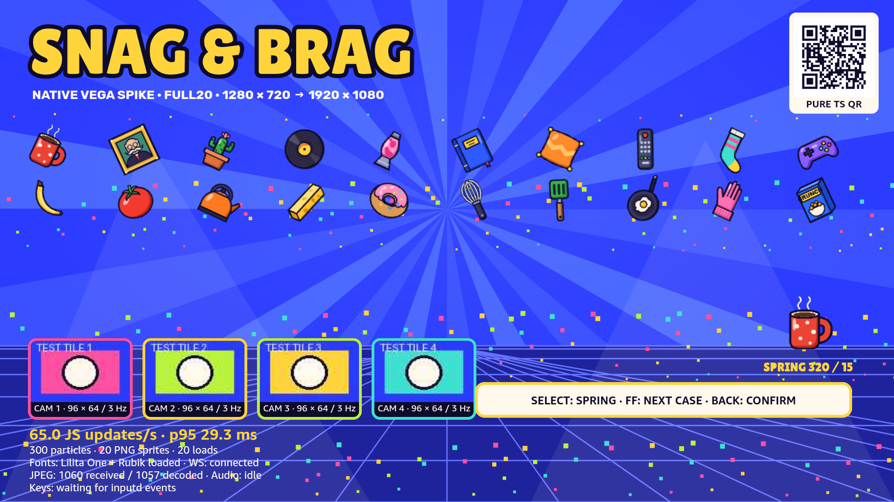

# Snag & Brag — native platform spike and device pick

**Decision, 2026-10-12:** recommend **Vega OS, native React Native**, and buy the **Fire TV Stick 4K Select (2025), ASIN B0C6W3D4RM**, [Amazon product page](https://www.amazon.com/dp/B0C6W3D4RM). **$49.99**, in stock, sold/shipped by Amazon.com, observed on the live signed-out US listing tonight. The native capability questions are substantially resolved. **60 fps on this 1 GB device is not resolved.** The lead makes the final call.

Use native SVG Paths and pre-rendered alpha PNGs initially. Skia has no official Vega port found in the current library catalog/registry. The documented native GL port drew the shader scene but failed to compose with our scaled RN interface; do not base this deadline's build on it. The first native performance traces are close enough to the 30 fps floor to make physical profiling the next mandatory gate.

**Native fallback:** [Fire TV Stick 4K Max, 2nd Gen (2023), B0BP9SNVH9](https://www.amazon.com/dp/B0BP9SNVH9), **$84.99**, in stock tonight. Its Fire OS 8, 2 GB RAM and documented Android Skia route offer a stronger fallback. GPU architectures differ, so clock rates alone do not establish a speedup over Select. This is a docs/sample assessment, not a Fire OS runtime pass. No Android emulator or second SDK was installed.

## What was actually run

One throwaway app: [spike/vega-app](../../spike/vega-app/README.md). Existing SDK main@0.24.12112, CLI 1.4.2; VVD OS 1.2 / TV Ship 102282480, aarch64, 1920×1080. React Native 0.72.0 / React 18.2, Amazon runtime 2.0.9000000000. SVG 2.0.9000000001+13.14.0, Reanimated 2.0.9000000001+3.5.4, W3C media 2.3.2, expo-font 2.0.1758683737. RN 0.83 is another SDK template, but upgrading the spike was unnecessary.

The [Amazon app detector](evidence/app-type.txt) returned **vegascript, exit 0**. This is native RN with no WebView dependency. Both Release architectures compile and package: [build receipts](evidence/build-receipt.json). The armv7 package is built, **not installed on a physical device**. React/RN and eligible libraries use system bundles. No developer login, purchase, account creation or Appstore publishing occurred. Mac output was muted before any audio and remained muted.

Final typecheck and `vega project doctor` pass all critical checks. Doctor has two warnings: the explicitly tested runtime 2.0.9000000000 pin is older than its recommended 2.1.0+rn0.72.0, and Amazon's expo-asset/turbomodule companion packages are outside its managed OS-version list. [Doctor receipt](evidence/project-doctor.txt). Results here apply to the tested pin; no unmeasured version upgrade is presented as equivalent evidence.

Both specified September provenance captures were read. Their WebView/tooling facts helped avoid repeated setup. The other project's directory was not accessed. The September release frame-cost study described an iOS CGContext renderer; its numbers do not establish Vega costs.



## Capability matrix

**PASS** means exercised here on VVD. **DOC** qualifies a documentation/sample result, never a runtime pass. **WORKAROUND** means the named alternative passes. **UNKNOWN** is still untested. Links were checked 2026-10-12 unless explicitly labeled inherited.

| Capability | Vega OS | Fire OS — docs/samples only |
|---|---|---|
| Native RN / shared TypeScript | **PASS**: native app launches; both target packages build. [receipt](evidence/build-receipt.json) | **PASS (DOC)**: Amazon [multi-TV sample](https://github.com/AmazonAppDev/react-native-multi-tv-app-sample) uses react-native-tvos for Android. |
| Skia | **UNKNOWN / no official port found**: Amazon package lookup returns 404; current supported library list omits it. [receipt](evidence/skia-registry.json) | **PASS (DOC)**: [Skia v2 Android support](https://wcandillon.github.io/react-native-skia/v2/docs/getting-started/installation/). Pin a compatible v2 release, rather than assuming the new v3/Vulkan requirements fit. |
| Rays, gradients, perspective grid, 300 moving particles | **PASS** using four batched native SVG Paths, native rotating ray layer and gradients. [shot](shots/full20.png), [source](../../spike/vega-app/src/App.tsx) | **PASS (DOC)**: Skia Canvas/paths/shaders and SVG are Android options; no measured workload. |
| True additive light composition | **UNKNOWN** for SVG; the tested cones use alpha. **WORKAROUND proposal**: pre-composed light textures/background, still needs production visual verification. | **PASS (DOC)**: Skia blend modes; no runtime validation. |
| Native GL alternative | **FAIL in tested composition**: shader/particles draw, but scaled GLView occludes RN UI and logs GL error 1282. [shot](shots/gl-composition-failure.png), [friction](friction-entries.md). Standalone/unscaled behavior unknown. | **PASS (DOC)**: Skia's supported Android graphics backend; exact Fire TV compatibility still needs a build. |
| 20/40 rotating alpha PNG sprites | **PASS**: original reference art pre-rendered at 288×288; 40 instances use 26 distinct bitmaps. [20](shots/full20.png), [40](shots/full40.png) | **PASS (DOC)**: native Image/Skia image plus transform animation. |
| Spring transform | **PASS**: Reanimated withSpring, stiffness 320 / damping 15, scale 1↔1.45 from Select or test command. [shot](shots/spring-fonts.png) | **PASS (DOC)**: sample includes Reanimated 3.19.5; [compatibility](https://docs.swmansion.com/react-native-reanimated/docs/3.x/guides/compatibility/) covers its RN 0.81 stack. |
| Lilita One / Rubik | **PASS**: original WOFF2 converted to TTF, loaded with Amazon expo-font; native RN text uses both. [shot](shots/back-remote-audio.png) | **PASS (DOC)**: sample includes expo-font; standard TTF asset bundling. |
| Display font stroke 8–14 px | **WORKAROUND PASS**: SVG Text missed font/stroke in first attempt; actual Lilita glyph Paths render stroke under fill at 12 px. [before](shots/Screenshot_1791852595.png), [after](shots/full20.png) | **PASS (DOC)**: Skia text/path paint supports stroke/fill. |
| WebSocket text + binary | **PASS**: text echo and exact ArrayBuffer bytes 0/1/2/127/128/254/255. Local socket via VDA reverse. [runtime](evidence/runtime.jsonl), [shot](shots/websocket-jpeg.png). WSS/TLS deployment not tested. | **PASS (DOC)**: RN [WebSocket API](https://reactnative.dev/docs/websocket); relay integration untested. |
| JPEG from runtime binary/base64, 3 Hz × 4 tiles | **PASS**: binary JPEG → base64 Image URI → onLoad for distinct frames. Fixture COM markers prevent cache hits. Thousands decoded; transient counters can differ by 4 while a batch is in flight. [shot](shots/websocket-jpeg.png), [relay](../../spike/vega-app/relay.cjs) | **PASS (DOC)**: RN Image accepts data URIs; actual decode/frame cost unknown. |
| Music loop + 3 overlapping SFX | **PASS for API/state**: four local MP3 AudioPlayers advance simultaneously; looping wraps. [shot](shots/back-remote-audio.png), [runtime](evidence/runtime.jsonl). Acoustic output/latency unknown because the Mac was muted. | **PASS (DOC)**: Android [SoundPool](https://developer.android.com/reference/android/media/SoundPool) supports low-latency concurrent SFX; separate media player for music. Native bridge still needed. |
| D-pad / Select / Back / Play-Pause / FF / Menu | **PASS**: actual inputd injections produce up/down/left/right/select/back/playpause/skip_forward/menu. [shot](shots/back-remote-audio.png), [Amazon events](https://developer.amazon.com/docs/react-native-vega/0.72/using_tveventhandler) | **PASS (DOC)**: RN TV events plus Android media/key callbacks. Media FF/Menu mapping must be tested on a Fire TV remote. |
| Back confirm | **PASS**: BackHandler returns true; confirm appears and app remains active. [shot](shots/back-remote-audio.png) | **PASS (DOC)**: react-native-tvos BackHandler covers Android TV remote Back. |
| Alexa pause / next transport | **UNKNOWN runtime, documented route**: Vega Media Controls, with custom handler mapping to game actions. Account-free simulator was not registered for Alexa. See voice section. | **PASS (DOC), runtime unknown**: Android MediaSession onPause / onSkipToNext with active session and advertised actions. |
| Custom voice phrases | **UNKNOWN / expensive**: no arbitrary phrase registration API found in the TV key/media API. Alexa integration beyond media transport is another scope. | **UNKNOWN / expensive**: MediaSession does not register arbitrary game phrases. |
| QR | **PASS**: pure JS encoder usable from TS + native SVG Path; independent Apple Vision decoder reads the screenshot's URL. [decoded](evidence/qr-decoded.txt), [shot](shots/full20.png) | **PASS (DOC)**: same encoder + SVG/Skia; no device scan. |
| 60 fps at 1080p, never below 30 | **UNKNOWN on stick; simulator fails to certify**. Native render traces ~38 and ~31.7 frames/s in different full cases, with heavy windows below 30 JS updates/s. See measurements. | **UNKNOWN**: more plausible headroom, still no workload measurement or physical pass. |

## Performance evidence and implications

[benchmark.py](../../spike/tooling/benchmark.py) runs two counterbalanced 24-second blocks per case within one VVD session, excluding the first four seconds of each block. [Blocks](evidence/benchmark-blocks.json), [summary](evidence/benchmark-summary.json), [raw app telemetry](evidence/runtime.jsonl). Music was looping during this A/B series. All values below are **JS rAF handler cadence**, timed with performance.now at entry; they are not compositor FPS.

| Case | 2-second windows | Median JS updates/s | Minimum window | Median window p95 interval |
|---|---:|---:|---:|---:|
| Baseline | 20 | 75.0 | 74.5 | 14.4 ms |
| Rotating rays | 20 | 75.0 | 74.0 | 14.5 ms |
| 300 particles | 20 | 62.5 | 8.3 | 27.7 ms |
| 20 rotating PNGs | 20 | 75.0 | 73.0 | 14.5 ms |
| Full, 20 PNGs + four JPEG feeds | 20 | 60.5 | 44.7 | 32.5 ms |
| Full, 40 PNGs + four JPEG feeds | 19 | 54.4 | 23.8 | 40.2 ms |

The 75/s baseline is itself proof that this counter is not a 60 Hz TV FPS measurement. Particle updates and the combined workload add relative cost. The isolated particle minimum and other outliers occurred on a shared Mac; do not extrapolate them to the retail stick. Capture/build activity can disturb the simulator. The native driver does not remove all framework work: Perfetto contains ShadowTree/Yoga transactions during the full scene.

Standalone `vega exec perf record` produced native traces, analyzed through Builder Tools MCP:

- Early full20 trace includes the controlled app restart/startup: 310 Toolkit/Render frame slices over 8.125 s, **38.03 starts/s**, average frame span **26.11 ms**, render work **20.21 ms**. [SQL receipt](evidence/trace-frame-summary.jsonl).
- Later full40 scene, music and confirm overlay: 393 frames over 12.365 s, **31.70 starts/s**, average frame span **31.24 ms**, render work **23.92 ms**. [SQL receipt](evidence/final-trace-summary.jsonl).
- Later process RSS was **266.28 MiB**, high-water **276.50 MiB**, after the GL trial and thumbnail churn. This does not isolate SVG-only memory or proportional/shared memory. [receipt](evidence/trace-memory.jsonl). VVD reported about **3.84 GiB total memory**, unlike the 1 GB retail stick.

These trace rates are native render-cycle evidence, not a certified presented-frame KPI or physical device forecast. The UI-fluidity KPI workflow stopped because Appium was not installed; the standalone trace tool worked. GL's ~75/s JS counter while the RN UI was hidden is **not a performance pass**.

**Production implementation:** pre-render the complete background where possible; update the floor/background/particles at 30 Hz; retain 60 Hz transforms for stickers, cache paths/bitmaps, stop hidden effects, avoid one RN node per particle, and implement explicit Reduced motion. Verify whether unique data URI thumbnails accumulate in native caches before shipping; this spike only establishes decode throughput. Prefer a bounded four-tile decoding/texture strategy. An app RSS budget near 200 MiB is an engineering target to validate, not a measured guarantee.

**Physical gate on arrival, no later than Oct 15:** use the armv7 Release build at 1080p60, 40 distinct cached stickers, 300 particles, four 96×64 feeds at 3 Hz, music + burst SFX and repeated remote inputs. Run the full scene at least five times plus a ten-minute soak; measure native frames, p95/p99, memory growth and input latency. Aim for 60 fps and no sustained intervals below 30. If a one-day pass with baked background and 30 Hz effects cannot maintain the floor, **switch to Fire OS native on the 4K Max**. Do not spend the submission week porting Skia to Vega or repairing GL composition.

## Current US device landscape

Live Amazon prices/stock observed 2026-10-12 in a signed-out browser, without changing shipping location or buying anything. All six showed In Stock and Amazon.com as seller. Delivery shown was location dependent: Select Oct 17 standard / Oct 13 Prime; other sticks generally Oct 17 standard, Max Oct 18, Cube Oct 18–23. These are observations, not promised delivery to Nick. [Amazon stick specifications](https://developer.amazon.com/docs/device-specs/device-specifications-fire-tv-streaming-media-player.html), [Cube specifications](https://developer.amazon.com/docs/device-specs/device-specifications-fire-tv-cube.html).

| Exact model / Amazon link | OS in device specs | Max output | RAM / GPU | Price seen |
|---|---|---|---|---:|
| [4K Select (2025), B0C6W3D4RM](https://www.amazon.com/dp/B0C6W3D4RM) | Vega 1.1 at launch; update to 1.2 for this SDK | 4K60 / 1080p60 | 1 GB LPDDR4; G310v2 ≤500 MHz | **$49.99** |
| [Stick HD (2026), B0DJGDC3BD](https://www.amazon.com/dp/B0DJGDC3BD) | Vega 1.1 at launch | 1080p60 | 1 GB LPDDR4; G310 V2 ≤500 MHz | $39.99 |
| [Stick 4K, 3rd Gen (2026), B0G4XRP464](https://www.amazon.com/dp/B0G4XRP464) | Vega 2.0 | 4K60 / 1080p60 | 1 GB LPDDR4; G310 V2 ≤500 MHz | $59.99 |
| [Stick 4K Plus (2025), B0F7Z4QZTT](https://www.amazon.com/dp/B0F7Z4QZTT) | Fire OS 8 / Android 11 API 30 | 4K60 / 1080p60 | 2 GB LPDDR4; GE9215 ≤650 MHz | $69.99 |
| [Stick 4K Max, 2nd Gen (2023), B0BP9SNVH9](https://www.amazon.com/dp/B0BP9SNVH9) | Fire OS 8 / Android 11 API 30 | 4K60 / 1080p60 | 2 GB LPDDR4; GE9215 ≤850 MHz | **$84.99** |
| [Cube, 3rd Gen (2022), B09BZZ3MM7](https://www.amazon.com/dp/B09BZZ3MM7) | Fire OS 7 / Android 9 API 28 | 4K60 / 1080p60 | 2 GB LPDDR4/x; G52 MP8 800 MHz | $199.99 |

The 2024 Stick HD is **Fire OS 7**, unlike the **2026 Vega Stick HD**. Older 2023 4K, Max 1st Gen, Stick 3rd Gen and Lite are Fire OS models; current inventory/price for those legacy SKUs was not verified. Integrated Fire TV televisions have model-specific OS/specs, and are not economical spike purchases. No supported dual-boot or switchable Vega/Fire OS device was found. Vega devices do not install Android APKs.

Amazon has [simplified the 2026 stick lineup](https://www.aboutamazon.com/news/devices/fire-tv-stick-4k-new-remote), with existing models continuing while stock lasts. The newest 4K has the same RAM/GPU class and adds OS 2.0 compatibility questions; it does not solve this game's known headroom risk. Select follows the lead's default and established SDK target. Max costs $15 more than Plus and has the faster documented GPU; that is useful fallback insurance. Cube adds unnecessary cost here.

**Firmware caveat:** SDK 0.24 requires os.min/target 1.2. Amazon staff say [OS 1.2 reached full rollout](https://community.amazondeveloper.com/t/os-1-2-ota-update/29152), while launch spec pages still list 1.1 and [some developers report stuck updates](https://community.amazondeveloper.com/t/fire-tv-stick-4k-select-with-os-1-1-doesnt-update-and-i-cant-install-apps-anymore/29722). Check and update the actual purchase immediately. Retail firmware was not tested; never claim a simulator package installs on a stock device solely because it builds.

## Accounts, sideloading and capture

**Vega:** [official run/developer-mode instructions](https://developer.amazon.com/docs/vega/0.24/run-apps) permit sideloading without Appstore publication. Retail setup needs the consumer Amazon account. For Developer Mode: About → device name → Select seven times → Developer Options → Developer Mode; the owner completes `vega devmode login`, browser authorization, and `vega devmode enable-device --code <device code>` within its five-minute lifetime. Then build armv7, install VPKG and launch the component through VDA/CLI. We stopped before account-dependent work; no physical device exists here. SDK/VVD and this entire local spike worked account-free. VVD account registration is only needed for Amazon-service tests such as Alexa.

**Fire OS:** [ADB connection](https://developer.amazon.com/docs/fire-tv/connecting-adb-to-device.html) and [APK sideloading](https://developer.amazon.com/docs/fire-tv/installing-and-running-your-app.html) use Developer Options → ADB debugging, Mac/device networking and the on-TV RSA authorization. A Developer account is not an ADB signing/sideload prerequisite; consumer setup and contest registration are separate. This branch was researched only.

**VVD capture PASS:** authenticated emulator console port 5554, token read privately from `~/.emulator_console_auth_token` by [console.py](../../spike/tooling/console.py):

```sh
python3 spike/tooling/console.py 'screenrecord screenshot <absolute-directory>'
python3 spike/tooling/console.py 'screenrecord start --size 1920x1080 --fps 60 --bit-rate 4000000 --time-limit 8 <absolute-file.webm>'
python3 spike/tooling/console.py 'screenrecord stop'
```

[ffprobe receipt](evidence/capture-probe.json) confirms 1920×1080 and 60/1 encoded rate. Both an eight-second trial and a six-second final-build capture succeeded. The actual final [native clip](evidence/native-1080p60.mp4) is committed. Encoded 60 fps can repeat source frames; it does not prove the renderer delivers 60 unique frames/s. Console recording is capped at 180 seconds. It is the underlying Android Emulator interface, not a first-class documented Vega capture API.

**Physical Vega:** [VDA screenshot tool](https://developer.amazon.com/docs/vega/0.24/vda-tools.html) is `gwsi-tool-screenshooter`, then VDA pull. No documented/evidenced physical-device 1080p60 video export was found. Screenshot support is not recording support. Without an HDMI capture card, use the verified VVD recording for submission and film physical play separately if desired.

**Physical Fire OS:** [Android ADB screenrecord](https://developer.android.com/tools/adb#screenrecord) provides MP4, e.g. `adb shell screenrecord --size 1920x1080 --bit-rate 8000000 /sdcard/demo.mp4`, then `adb pull`. Standard screenrecord lacks a requested `--fps 60` guarantee and does not record audio; supported encoder size/rate must be verified on the stick. An Android TV emulator can also record, but no emulator was downloaded here. Fire OS behavior, Alexa and codec performance are not identical to generic Android TV.

The [current contest rules](https://amazonappdev2026.devpost.com/rules) explicitly allow a Fire TV/Vega simulator demonstration, and the [FAQ](https://amazonappdev2026.devpost.com/details/faqs) says physical hardware is not required at submission or judging. The project brief still sets a real-household/device quality goal. Current rules allow multiple frameworks; the native requirement comes from our lead's brief. Vega affinity among judges is useful context, not a published numerical platform bonus. Working behavior and coherent design take priority; documented tool feedback can earn up to 10% bonus.

## Voice feasibility

| OS / action | Effort | Evidence and gate |
|---|---|---|
| Vega pause/resume | **Cheap code, runtime uncertain** | [Vega Media Controls](https://developer.amazon.com/docs/vega/0.24/content-launcher-overview.html) supports transport. Map a media handler to the whole game's pause/resume, rather than pausing music alone. Test with the registered retail remote. |
| Vega next/skip phase | **Cheap if transport reaches handler** | Advertise Next and map it to skip-phase. The documented phrase is “Alexa, next”; literal “skip” recognition is unknown. [Audio sample handler](https://github.com/AmazonAppDev/vega-audio-sample/blob/main/src/utils/AppOverrideMediaControlHandler.ts) is the starting point. |
| Fire OS pause/resume/next | **Cheap native bridge** | [Amazon MediaSession callbacks](https://developer.amazon.com/docs/fire-tv/mediasession-api-integration.html): active session, correct playback state/actions, onPause/onPlay/onSkipToNext routed into TS. Not tested on hardware. |
| Arbitrary phrases on either | **Expensive / unsupported by these APIs** | No generic phrase-to-TV-key registration found. A separate Alexa skill/service/integration is beyond this day's spike; omit from P0. |

There are [public older W3C/KMC transport reports](https://community.amazondeveloper.com/t/alexa-transport-control-commands-play-pause-stop-never-reach-js-handler-via-w3c-media-kmc-integration/28421), with later Amazon advice about competing WebView media focus. Our app has no WebView. The reports are a risk to investigate, not a reproduced failure on our SDK. Timebox voice to two hours on Oct 14/arrival; direct remote pause/FF and phone controls already have a viable native path. No speech test or Alexa success screenshot is claimed.

## Day-by-day risk plan

| Date | Vega gate / main risk | Fire OS fallback readiness |
|---|---|---|
| Oct 12 | Native spike, device pick, evidence and friction committed. GPU/headroom remains open. | Docs/sample matrix and exact Max SKU ready; no emulator. |
| Oct 13 | Port shared TS core; bake reference art/background; native input and pause. Owner finishes account setup and verifies delivery. | Keep renderer behind an interface; use Amazon sample's RN TV/Expo versions. |
| Oct 14 | Four-phone relay/thumbnail path, bounded image memory, production audio files. Voice timebox only. | Prepare native Skia v2 + RN TV build instructions; avoid new Skia v3 migration. |
| Oct 15 | Retail OS update/dev mode/armv7 install; full workload + soak. **Switch if floor cannot be maintained after one focused optimization day.** | On switch, install APK on Max and immediately test keys/audio/1080p capture. |
| Oct 16 | Full Color Rush scene, real photos/AI timeout behavior; device frame trace. | Same scene/core; alternate renderer remains the largest port risk. |
| Oct 17 | Brag-Off six-second mash and SFX bursts; remote latency, phase skips. | SoundPool warm pools and media key mapping gate. |
| Oct 18 | Showstopper/finale/reactions; worst-case particles/stickers and memory reuse. | Match approved visuals; trim effects only through explicit performance settings. |
| Oct 19 | Full household play + dropout/reconnect + bots; fix crashes/long-frame causes. | Device soak and renderer parity; simulator results are insufficient. |
| Oct 20 | Freeze features, verify Reduced motion, sound/music settings, native pause/Back. | Same freeze; voice cut if unreliable. |
| Oct 21 | Submission-ready package, clean setup/run instructions and evidence. | Prove the chosen device build after clean checkout. |
| Oct 22 | Film under-three-minute video. Use verified VVD recording if physical export unavailable. | Check ADB encoder beforehand; use allowed simulator if needed. |
| Oct 23 | Final smoke and submit before 12:00 PT; aim 09:00 PT. No Appstore publishing in this spike. | No last-day platform switch. |

A WebView production wrapper is outside the lead's native constraint. Native 2D is possible here; performance on the actual device is still unknown, so no unsupported WebView performance comparison is used to justify the pick. The inherited September WebView numbers varied roughly 4–68 fps across configurations/runs and are not a Snag & Brag benchmark. If the physical native floor fails, the prescribed fallback is **Fire OS native**, not a wrapper.

## Footprint, artifacts and remaining unknowns

See [disk-receipt.json](evidence/disk-receipt.json) for final measured bytes and installation paths. The pre-existing SDK/VVD is about 6.02 GiB and was not reinstalled. New local installs: Builder Tools and dependencies (31.8 MiB), native app dependencies (450.7 MiB), a 50.2 MiB Python font/fixture environment, and a 726 KB GL package included in app dependencies. Existing ffmpeg, librsvg and Swift/Vision were reused. npm/pip/Swift caches and the discarded scaffold were cleaned before delivery; source and lockfiles are committed, build outputs/node_modules are ignored. The one existing working Vega simulator is retained. No license click-through was needed. The probe app/relay/log stream were stopped after the final smoke test so they do not keep producing audio or files.

Required outputs: this report; [builder-tools.md](builder-tools.md); [friction-entries.md](friction-entries.md); [screenshots](shots/); [source/run guide](../../spike/vega-app/README.md); [measurement receipts](evidence/). Full fetched documentation is kept out of the committed evidence; MCP call receipts retain source URLs, result hashes and tool/error metadata.

**Could not test:** physical retail installation/firmware, physical 60 fps/latency/memory, spoken Alexa transport, physical screen recording, acoustic audio quality/output latency, arbitrary voice phrases, WSS/TLS and AWS relay, Fire OS runtime. Reasons: no Fire TV exists yet; account/login branches are prohibited; Fire OS is intentionally docs-only; Mac must stay muted. These are explicit unknowns, not blanket capability failures. Native GL composition failed in the tested scaled case and is not a recommended implementation path.
